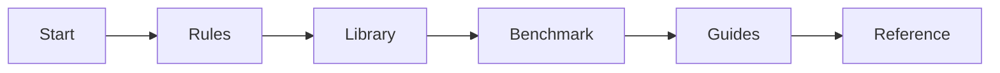

# Factory simulator

Factory simulator is a research tool for comparing agents that plan one factory period
by period. The simulator runs over HTTP and records every run.

## Reading path

Read the six sections in order, or start with the quick start and then follow the rules.

## Start

- [Overview](start/overview.md): what the simulator does and what it includes.
- [Quick start](start/quick-start.md): install, start the server and make a first run.
- [Concepts](start/concepts.md): factories, worlds, runs, agents and harnesses.

## Rules

- [Period](rules/period.md): the six steps of a period.
- [Decisions](rules/decisions.md): decisions, execution order and rejection reasons.
- [Information](rules/information.md): observations, forecasts and hidden parameters.
- [Suppliers](rules/suppliers.md): catalogues, orders and deliveries.
- [Customers and demand](rules/customers-and-demand.md): demand, orders, shipping and
  penalties.
- [Production](rules/production.md): recipes, lines, hours, wear and repair.
- [Warehouses and routes](rules/warehouses-and-routes.md): storage and transfers.
- [Cash and profit](rules/cash-and-profit.md): credit, payments and profit.
- [Disruptions](rules/disruptions.md): written and random disruptions.
- [Groups](rules/groups.md): shared defaults, targets and measures.
- [Randomness and fairness](rules/randomness-and-fairness.md): seeds, worlds and replay.

## Library

- [Example factory](library/example-factory.md): items, recipes, suppliers, customers
  and groups of the factory.
- [Example plant and cash](library/example-plant-and-cash.md): production, warehouses,
  routes, cash and estimates.
- [Scenario library](library/scenario-library.md): the scenarios included in the
  package.

## Benchmark

- [Playing a run](benchmark/playing-a-run.md): the HTTP client, run loop and forks.
- [Optimizers](benchmark/optimizers.md): seven benchmark optimizers and the informed
  diagnostic.
- [Normalized score](benchmark/score.md): how to compare profit within a world.
- [Stress test](benchmark/stress-test.md): run checks, calibration and current results.

## Guides

- [Writing a manifest](guides/writing-a-manifest.md): a small manifest, validation and
  errors.
- [Larger manifests](guides/larger-manifests.md): generated manifests and scale.
- [Writing a scenario](guides/writing-a-scenario.md): demand, forecasts and disruptions.

## Reference

- [HTTP interface](reference/http-interface.md): HTTP routes, request bodies and errors.
- [Manifest fields](reference/manifest-fields.md): every manifest key and default.
- [Scenario fields](reference/scenario-fields.md): every scenario key and default.
- [Glossary](reference/glossary.md): terms used across the documentation.
- [Limits](reference/limits.md): limits and qualifications for studies.
- [Measures and the record](reference/measures-and-the-record.md): recorded measures,
  tables and exports.
- [Operational record](reference/operational-record.md): HTTP operations, startups and
  shutdowns recorded beside the record.
- [Questions](reference/faq.md): frequently asked questions.
