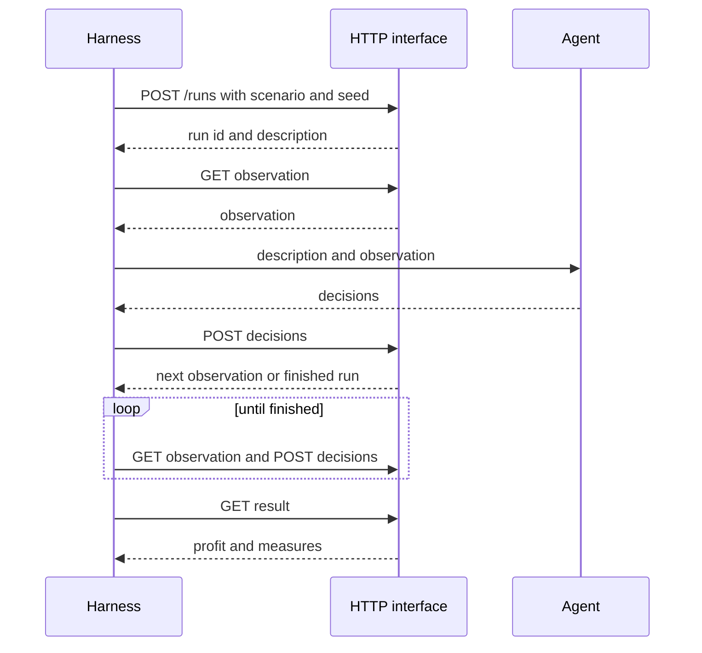
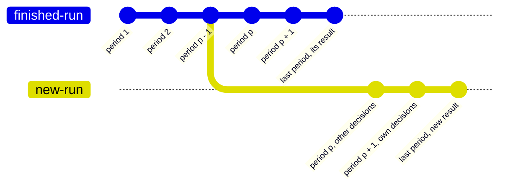

# Playing a run

The benchmark is the part of the package that plays runs over HTTP: a client and 8
agents, which are no decisions, the reference optimizer, 5 limited optimizers and the
informed optimizer, a diagnostic played at the terminal value factors 1.01 and 1.2. An
agent of any kind plays through the same HTTP interface.

## Smallest example

One run is a loop of a few requests, drawn as a sequence in
[Quick start](../start/quick-start.md):

1. `POST /api/v1/runs` with `{"scenario_id": ..., "seed": ...}`. The answer holds the
   run identifier and the description.
2. `GET /api/v1/runs/{id}/observation` gives the observation of period 1.
3. The agent returns the decisions of the period.
4. `POST /api/v1/runs/{id}/decisions` with `{"period": t, "decisions": [...]}`. The
   answer is the observation of the next period, or the run with `finished: true`
   after the last period.
5. Deciding and submitting repeat until the run is finished.
6. `GET /api/v1/runs/{id}/result` gives the profit and the measures.



An agent is a function of the description and the observation that returns a list of
decisions in the shapes of [Decisions](../rules/decisions.md). This one ships every open
customer order, the earliest due first, from the stock it finds:

```python
def ship_from_stock(description: dict, observation: dict) -> list[dict]:
    stock = {
        warehouse: dict(items) for warehouse, items in observation["stock"].items()
    }
    decisions = []
    for order in sorted(observation["customer_orders"], key=lambda o: o["due"]):
        open_quantity = order["quantity"] - order["shipped"]
        for warehouse, items in stock.items():
            quantity = min(open_quantity, items.get(order["product"], 0))
            if quantity > 0:
                decisions.append(
                    {
                        "kind": "ship",
                        "order": order["id"],
                        "quantity": quantity,
                        "warehouse": warehouse,
                    }
                )
                items[order["product"]] -= quantity
                open_quantity -= quantity
    return decisions
```

The harness is the program of a study. It starts each run, gives the agent its
description and observations, closed periods and check outcomes, and submits the
decisions the agent returns. A study that relies on hidden information keeps the HTTP
routes of manifests and scenarios out of reach of the agent. The reference optimizer is
given the world of a finished run of no decisions with the same scenario and seed. A
harness can be written in any language that sends HTTP requests. This one, built on the
standard library, plays the agent above:

```python
import json
from decimal import Decimal
from urllib.error import HTTPError
from urllib.request import Request, urlopen

API = "http://127.0.0.1:8000/api/v1"


def call(method: str, path: str, body: object = None) -> dict:
    data = None if body is None else json.dumps(body, default=str).encode()
    request = Request(
        API + path,
        data=data,
        method=method,
        headers={"Content-Type": "application/json"},
    )
    try:
        with urlopen(request) as response:
            return json.loads(response.read(), parse_float=Decimal)
    except HTTPError as error:
        detail = json.loads(error.read())["detail"]
        raise RuntimeError(f"{method} {path}: {error.code} {detail}") from None


def play(scenario_id: str, seed: int, decide) -> dict:
    run = call("POST", "/runs", {"scenario_id": scenario_id, "seed": seed})
    observation = call("GET", f"/runs/{run['id']}/observation")
    while True:
        decisions = decide(run["description"], observation)
        body = {"period": observation["period"], "decisions": decisions}
        answer = call("POST", f"/runs/{run['id']}/decisions", body)
        if answer.get("finished"):
            return call("GET", f"/runs/{run['id']}/result")
        observation = answer
```

Here `scenario_id` is the identifier of `steady-market` from
`GET /api/v1/manifests/{manifest_id}/scenarios`.
`play(scenario_id, 7, ship_from_stock)["profit"]` gives `-693395.167545` on the
example factory, against `-709331.2306` for no decisions.

### Exact decimals

- Every amount, quantity and share is a decimal. Read every answer with
  `json.loads(text, parse_float=Decimal)`: a number with a fraction becomes a
  `Decimal`, a whole number an `int`, and no digit is lost.
- A float loses digits. Never compute decisions in floats and send the result.
- Send a `Decimal` as decimal text: `json.dumps(body, default=str)` writes
  `Decimal("12.5")` as `"12.5"`, which the HTTP interface reads as 12.5.
- A quantity has at most 3 decimal places and a repair amount at most 4. Round down
  before sending: `quantity.quantize(Decimal("0.001"), rounding=ROUND_DOWN)`.
- The seed is a whole number from 0 to 2 to the power 128, minus 1, sent as a JSON
  number or as text (`7` or `"7"`).

## The client of the package

The module `factory_simulator.benchmark.client` plays runs over HTTP like any harness.
It takes an `httpx2.Client` whose base URL is the HTTP interface. An agent of the client
is any function of the description and the observation that returns a list of
decisions, `Agent` in the module; both arguments are dictionaries with `Decimal`
numbers. `ship_from_stock` above is one. The client plays it:

```python
import httpx2 as httpx

from factory_simulator.benchmark.client import (
    find_manifest,
    find_scenario,
    play_run,
    start_run,
)

with httpx.Client(base_url="http://127.0.0.1:8000/api/v1") as client:
    manifest_id = find_manifest(client, "Electronics factory with economies of scale")
    scenario_id = find_scenario(client, manifest_id, "steady-market")
    for seed in (101, 102, 103):
        run = start_run(client, scenario_id, seed)
        result = play_run(client, run, ship_from_stock)
        print(seed, result["profit"])
```

- `play_run(client, run, agent)` gives the agent the description and each observation,
  submits its decisions for the period of the observation until the run is finished,
  and gives the result.
- An agent that keeps memory, such as a smoothed demand, is made anew for each run, so
  no memory passes from one run to the next.
- An agent that checks its decisions gets a check bound to its run:
  `functools.partial(create_check, client, run["id"])`, with `create_check` from
  the same module. It takes the period and a list of decisions and gives their
  outcomes.
- `read_world(client, run_id)` gives the world of a finished run, and
  `read_periods(client, run_id)` the periods of a run already closed.
- `create_shown_description(client, manifest_id, seed, scenario_content)` sends a twin
  of a scenario, its content with `hidden` empty and a name `<name>`, if any, as
  `<name>-shown`, starts a run of the twin with the seed and gives the description of
  that run. The twin run is never played. Its description shows every parameter group
  as a range with its `cut_mean`, never a value drawn for a period. It reads no
  `GET /api/v1/scenarios/{id}`.
- A response with a status of 400 or more raises `RuntimeError` with the method, the
  HTTP route, the status and the detail, such as
  `GET /runs/1f3a: 404 run_id: unknown run 1f3a`. A body that is no JSON object raises
  `RuntimeError` ending "not a JSON object".
- `find_manifest` and `find_scenario` raise `ValueError` for a name that is not stored,
  such as `no manifest named Electronics factory`.

## Studies with a person and an AI assistant

A person takes part through a harness. The simulator has no screen: the harness shows
the person the description and the observation, and submits the decisions the person
chooses with the help of an AI assistant.

- No time limit. A run waits for its submission as long as needed, for minutes or for
  days. After a restart of the server, an unfinished run continues from its record.
- `POST /api/v1/runs/{id}/checks` takes the same body as a submission and answers the
  outcome each decision would have now, without changing the run. A person or an
  assistant may check any number of times in a period, then submit.
- The record keeps every check, and every submission refused with 422 or with 409 for
  another period, as an interaction, apart from the run. The export holds them, so a
  study can see how a person checked decisions before submitting.
- The record holds the simulator's side only. The advice the person received, the text
  of the assistant and the time the person took are kept by the study itself. No row
  of the record holds a clock time.
- Every agent of a study gets the same description and observations through the same
  harness, so a person and a program are compared in the same worlds.

## Forks for "what if"

A fork is a new run that repeats a finished run up to a chosen period with the same
submissions, and continues from there with other decisions.



- `POST /api/v1/runs/{id}/forks` with `{"period": p}` forks the finished run `id`. The
  answer, 201, is the new run in period p, not finished.
- The new run has the same scenario and seed, so the same world. Periods 1 to p - 1
  repeat the submissions of the finished run and give the same rows. From period p the
  harness plays it like any run.
- p is from 1 to the horizon; any other period answers 422. A run that is not finished
  answers 409.
- A run can be forked any number of times, from any period.
- The new run starts with no interactions. Its export names the run it came from and
  the period, in `forked_from` and `forked_from_period` of `run.json`.
- The agent of the new run gets the description and the observation of period p.
  `GET /api/v1/runs/{id}/periods` of the new run gives the periods already closed, from
  which an agent can rebuild its memory.

The difference between the profit of the new run and of the finished run is the value
of the other decisions from period p on, in the same world. Example: fork a run of the
rolling optimizer at the start of a supplier outage, let another agent play from
there, and compare the two profits.

## Errors

The response to every error is `{"detail": "<key>: <problem>"}`, such as
`{"detail": "run_id: unknown run 1f3a"}`.

| Code | When | What to do |
| --- | --- | --- |
| 404 | The manifest, scenario or run does not exist. | Check the identifier. |
| 409 | The submission or check names another period than the current one. | Read the observation again and submit for its `period`. |
| 409 | The run is finished, and the harness submits, checks or reads the observation. | Read the result. |
| 409 | The run is not finished, and the harness reads the result, the world or the export, or forks it. | Finish the run first. |
| 409 | A run to replay or fork does not match its record or the versions now running. | Use the versions that wrote the run. |
| 422 | A body breaks its form: an unknown key, a wrong type, a quantity not above 0 or with too many decimal places, a seed that is not a whole number. | Fix the body. The detail names the key, such as `decisions.0.quantity: has more than 3 places`. |

- A submission answered with 409 or 422 is refused whole. The run stays in its period,
  and the harness submits again. The record keeps a submission refused with 422, or
  with 409 for another period, as an interaction, apart from the run.
- A refused submission is not a rejected decision. A decision that is well formed but
  breaks a rule of the factory, such as a ship decision above the stock, is rejected
  with a reason; the period still closes, and the outcome comes back in the next
  observation. See [Decisions](../rules/decisions.md).
- Two submissions for one period: one is executed, the other gets the response 409.
