# Stress test

The stress test plays the benchmark agents across the scenario library, checks each run
and writes a report.

## Smallest example

The test lives in `tests/stress/` of the repository and starts by hand:

```sh
uv run pytest tests/stress -m stress -n 0 --stress-seeds 1 --stress-scenarios steady-market
```

A normal run of `pytest` leaves it out: `-m "not stress"` stands in the `addopts` of
`pyproject.toml`.

| Option | Default | Sets |
| --- | --- | --- |
| `--stress-seeds` | 20 | The number of seeds, at least 1; n plays the seeds 0 to n - 1. |
| `--stress-scenarios` | `all` | The scenarios, names separated by commas. |
| `--stress-workers` | the number of CPUs | The processes that play worlds at once. |
| `--stress-time-limit` | 600 | The seconds every solve may take. |
| `--stress-evaluation` | off | Plays the evaluation seeds 1000 to 1019 in place of 0 to n - 1. |

- It starts its own server on `data/records/stress.duckdb`, with the examples loaded and
  `--timeout-keep-alive 30`.
- It sends the example manifest and every scenario file of the package to the server and
  plays exactly the scenario identifiers the responses give. An earlier version of a
  scenario that the database keeps is never played.
- Beside the chosen scenarios it plays their information controls. An information
  control of a scenario is the scenario without one information treatment, the same in
  every other key. `forecasts` has two: `forecasts-without-forecasts`, with hidden
  demand and no forecasts, and `forecasts-shown`, with the same forecasts and nothing
  hidden. `hidden-groups` has `hidden-groups-shown`, with nothing hidden and demand
  still multiplied by 2.5. `notice` has `supplier-outage`, with the same two disruptions
  seen only when they start. The stress test builds the first three from the files of
  their scenarios, and stops with an error when a control differs from its scenario in
  more than its treatment, or when its forecasts hold other demand shocks, through a
  hidden `disruptions.duration` or another notice of a shock. A scenario and its control
  draw the same world with the same seed.
- A world is one scenario and one seed. Per world it plays, in this order, no decisions,
  the reference, then the full-horizon, rolling, aligned, myopic and buffered rolling
  optimizers. In a scenario that hides a parameter group other than the duration of
  disruptions it then plays the informed optimizer twice, at the terminal value factors
  1.01 (`informed_optimizer`) and 1.2 (`buffered_informed_optimizer`), each with the
  description of a twin run. It plays the world of the first seed of every scenario
  twice.
- It keeps the index `data/records/stress-runs.csv`, one row per run, with its profit,
  seconds, solves, violations, settings, version, code, solver environment, checks, one
  column per named measure and the outcomes the decision value reads: the units ordered,
  shipped and bought and the periods that close below the credit limit. The settings
  hold the time limit and the terminal value factors 1.01 and 1.2. The code is the
  SHA-256 of one line per Python file under `src/factory_simulator`, the SHA-256 of its
  bytes and its path, in the order of the paths, so a change of the package, a renamed
  file included, plays every world again and a change of the tests alone does not. The
  solver environment names the versions of Python, numpy, scipy and the HiGHS solver
  inside scipy, and the system, the machine and the C library the runs play on, so a
  change of any of them plays every world again too. An index with other columns than
  the stress test writes is refused: move it away first.
- The rows of a world are written once all its runs end, through a new file that then
  replaces the index, so a stop leaves the index whole. A world needs every agent in its
  first play and, for the first seed, in its second play too. A world the index holds
  whole, for the same settings, version, code and solver environment, is skipped, so a
  stopped stress test resumes. A world without a run of no decisions or of the reference
  is played again whole; any other world plays the agents it misses again, in each of
  its plays. When the last row of the index was cut by a stop, the stress test first
  moves that row to `data/records/stress-runs.csv.cut`. Two rows of the same run of a
  world, with the same scenario identifier, seed, agent, play, settings, version, code
  and solver environment, both stay in the index, and the report counts the later one.
  The stress test fails when they differ in more than the run identifier, the seconds
  and the time, unless one of them has a solve stopped at the time limit. It also fails
  when a world still misses a run after it plays, with a violation that names the
  missing runs.
- The checks of a row are the SHA-256 of one line for `tests/stress/checks.py` and then
  one for `tests/factories/strategies.py`, each built like a line of the code: the
  checks of a run and the cost kinds they read. Before it plays, the stress test checks
  again every world of the index of the same settings, version, code and solver
  environment that holds a row of other checks. It reads the description, the result and
  the periods of each run of the world from the server, applies the current checks and
  writes the new violations and checks into the index, so a change of the checks alone
  plays no world again. A world with a run the server cannot read keeps its rows, and
  the stress test fails with a violation that names the run and says that the current
  checks did not run.
- It checks every run: the run raises no error and ends after its horizon; profit is
  revenue less costs plus interest earned and salvage; `profit_so_far` of the last
  period plus salvage is the profit; the ledger sums to the change of cash; the units of
  customer orders and of supplier orders balance; per item, summed over the warehouses,
  the starting stock, the units accepted from suppliers and the good units of the lines
  equal the stock at the last close, the units used by production, the units shipped and
  the units of transfers on the way; and no decision of an optimizer is rejected. A
  world played twice gives the same periods and result both times, unless a run has a
  solve stopped at the time limit. The stress test fails with the list of every
  violation.
- A world is unscorable when the reference makes no more profit than no decisions, or
  when a solve of the reference has no solution. An unscorable world is no violation:
  the report counts it with its cause, leaves it out of every normalized score and lists
  it with the profits of its runs. The reference never cancels a supplier order and runs
  the transfers of a period in the order of its routes, so a better decision can exist
  in an unscorable world.
- It writes a report into a new folder `data/reports/<YYYY-MM-DDTHHMMSS>-stress/`:
  `report.md`, `runs.csv`, the rows of the index of its worlds with their normalized
  scores, and `scores.png`, a box plot of the normalized scores per scenario and limited
  optimizer. It reads only the rows of the current settings, version, code and solver
  environment, and refuses a row of another solver environment.
- `report.md` starts with the version, the code, the solver environment, the checks, the
  analysis, the command, the manifest, the seeds, the protocol, the settings, the worlds
  played and unscorable with the count of each cause, and the mean seconds of a world.
  Its sections:
  - `## Scenarios`: every scenario of the report with its identifier.
  - `## Scores`: a sentence that states what the largest gap bounds, then per scenario,
    for the reference, each limited optimizer and each informed run, over the scorable
    worlds, the mean, quartiles and median of the normalized score, whether the program
    was linear or integer and the largest gap of its integer solves in money, a solve at
    the gap limit included; a dash marks an agent without an integer solve with a
    solution there.
  - `## Calibration`: a sentence that states the rule below, then per scenario its
    worlds, those unscorable, the seeds compared, the mean calibration score, the
    difficulty with its standard error and the lower and upper bound of its 95 percent
    interval, whether it is hard enough, and whether the named measure moves in its
    expected direction against `steady-market`. The verdict reads one limited optimizer,
    fixed before the run: the buffered rolling optimizer. Its gap in a world is the
    profit of the reference less its profit. The calibration score of a world is 1 less
    that gap over the denominator of `steady-market` in the same seed, the profit of the
    reference less that of no decisions there; in `steady-market` it is the normalized
    score of the optimizer. A loss that the reference and the optimizer share leaves it
    unchanged, and so do the denominator of the scenario and the other limited
    optimizers. The difficulty is the mean over seeds of the calibration score less that
    of `steady-market` in the same seed. The interval is the Student interval with the
    correction for skew of Hall (1992). With n seeds, t the 0.975 quantile of the
    Student t distribution with n - 1 degrees of freedom, and the differences of mean m,
    standard deviation s and skew g (the third central moment over the second to the
    power 1.5), each bound is m - s * w, w = 3 * y / (c * c + c + 1), c the cube root of
    1 + g * y, at y = t / sqrt(n) - g / (6 * n) for the lower bound and y = -t /
    sqrt(n) - g / (6 * n) for the upper one. Without skew, as with 2 seeds, it is the difficulty
    less and plus t standard errors; skewed differences move it toward their long tail.
    Each bound has 3 places; with one seed the standard error and both bounds read `-`.
    Each interval covers its own scenario: at a mean difference of -0.03 about 1
    scenario in 20 still reads `yes` or `no`. A scenario is hard enough (`yes`) when the
    upper bound is at most -0.03; `no` when the lower bound is at least -0.03;
    `undecided` otherwise. A scenario whose reading holds foresight reads `foresight`,
    without a verdict: its gap holds what the reference knows of a disruption before a
    limited optimizer sees it. A scenario reads `incomplete` when a seed has no
    calibration score in it or in `steady-market`: a solve of its reference has no
    solution, or that world of `steady-market` is unscorable. The built controls have no
    row here.
  - `## Decision value`: a sentence that states that a score can rise while profit
    falls, since its denominator, the profit of the reference less that of no decisions,
    differs from world to world, and what each reading means. Then per scenario, over
    all its worlds, the means of the profits of no decisions and the reference, the
    denominator, the best limited profit, the highest profit of the five limited
    optimizers in a world, its gap to the reference, the fill rates of the reference and
    of the best limited run, and the units lost, the units bought and the periods that
    close below the credit limit of the reference. Then per scenario but `steady-market`
    the means of the differences against `steady-market` in the same seed of the best
    limited score, the best limited profit, the gap and the denominator, beside the
    reading of the scenario and its evidence: what a policy can still do and the loss no
    policy avoids, worked at the middle of demand. A reading is adaptation, overload,
    foresight, recovery or information, or several of them joined. Foresight names a
    loss that only the reference avoids, as it reads the whole world: a limited
    optimizer sees a disruption when it starts, or as many periods earlier as its
    notice.
  - `## Information controls`: a sentence that states what an information control is,
    that the standard error of an effect covers the mean of its differences as in the
    calibration, and that a difference against `steady-market` is no effect of
    information, then for each scenario and its control the treatment, the identifier of
    the control, what both share, the seeds scored in both, and the effect of the
    treatment of the buffered rolling optimizer, as the
    [Glossary](../reference/glossary.md) defines it, with its standard error and the
    bounds of its 95 percent interval; `None.` without a pair.
  - `## Disclosure effect`: a sentence that states the two policies, what is disclosed,
    that both are fixed before the run and that every effect is a diagnostic, then for
    each scenario with informed runs the treatment, the informed run, the rolling run,
    the seeds scored in both and the disclosure effect with its standard error and the
    bounds of its 95 percent interval; `None.` without informed runs. The disclosure
    effect, as the [Glossary](../reference/glossary.md) defines it, compares the
    informed optimizer at the terminal value factor 1.2 with the buffered rolling
    optimizer in the same world and can be negative. With one seed it has no standard
    error and no bounds.
  - `## Unscorable worlds`: a sentence that states when a world is unscorable and that a
    better decision can exist there, then per unscorable world its scenario, seed and
    cause, the profits of no decisions and the reference, and the highest profit of the
    five limited optimizers with the optimizer that makes it; `None.` without one.
  - `## Not repeatable`, `## Solves without a solution` and `## Violations`, which lists
    the violations of the rows of the current checks, the runs the server cannot read,
    the runs a world misses and the rows of one run that differ.

## The windows of the disruptions

Written disruptions end by period 41. Random breakdowns may occur throughout the
horizon. A bar ends at the start of the period after its last active period.

```mermaid
gantt
    title Written disruptions over the 52 periods
    dateFormat X
    axisFormat %s
    section Horizon
    periods 1 to 52 : horizon, 1, 53
    section Suppliers
    supplier-outage : supplier_outage, 10, 42
    notice visible : notice_visible, 6, 10
    notice acting : notice_acting, 10, 42
    material-shortage : material_shortage, 10, 42
    quality-crisis : quality_acting, 9, 41
    price-change : price_acting, 8, 40
    transport-delays : transport_delays, 12, 42
    regional-crisis : regional_crisis, 16, 42
    section Lines
    capacity-cut : capacity_cut, 18, 42
    line-breakdown : line_breakdown, 18, 19
    line-breakdown cut : line_cut, 22, 38
    frequent-breakdowns cut : frequent_cut, 34, 42
    yield-drop : yield_drop, 7, 41
    section Demand
    demand-surge : demand_surge, 14, 42
    surge-and-breakdown surge : surge, 14, 42
    surge-and-breakdown breakdown : surge_breakdown, 16, 17
```



## Calibration

The [Scenario library](../library/scenario-library.md) gives the start, the disruptions,
the demand shapes and the forecast quality of every scenario.

On the development seeds 0 to 19, the 23 scenarios and 3 controls make 520 worlds and
3948 runs with the repeats of seed 0, and no run has a violation. 4 worlds are
unscorable: a solve of the reference optimizer finds no solution within its limits. 6
scenarios fail the direction check: `decline`, `product-life-cycle`, `price-change`,
`full-warehouse`, `forecasts` and `yield-drop`.

The difficulty reads `yes` for `yield-drop`, `no` for 8 scenarios, `undecided` for 3,
`incomplete` for `surge-and-breakdown` and `foresight` for 9; `steady-market` is the
comparison for every other scenario. The notice treatment adds 0.290 against its
control, with the 95 percent interval from 0.256 to 0.328. The intervals of the
forecasts and hidden-group treatments contain 0.

The seeds form two sets. Seeds below 1000 are development seeds: every run without
`--stress-evaluation` plays them, and a run that reaches seed 1000 stops with an error.
Seeds 1000 to 1019 are evaluation seeds. One confirmatory evaluation plays them, with
`--stress-evaluation`, `--stress-scenarios all` and 20 seeds: the 23 scenarios of the
library and the 3 built information controls, 520 worlds.

The evaluation plays only under the definitions frozen in `tests/stress/protocol.py`:
the version, the code, the solver environment, the checks, the analysis, the settings,
the identifier of the manifest and the identifier of every scenario. The analysis is the
SHA-256 of one line for each of `tests/stress/playing.py`, `tests/stress/controls.py`,
`tests/stress/report.py`, `tests/stress/test_stress.py` and `tests/factories/client.py`,
in this order, each built like a line of the code: the agents, the named measures, the
controls, every formula of the report, the worlds played twice, the runs the report
reads, and the plays of no decisions and the reference. The evaluation stops with an
error when the protocol holds no frozen definitions or an empty one, when the two sets
of seeds overlap, when the budget differs from the evaluation seeds times the scenarios,
when a current definition differs from its frozen value, when the index holds a run of
an evaluation seed under another version, code, solver environment, settings or scenario
identifier, or when an earlier evaluation of the same seeds started under other
definitions. Before it plays, every evaluation writes its start, with its time, seeds
and definitions, to `stress-evaluations.json` beside the index, so an index moved away
hides no evaluation. The check reads only these two files: an index or a start in a copy
of the repository or moved out of `data/records` escapes it. The protocol holds no
frozen definitions, so an evaluation stops at once.

Every report gives the analysis (`- Analysis:`) and a line `- Protocol:` with the kind
of run and the two sets of seeds, such as
`development; development seeds 0 to 999, evaluation seeds 1000 to 1019`. The report of
the evaluation reads `confirmatory evaluation of the frozen definitions` and its budget
of 520 worlds. It holds every verdict, interval, unscorable world and violation as it
comes out.

## Scale study

`tests/stress/scale.py` plays a scale study: generated manifests of several patterns of
counts, each with every generator seed, in the matched economy. Its protocol,
`ScaleProtocol`, names the patterns, the economy, the generator seeds, the scenario
written for every manifest, the seeds of the runs and the agents, no decisions and the
reference first.

- `play_scale_study` refuses a protocol in another economy than `matched`, with fewer
  than two patterns, or whose agents do not start with no decisions and the reference,
  before it generates a manifest.
- It plays every world once: a pattern, a generator seed and a seed. Each world gives a
  row with the identifier and description of its manifest, the items, recipe inputs,
  catalogue entries, customer products and lines, the class, useful demand coverage and
  margin share of its economic profile, the profits of no decisions and the reference,
  their difference and the normalized score of every other agent.
- `scale_lines` gives the rule of unscorable worlds, the table of worlds, and per
  pattern its worlds, its unscorable worlds and the mean best score of the others.
- An unscorable world keeps its row with its profile and both profits, has no score,
  counts in its pattern and stays out of the mean. No world is dropped or replaced.
- No command starts it; a study calls it over a client of the HTTP interface.

## Errors

The stress test fails when a world violates a balance, a decision is rejected or two
repeated runs differ. The report lists each violation.
