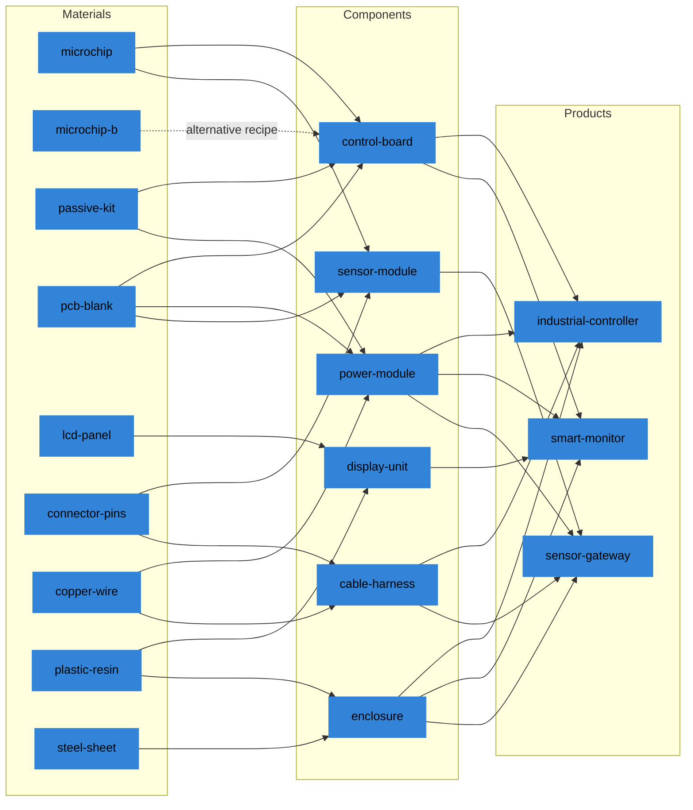

# Example factory

The package ships one electronics factory with economies of scale. It loads into the
database when the server starts.

- Its name is `Electronics factory with economies of scale`. It is an
  economies-of-scale manifest: it has minimum quantities, discounts and changeovers
  (see [Economies of scale](example-plant-and-cash.md#economies-of-scale)).
- It names its period "week". Money is in one currency, written without a sign.
- It has 3 products, 6 components, 9 materials, 4 suppliers, 4 customers, 4 lines,
  2 warehouses, 1 route and 10 groups.
- `GET /api/v1/manifests` lists it with its identifier, name and description (see
  [Quick start](../start/quick-start.md)).

## Items

### Materials

| Material | Unit | Category | Space per unit | Sold by |
| --- | --- | --- | --- | --- |
| `microchip` | piece | `semiconductor` | 0.001 | `apac-chips` |
| `microchip-b` | piece | `semiconductor` | 0.001 | `emea-electronic-parts` |
| `passive-kit` | set | `passive` | 0.002 | `emea-electronic-parts`, `amer-metals` |
| `pcb-blank` | piece | `passive` | 0.002 | `emea-electronic-parts` |
| `lcd-panel` | piece | `display` | 0.020 | `apac-displays-plastics`, `emea-electronic-parts` |
| `connector-pins` | set | `connector` | 0.001 | `emea-electronic-parts` |
| `copper-wire` | metre | `connector` | 0.001 | `amer-metals`, `emea-electronic-parts` |
| `plastic-resin` | kg | `mechanical` | 0.002 | `apac-displays-plastics` |
| `steel-sheet` | kg | `mechanical` | 0.001 | `amer-metals` |

`microchip-b` is a chip from another region. Only the alternative recipe of
`control-board` uses it.

### Components

| Component | Recipe: inputs for one unit | Made on | Space per unit |
| --- | --- | --- | --- |
| `control-board` | standard: 2 `microchip`, 1 `pcb-blank`, 1 `passive-kit`; alternative: 2 `microchip-b`, 1 `pcb-blank`, 1 `passive-kit` | `smt-line` | 0.003 |
| `power-module` | 2 `passive-kit`, 1 `pcb-blank`, 1.5 `copper-wire` | `smt-line` or `module-assembly-line` | 0.003 |
| `sensor-module` | 1 `microchip`, 1 `pcb-blank`, 2 `connector-pins` | `smt-line` | 0.002 |
| `display-unit` | 1 `lcd-panel`, 0.3 `plastic-resin` | `module-assembly-line` | 0.025 |
| `enclosure` | 2 `steel-sheet`, 0.4 `plastic-resin` | `moulding-line` | 0.015 |
| `cable-harness` | 3 `copper-wire`, 2 `connector-pins` | `module-assembly-line` | 0.004 |

The standard recipe is the default recipe of `control-board`. The alternative recipe
costs about 10 percent more: 26.50 a board against 24.10, line cost included, at the
usual prices.

### Products

| Product | Recipe: inputs for one unit | Segment | Space per unit |
| --- | --- | --- | --- |
| `industrial-controller` | 1 `control-board`, 1 `power-module`, 1 `enclosure`, 1 `cable-harness` | `spare-parts` | 0.030 |
| `smart-monitor` | 1 `display-unit`, 1 `control-board`, 1 `power-module`, 1 `enclosure` | `new-devices` | 0.040 |
| `sensor-gateway` | 1 `sensor-module`, 1 `power-module`, 1 `enclosure`, 1 `cable-harness` | `new-devices` | 0.020 |

Every product is made on `final-assembly-line`. Components share materials and
products share components: every product needs `power-module` and `enclosure`, and
every component but `display-unit` and `enclosure` needs `pcb-blank` or
`connector-pins`. So a shortage of one material reaches several products.

### The recipe tree

The dotted edge is the alternative recipe of `control-board`: it takes `microchip-b`
in place of `microchip`, with the same `pcb-blank` and `passive-kit`.

## Suppliers

Four suppliers in three regions. A region gives its suppliers their lead time and
punctuality.

| Region | Lead time | Punctuality | Delay when late | Backfill after |
| --- | --- | --- | --- | --- |
| `emea` | 2 | 0.90 to 0.97 | 1 | 1 |
| `apac` | 3 to 5 | 0.80 to 0.92 | 1 to 2 | 2 |
| `amer` | 3 | 0.88 to 0.95 | 1 to 2 | 2 |

A range is drawn once per run for each catalogue entry, so seeds change the lead time
of every `apac` entry. A category of materials gives the completeness and the
acceptance of its deliveries, each a range within 0.95 to 1.

| Supplier | Region | Material | Price | Express |
| --- | --- | --- | --- | --- |
| `apac-chips` | `apac` | `microchip` | 6.00 to 7.50, mode 6.50 | 2 periods, 1.625 more |
| `apac-displays-plastics` | `apac` | `lcd-panel` | 34.00 to 42.00, mode 38.00 | 2 periods, 9.50 more |
| `apac-displays-plastics` | `apac` | `plastic-resin` | 2.20 | 2 periods, 0.55 more |
| `emea-electronic-parts` | `emea` | `microchip-b` | 7.70 | 1 period, 1.925 more |
| `emea-electronic-parts` | `emea` | `passive-kit` | 2.20 to 2.60, mode 2.40 | 1 period, 0.60 more |
| `emea-electronic-parts` | `emea` | `pcb-blank` | 3.80 | 1 period, 0.95 more |
| `emea-electronic-parts` | `emea` | `connector-pins` | 0.90 | 1 period, 0.225 more |
| `emea-electronic-parts` | `emea` | `lcd-panel` | 45.60 | 1 period, 11.40 more |
| `emea-electronic-parts` | `emea` | `copper-wire` | 0.5175 | 1 period, 0.1294 more |
| `amer-metals` | `amer` | `copper-wire` | 0.45 | 1 period, 0.1125 more |
| `amer-metals` | `amer` | `steel-sheet` | 1.10 | 1 period, 0.275 more |
| `amer-metals` | `amer` | `passive-kit` | 2.76 | none |

- The three price ranges are triangular and drawn once per run, so seeds also change
  the cost of chips, passive kits and panels.
- Every entry has a largest quantity per period, from 500 for `lcd-panel` to 4000 for
  `copper-wire`, and a cancellation fee of 10 percent of its price.
- `amer-metals` writes a lead time of 1 for `passive-kit` in its entry. That entry has
  no express order.

### Second suppliers

Three materials have a second supplier that is faster and dearer than the first:

| Material | First supplier | Second supplier |
| --- | --- | --- |
| `passive-kit` | `emea-electronic-parts`, 2.40, 2 periods | `amer-metals`, 2.76, 1 period |
| `lcd-panel` | `apac-displays-plastics`, 38.00, 3 to 5 periods | `emea-electronic-parts`, 45.60, 2 periods |
| `copper-wire` | `amer-metals`, 0.45, 3 periods | `emea-electronic-parts`, 0.5175, 2 periods |

`microchip`, `pcb-blank`, `connector-pins`, `plastic-resin` and `steel-sheet` have one
supplier each. For `microchip` the factory can turn to the alternative recipe of
`control-board` and buy `microchip-b` from `emea-electronic-parts`; `sensor-module` has
no alternative. See [Suppliers](../rules/suppliers.md).

## Customers

Four customers. Each buys some of the products:

| Customer | Pays after | `industrial-controller` | `smart-monitor` | `sensor-gateway` |
| --- | --- | --- | --- | --- |
| `tier1-distributor` | 4 periods | 144.00 | 189.00 | 108.00 |
| `equipment-maker` | 6 periods | 152.00 | 199.50 | 114.00 |
| `retail-chain` | 8 periods | does not buy | 193.20 | 110.40 |
| `system-integrator` | 2 periods | 160.00 | does not buy | 120.00 |

The prices are per unit. Together the 10 pairs order, at the middle of demand, 90
`industrial-controller`, 95 `smart-monitor` and 80 `sensor-gateway` a period.

| Pair | Demand range | Middle |
| --- | --- | --- |
| `tier1-distributor`, `industrial-controller` | normal, 27 to 63 | mean 45 |
| `equipment-maker`, `industrial-controller` | normal, 18 to 42 | mean 30 |
| `system-integrator`, `industrial-controller` | normal, 9 to 21 | mean 15 |
| `tier1-distributor`, `smart-monitor` | lognormal, 14 to 70 | median 35 |
| `equipment-maker`, `smart-monitor` | lognormal, 8 to 40 | median 20 |
| `retail-chain`, `smart-monitor` | lognormal, 16 to 80 | median 40 |
| `tier1-distributor`, `sensor-gateway` | lognormal, 8 to 40 | median 20 |
| `equipment-maker`, `sensor-gateway` | lognormal, 8 to 40 | median 20 |
| `retail-chain`, `sensor-gateway` | lognormal, 6 to 30 | median 15 |
| `system-integrator`, `sensor-gateway` | lognormal, 10 to 50 | median 25 |

The segment of a product sets how its customers order and wait:

| Segment | Products | Due after | Patience | Late penalty | Lost-sale penalty | Persistence | Variation of demand |
| --- | --- | --- | --- | --- | --- | --- | --- |
| `spare-parts` | `industrial-controller` | 2 periods | 4 | 3 | 20 | 0.6 | about 0.12 |
| `new-devices` | `smart-monitor`, `sensor-gateway` | 1 period | 2 | 12 | 30 | 0.3 | about 0.34 |

The penalties are per unit; the late penalty is per period late. The variation of
demand is the standard deviation over the mean. New devices swing more, are due sooner,
and cost more when late. See [Customers and demand](../rules/customers-and-demand.md).

## Groups

| Group | Kind | Members | What it gives |
| --- | --- | --- | --- |
| `emea`, `apac`, `amer` | region | suppliers | Lead time, punctuality, delay and backfill delay of their catalogue. |
| `new-devices`, `spare-parts` | segment | products | Lead time of customer orders, patience, penalties and persistence of demand. |
| `semiconductor`, `passive`, `connector`, `display`, `mechanical` | category | materials | Completeness and acceptance of their deliveries. |

A group is also a target of disruptions and has its own measures. `regional-crisis`
of the library hits the region `apac`. See [Groups](../rules/groups.md).
