# Example plant and cash

The example factory has four production lines, two warehouses and one route.

## Lines

Four lines, all at `main-plant`, with different hours:

| Line | Hours per period | Overtime | Items: hours and cost per unit |
| --- | --- | --- | --- |
| `smt-line` | 80 | 16 hours at 55 | `control-board` 0.140 and 4.90; `power-module` 0.112 and 3.92; `sensor-module` 0.112 and 3.92 |
| `module-assembly-line` | 64 | none | `display-unit` 0.300 and 10.50; `cable-harness` 0.150 and 5.25; `power-module` 0.180 and 6.30 |
| `moulding-line` | 64 | none | `enclosure` 0.200 and 6.00 |
| `final-assembly-line` | 72 | 16 hours at 55 | `industrial-controller` 0.320 and 11.20; `smart-monitor` 0.250 and 8.75; `sensor-gateway` 0.180 and 6.30 |

- `power-module` is made on two lines. On `module-assembly-line` it takes about
  60 percent more hours, costs 6.30 against 3.92 and has a lower yield, 0.95 to 0.98
  against 0.96 to 0.99.
- At the middle of demand, `smt-line`, `module-assembly-line` and `moulding-line` use
  about 84 to 87 percent of their hours. `final-assembly-line` uses about 94 percent:
  it has no spare hours.
- Yield ranges lie within 0.95 to 1. A yield is drawn for every line, item and period.

| Line | Breakdown chance per period | Condition lost | Full repair: cost and hours | Repair per period at most |
| --- | --- | --- | --- | --- |
| `smt-line` | 0.020 | 0.10 to 0.30 | 2500, 16 | 0.5 |
| `module-assembly-line` | 0.015 | 0.10 to 0.25 | 1200, 8 | 0.6 |
| `moulding-line` | 0.030 | 0.15 to 0.40 | 1800, 12 | 0.5 |
| `final-assembly-line` | 0.010 | 0.05 to 0.20 | 800, 8 | 0.7 |

See [Production](../rules/production.md).

## Warehouses and the route

| Warehouse | Space | Holds | Storage factor | Transport factor |
| --- | --- | --- | --- | --- |
| `main-plant` | 116 | every item | 1 | 1 |
| `distribution-centre` | 120 | products only | 0.6 | 0.85 |

The storage factor multiplies the storage cost of what the warehouse holds; the
transport factor multiplies the transport cost of shipments from it.

- Materials arrive at `main-plant`, and every line takes its inputs from it and puts
  its output there.
- One route, `main-plant` to `distribution-centre`, takes 1 period and costs 0.80 per
  unit. There is no route back.
- A product can be shipped from either warehouse. From `distribution-centre` it costs
  less to store and to ship, and it must be moved there one period ahead.
- In the scenario `steady-market` the starting stock fills 47.97 of the 116 units of
  space at `main-plant` and 2.025 of the 120 at `distribution-centre`.

See [Warehouses and routes](../rules/warehouses-and-routes.md).

### The places

```mermaid
flowchart LR
    subgraph region_apac[APAC]
        apac_chips[apac-chips]
        apac_displays_plastics[apac-displays-plastics]
    end
    subgraph region_emea[EMEA]
        emea_electronic_parts[emea-electronic-parts]
    end
    subgraph region_amer[AMER]
        amer_metals[amer-metals]
    end
    subgraph main_plant[main-plant, 116 units of space]
        smt_line[smt-line, 80 hours]
        module_assembly_line[module-assembly-line, 64 hours]
        moulding_line[moulding-line, 64 hours]
        final_assembly_line[final-assembly-line, 72 hours]
    end
    distribution_centre[distribution-centre, 120 units of space, products only]
    subgraph customers[Customers]
        tier1_distributor[tier1-distributor]
        equipment_maker[equipment-maker]
        retail_chain[retail-chain]
        system_integrator[system-integrator]
    end
    apac_chips -->|3 to 5 periods| main_plant
    apac_displays_plastics -->|3 to 5 periods| main_plant
    emea_electronic_parts -->|2 periods| main_plant
    amer_metals -->|3 periods, passive-kit 1| main_plant
    main_plant -->|route, 1 period, 0.80 per unit| distribution_centre
    main_plant -->|shipments| customers
    distribution_centre -->|shipments| customers
    classDef item fill:#3284D8,stroke:#3284D8,color:#000000
    classDef place fill:#AF751D,stroke:#AF751D,color:#000000
    classDef partner fill:#3D9250,stroke:#3D9250,color:#000000
    classDef system fill:#9869DE,stroke:#9869DE,color:#000000
    classDef disruption fill:#E8473C,stroke:#E8473C,color:#000000
    class apac_chips,apac_displays_plastics,emea_electronic_parts,amer_metals partner
    class tier1_distributor,equipment_maker,retail_chain,system_integrator partner
    class smt_line,module_assembly_line,moulding_line,final_assembly_line place
    class distribution_centre place
```

Materials come from three regions to the main plant. Products leave from the main plant
or, one period after a transfer, from the distribution center.

## Cash

- Credit limit: 80000.
- Interest per period: 0.0003 on cash above 0, 0.0015 from 0 down to -80000, 0.0040
  below -80000.
- Starting cash is set by the scenario: 0 in every scenario of the library
  but `cash-squeeze`.

See [Cash and profit](../rules/cash-and-profit.md).

## Economies of scale

The factory has 2 minimum quantities, 4 discount tiers and 6 changeovers:

| Where | Rule | Number |
| --- | --- | --- |
| `microchip` at `apac-chips` | minimum quantity | 500 per order |
| `lcd-panel` at `apac-displays-plastics` | minimum quantity | 100 per order |
| `microchip` at `apac-chips` | discount tier | 5.85 from 1000 units |
| `microchip` at `apac-chips` | discount tier | 5.70 from 1500 units |
| `passive-kit` at `emea-electronic-parts` | discount tier | 2.10 from 1500 units |
| `pcb-blank` at `emea-electronic-parts` | discount tier | 3.61 from 1000 units |
| `control-board` on `smt-line` | changeover | 2 hours and 300 |
| `power-module` on `smt-line` | changeover | 2 hours and 300 |
| `sensor-module` on `smt-line` | changeover | 2 hours and 300 |
| `industrial-controller` on `final-assembly-line` | changeover | 1 hour and 150 |
| `smart-monitor` on `final-assembly-line` | changeover | 1 hour and 150 |
| `sensor-gateway` on `final-assembly-line` | changeover | 1 hour and 150 |

- Every discount price is below the lowest price of its entry: 5.85 and 5.70 against
  6.00, 2.10 against 2.20, 3.61 against 3.80.
- The second suppliers of a material have no minimum quantity and no discount.
- `module-assembly-line` and `moulding-line` have no changeover, so `power-module` on
  `module-assembly-line` has none.
- The scenarios of the library start every line set for no item, so the first
  production on `smt-line` and on `final-assembly-line` pays a changeover.

So large buys, and long series of one item on a line, cost less per unit, and the best
decisions need a program with yes-or-no choices. See
[Placing an order](../rules/suppliers.md#placing-an-order),
[Discounts](../rules/suppliers.md#discounts) and
[Changeovers](../rules/production.md#changeovers).

## Sources of the numbers

Each number comes from one of these sources:

- Prices of materials are market prices of large orders: a 32-bit microcontroller
  costs about 3 to 8, a 10 inch industrial panel about 30 to 60, a 4-layer board about
  2 to 6. A price range spans a good and a tight period of the market.
- A second supplier is 15 or 20 percent dearer than the usual price of the first. An
  express order costs 25 percent of the price more; a cancellation costs 10 percent.
- Lead times follow freight: road within Europe takes about 2 periods, sea and air
  from Asia with customs 3 to 5, ocean or rail from the Americas about 3.
- The largest quantity per period of an entry is at least twice the need of one
  period at the top of demand.
- Hours are shifts of 8 hours: 80 is two shifts on 5 days, 64 two shifts on 4 days,
  72 two shifts on 4 days and one more shift. Overtime is two Saturday shifts. An hour
  of a line costs 35 in labour and energy, 30 on the moulding line, and an overtime
  hour 55.
- Hours per unit come from the minutes of placement, assembly and test of each item.
- Storage costs 0.5 percent of the value of an item per period, about 25 percent over
  52 periods. A material is worth 40 percent of its price at the end of a run; a
  component or product 80 percent of the salvage value of its inputs.
- Selling prices are 90 to 100 percent of a list price, which is 2 to 2.5 times the
  cost of a unit; that cost is 65.98 for `industrial-controller`, 104.28 for
  `smart-monitor` and 53.00 for `sensor-gateway`.
- Payment terms follow common terms of trade: 30 days for a distributor, about 4
  periods; 45 days for an equipment maker, 6; 60 days for a retail chain, 8; and an
  integrator pays at each stage of a project, after about 2.
- Demand of a spare part varies by about 0.12 of its mean, and of a new device by
  about 0.34.
- The main plant holds 3 periods of need of materials and components, one cycle of
  supplier orders on the way and one period of production, with about 25 percent
  free. The distribution center holds about 15 periods of products.
- The credit limit is about 2 periods of sales, which are 40869 a period at the
  middle of demand. The interest rates are about 1.6, 8 and 23 percent over 52
  periods.
- Purchases are about 12451 a period. Every scenario of the library but
  `cash-squeeze` starts with no cash and buys on credit.
- Minimum quantities and discounts follow packs: a box of 500 chips is about one
  period of need, and the tiers are two and three boxes; 100 panels are one pallet. A
  changeover of `smt-line` is the 2 hours to change its feeders and stencil; of
  `final-assembly-line`, the hour to change its test rig and fixtures.
