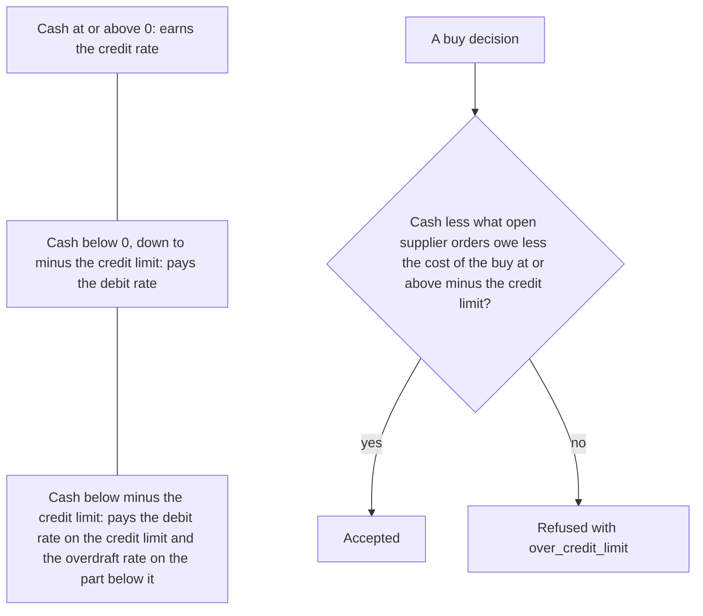
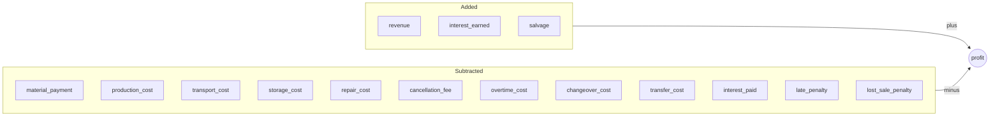

# Cash and profit

Cash is the money the factory holds. Profit is the one number that scores a run.

The factory starts a run with the cash the scenario gives, and cash may fall below
zero. At the close of every period cash earns or pays interest, at one of three rates
of the manifest. A buy is refused when its cost, together with what open supplier
orders still owe, would take cash below minus the credit limit; no other decision is
refused for cash. Profit is revenue minus every cost and penalty, plus the salvage
value of the stock at the end. Production and transfers not yet in stock, supplier
orders that have not arrived and customer orders not yet due count nothing.

## Starting cash

- `start.cash` of the scenario is the cash in period 1, before any step. It may be
  below 0. By default it is 0.
- The scenarios of the library start with 0, except `cash-squeeze`, which starts with
  -120000.
- Every movement of cash is a row of the ledger, with its kind, step and reference.
  `GET /api/v1/runs/{id}/periods` returns the ledger of every period.

## Interest

The manifest sets four fixed numbers under `cash`:

| Key | Meaning | Example factory |
| --- | --- | --- |
| `credit_limit` | The amount L. Cash below -L pays the overdraft rate. | 80000 |
| `credit_interest` | Share of cash at or above 0 earned per period. | 0.0003 |
| `debit_interest` | Share of cash below 0, down to -L, paid per period. | 0.0015 |
| `overdraft_interest` | Share of cash below -L paid per period. | 0.0040 |

- Each rate is from 0 to 1. The rates do not fall from one to the next:
  `credit_interest` <= `debit_interest` <= `overdraft_interest`. A manifest that breaks
  this is refused.
- Interest is the last movement of cash in a period. It is computed at the close of the
  period, after storage and penalties, on the cash c at that moment:

  ```text
  c >= 0:        earned = c * credit_interest
  -L <= c < 0:   paid   = -c * debit_interest
  c < -L:        paid   = L * debit_interest + (-c - L) * overdraft_interest
  ```

- Interest is rounded to 4 decimal places against the factory: interest earned is
  rounded down, interest paid is rounded up.
- The ledger books it as `interest_earned` or `interest_paid`; the event `interest`
  reports the amount.



The three bands of cash at the close of a period, and the check of a buy.

## The credit limit on buys

A buy is refused with the reason `over_credit_limit` when:

```text
cash - committed - quantity * unit price < -credit limit
```

- `cash` is the cash at the moment of the check. It includes the ship, cancel,
  transfer, repair and produce decisions of the period; buys accepted before this one
  count in `committed`.
- `committed` is the sum of open quantity x unit price over every open supplier order,
  starting supplier orders and missing parts still to come included. It is what the
  factory still owes when everything open arrives in full and passes acceptance.
- The unit price is fixed when the order is placed, with discount, price change and
  express cost (see [Suppliers](suppliers.md)).
- The outcome gives `asked`, the quantity x unit price, with up to 7 decimal places, and
  `available`, the cash + credit limit - `committed`, with the places of cash, up to 11.
  `available` may be below 0, and then every buy is refused.
- This is the last check of a buy. A buy that fails an earlier check is rejected for
  that reason (see [Decisions](decisions.md)).
- Ship, cancel, transfer, repair and produce decisions are never refused for cash.
- A factory below minus the credit limit buys again once payments for the units it
  ships raise `available` to the cost of a buy. A start whose stock can never earn
  that much refuses every buy of its run.
- Cash can still fall below minus the credit limit: through costs that are not buys,
  such as production, storage, penalties and interest, and through payments of orders
  placed earlier. Cash below the limit then pays the overdraft rate.

## Profit

```text
profit = revenue
         - material_payment - production_cost - overtime_cost - changeover_cost
         - transport_cost - transfer_cost - storage_cost - repair_cost
         - cancellation_fee
         - interest_paid + interest_earned
         - late_penalty - lost_sale_penalty
         + salvage
```

| Term | What it holds | Rules |
| --- | --- | --- |
| `revenue` | Price of every shipped unit, paid or not. | [Customers and demand](customers-and-demand.md) |
| `material_payment` | Accepted units of supplier orders * unit price. | [Suppliers](suppliers.md) |
| `production_cost` | Started units * cost per unit of the line. | [Production](production.md) |
| `overtime_cost` | Overtime hours * cost per overtime hour. | [Production](production.md) |
| `changeover_cost` | Cost of setting a line for an item. | [Production](production.md) |
| `transport_cost` | Shipped units * transport cost * transport factor. | [Customers and demand](customers-and-demand.md) |
| `transfer_cost` | Transferred units * cost of the route. | [Warehouses and routes](warehouses-and-routes.md) |
| `storage_cost` | Stock and transfers on the way * storage cost * storage factor, every period. | [Warehouses and routes](warehouses-and-routes.md) |
| `repair_cost` | Condition restored * repair cost. | [Production](production.md) |
| `cancellation_fee` | Cancelled units of supplier orders * fee. | [Suppliers](suppliers.md) |
| `interest_paid`, `interest_earned` | Interest at the close of every period. | [Interest](cash-and-profit.md#interest) |
| `late_penalty`, `lost_sale_penalty` | Penalties of customer orders. | [Customers and demand](customers-and-demand.md) |
| `salvage` | Stock at the end * salvage value. | [Salvage value](cash-and-profit.md#salvage-value) |

- The same number is counted from cash:

  ```text
  profit = cash at end - cash at start + receivables at end + salvage
  ```

  Every cost and penalty leaves cash, and every unit of revenue is either paid or still
  a receivable.
- `GET /api/v1/runs/{id}/result` gives, once the run has ended, `profit`,
  `cash_at_start`, `cash_at_end`, `receivables` and `terms`. `terms` holds each term of
  the formula as an amount at or above 0.
- Measures are recorded beside profit. They do not change it.



The terms of profit, as `GET /api/v1/runs/{id}/result` names them.

## Salvage value

- `salvage_value` of an item is the money one unit in stock is worth at the end of a
  run. A range is drawn once per run.
- salvage = the sum over warehouses and items of stock at the end x salvage value.
- A manifest is refused when a salvage value can be above what the item costs:
  - for a material, its lowest price in any catalogue, discounts included;
  - for a component or a product, the salvage values of the inputs of one unit plus
    the cost per unit of the line, for the cheapest recipe and line.
- A scenario is refused when its price changes could take the lowest price of a
  material below its salvage value.
- So buying or making an item only to hold it at the end never adds to profit.

## The end of a run

The run ends at the close of its last period. Then:

- Stock counts its salvage value.
- Production not yet in stock and transfers on the way are worth nothing. Their costs
  stay paid.
- Receivables count in full, also those with a payment period after the last period.
- Supplier orders that have not arrived are not paid. They count nothing.
- Every open customer order whose due period has come is lost at the close of the last
  period and pays the lost-sale penalty for its units not shipped.
- Customer orders not yet due pay nothing and earn nothing.

## Worked example

A run of `cash-squeeze` on the example factory with seed 7. `cash-squeeze` is
`steady-market` with a starting cash of -120000. The agent tries one buy in period 1
and decides nothing else. The credit limit is 80000.

- Period 1, step 5: the decision
  `{"kind": "buy", "supplier": "emea-electronic-parts", "material": "lcd-panel", "quantity": 100, "warehouse": "main-plant"}`
  is checked. The price is 45.6.
  - Nothing has been paid or received yet, so cash is -120000. No supplier order
    is open, so `committed` is 0.
  - asked = 100 x 45.6 = 4560.
  - available = -120000 + 80000 - 0 = -40000.
  - -120000 - 0 - 4560 = -124560 is below -80000. The buy is refused with
    `over_credit_limit`, `asked` 4560 and `available` -40000.
- Period 1, step 6: storage of the starting stock costs 472.3753. Cash is
  -120000 - 472.3753 = -120472.3753, below -80000.
  - interest = 80000 x 0.0015 + (120472.3753 - 80000) x 0.0040 = 120 + 161.8895012 =
    281.8895012, rounded up to 281.8896.
  - Cash at the close is -120754.2649.
- End of the run: nothing is shipped, made or bought, so the stock never changes.
  Storage is 52 x 472.3753 = 24563.5156, and the salvage of the starting stock is
  27434.2103.

| Term | Amount |
| --- | --- |
| `revenue` | 0 |
| `storage_cost` | 24563.5156 |
| `interest_paid` | 87014.0268 |
| `late_penalty` | 274633.248 |
| `lost_sale_penalty` | 376982.56 |
| `salvage` | 27434.2103 |
| every other term | 0 |

- From the terms: 0 - 24563.5156 - 87014.0268 - 274633.248 - 376982.56 + 27434.2103 =
  -735759.1401.
- From cash: -883193.3504 - (-120000) + 0 + 27434.2103 = -735759.1401.

`steady-market` with seed 7 and no decisions has a profit of -709331.2306. Every term
but interest is the same. The difference of 26427.9095 is 26427.9095 more interest
paid.
