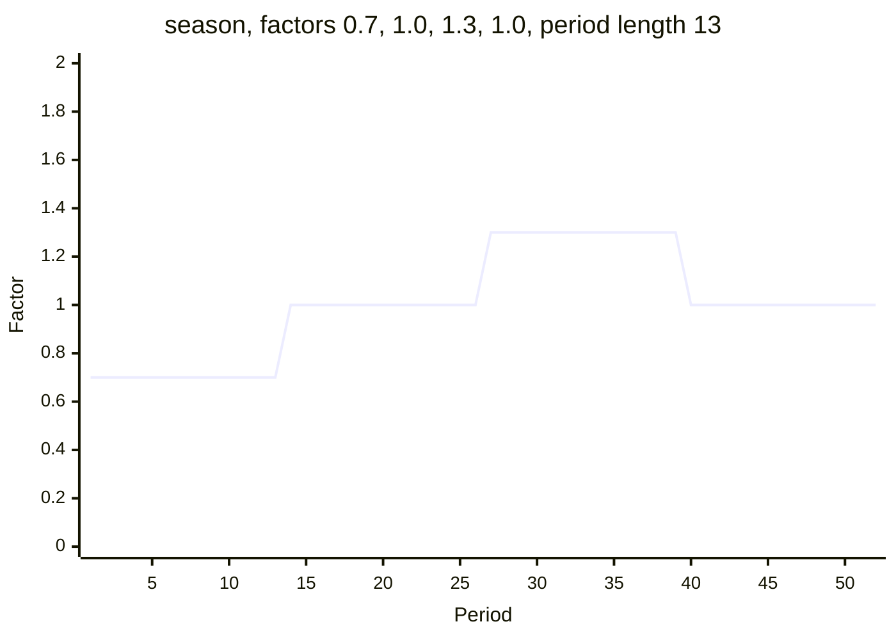
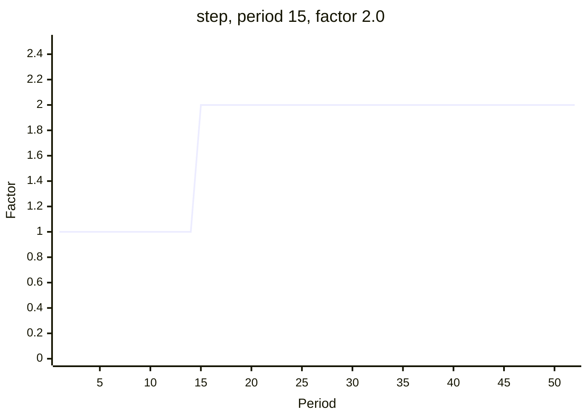
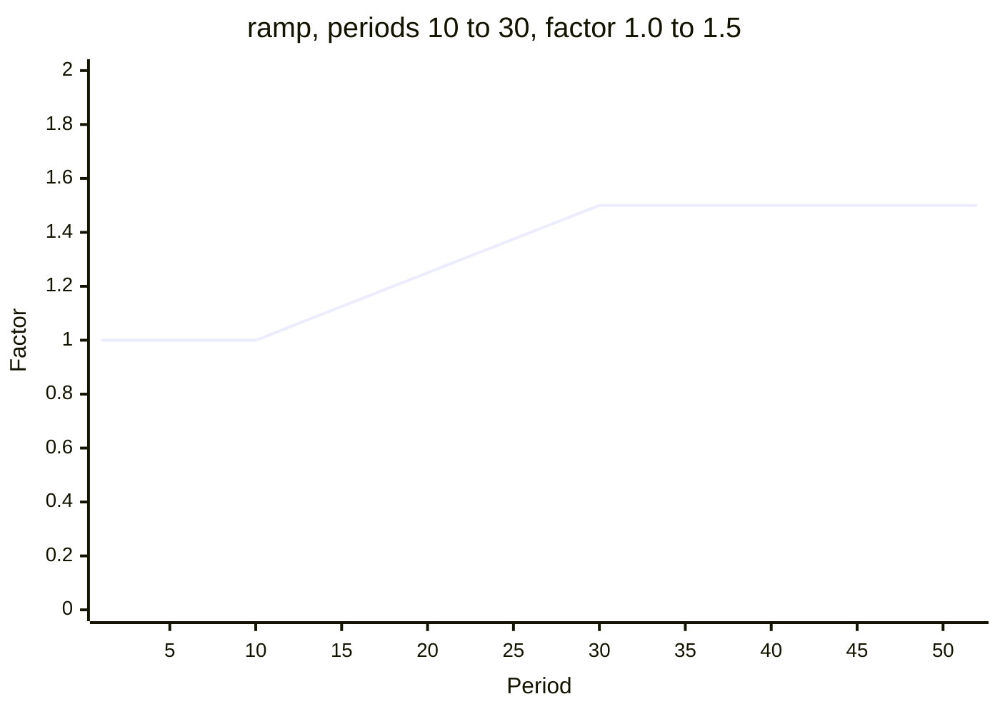
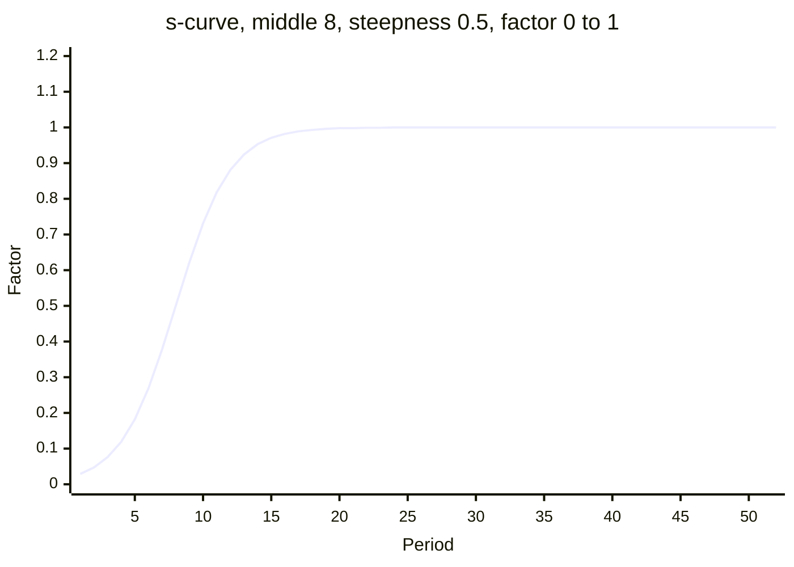
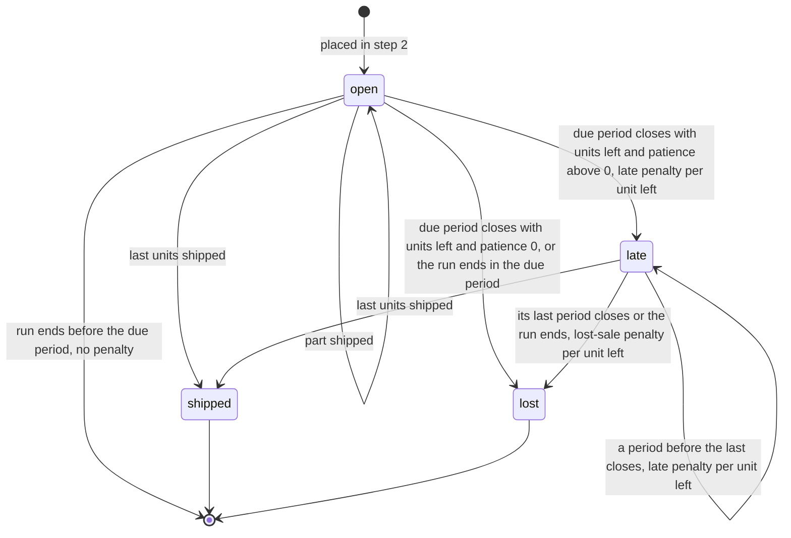

# Customers and demand

Customers buy products.

For every pair of a customer and a product, the world holds a base demand for each
period. The demand shapes of the scenario multiply it over time. The demand of a period
becomes one customer order, due a lead time later. Every unit not shipped by the close
of its due period pays a late penalty for each period until it is shipped or lost, and
units still not shipped when the patience runs out are lost at a lost-sale penalty. A
shipped unit earns its price, costs a transport cost and is paid after the payment terms
of the customer.

## Base demand

- Each pair of a customer and a product has a base demand per period: `demand` under
  `customers.<id>.products.<product>` in the manifest. It is a fixed number or a range.
- A range is drawn again for every period. All draws are made from the seed before
  period 1. The four distributions are in
  [Randomness and fairness](randomness-and-fairness.md).
- The base demand never depends on a decision. Every agent given the same manifest,
  scenario and seed meets the same base demand.
- A scenario can hide the demand of every pair, with its persistence and common share
  (see [Information](information.md)).

## Persistence

`demand_persistence` p of a pair is a share from 0 to 1, by default 0. It carries part
of the previous base demand into the next period:

```text
base(1) = draw(1)
base(t) = p * base(t - 1) + (1 - p) * draw(t)
```

draw(t) is the value drawn from the range in period t. The result is rounded half to
even to 3 decimal places. With p = 0 every period is drawn on its own. With p = 0.5,
base(1) = 40 and draw(2) = 30, base(2) = 20 + 15 = 35. A manifest that gives
`demand_persistence` for a fixed `demand` is refused.

## Common share

`common_share` s of a product is a share from 0 to 1, by default 0. It is the share of
the variation of demand that all customers of the product have in common.

- Each period draws one common chance number for the product and one own chance
  number for each pair.
- Each chance number is turned into a standard normal value. The two values are mixed:

  ```text
  z = sqrt(s) * common value + sqrt(1 - s) * own value
  ```

- z is turned back into a chance number. The pair draws its demand from its own range
  and distribution with that number.
- z is again a standard normal value. So each pair keeps its range, its mean and how
  widely it varies. Only the share of the variation that is common changes.
- With s = 0 each pair varies on its own. With s = 1 every customer of the product
  draws with the same chance number. A larger s makes the customers of the product
  order more, or less, in the same periods.
- Persistence acts after this draw.
- A common share above 0 is refused on a product that fewer than two customers buy with
  a range of demand.
- Every product of the example factory has a common share of 0.

## Demand shapes

A demand shape is a factor over time that multiplies base demand. The scenario lists
its shapes under `demand_shapes`. With t the period:

| Kind | Keys | Factor in period t |
| --- | --- | --- |
| `trend` | `rate` | (1 + rate) to the power (t - 1) |
| `season` | `factors`, `period_length` | `factors[i]`, with i = floor((t - 1) / period_length) mod (number of factors), counting from 0 |
| `step` | `period`, `factor` | `factor` when t >= period, otherwise 1 |
| `ramp` | `first`, `last`, `from_factor`, `to_factor` | `from_factor` when t <= first; `to_factor` when t >= last; otherwise from_factor + (to_factor - from_factor) * (t - first) / (last - first) |
| `s_curve` | `middle`, `steepness`, `from_factor`, `to_factor` | from_factor + (to_factor - from_factor) / (1 + exp(-steepness * (t - middle))) |

- A trend is 1 in period 1 and is multiplied by (1 + rate) every period after. A
  negative `rate` makes it fall.
- A season cuts the periods into blocks of `period_length`. Block 1 uses the first
  factor, block 2 the second, and after the last factor the list starts again.
- A step changes the factor once, in period `period`, for the rest of the run.
- A ramp moves in a straight line from `from_factor` in period `first` to `to_factor`
  in period `last`.
- An s-curve is half way between its two factors in period `middle`. A larger
  `steepness` makes the change faster. Far before the middle the factor is
  `from_factor`.
- Every factor is at least 0. `rate` is above -1. `factors` has at least 1 entry and
  `period_length` is at least 1. In a ramp, `first` is before `last`. `steepness` is
  above 0. `period`, `first`, `last` and `middle` are whole numbers and may lie outside
  the horizon. `rate` and the factors have 4 decimal places.
- `target` is `all`, one customer, one product, one pair of a customer and a product,
  or a group of customers or products (see [Groups](groups.md)).
- When several shapes target a pair, their factors multiply. A pair no shape targets
  has a factor of 1.
- Shapes are fixed numbers of the scenario, the same for every seed. The agent sees
  them in the description.

The five charts show the factor of each kind over 52 periods.

```mermaid
xychart-beta
    title "trend, rate 0.0100"
    x-axis "Period" 1 --> 52
    y-axis "Factor" 0 --> 2
    line [1.000, 1.010, 1.020, 1.030, 1.041, 1.051, 1.062, 1.072, 1.083, 1.094, 1.105, 1.116, 1.127, 1.138, 1.149, 1.161, 1.173, 1.184, 1.196, 1.208, 1.220, 1.232, 1.245, 1.257, 1.270, 1.282, 1.295, 1.308, 1.321, 1.335, 1.348, 1.361, 1.375, 1.389, 1.403, 1.417, 1.431, 1.445, 1.460, 1.474, 1.489, 1.504, 1.519, 1.534, 1.549, 1.565, 1.580, 1.596, 1.612, 1.628, 1.645, 1.661]
```

A trend with `rate` 0.0100: 1 in period 1 and 1.01 to the power 51 = 1.661 in period
52.



A season with `factors` 0.7000, 1.0000, 1.3000 and 1.0000 and `period_length` 13: 0.7 in
periods 1 to 13, 1.0 in 14 to 26, 1.3 in 27 to 39 and 1.0 in 40 to 52.



A step in period 15 with factor 2.0000: 1 in periods 1 to 14 and 2 from period 15. The
scenario `demand-step` steps every product to factor 6.0000 from period 11.



A ramp with `first` 10, `last` 30, `from_factor` 1.0000 and `to_factor` 1.5000: 1 up to
period 10, 1 + 0.5 x 10 / 20 = 1.25 in period 20, and 1.5 from period 30.



An s-curve with `middle` 8, `steepness` 0.5000, `from_factor` 0.0000 and `to_factor`
1.0000: 1 / (1 + exp(3.5)) = 0.029 in period 1, 0.5 in period 8 and 0.998 in period 20.

## The demand of a period

The demand of a pair in period t is:

```text
demand(t) = base(t) * factor of every shape that targets the pair
                    * factor of every demand_shock acting on the product
```

rounded half to even to 3 decimal places. A disruption of kind `demand_shock` is
described in [Disruptions](disruptions.md).

With base demand 40, a trend of `rate` 0.0100 and a step from period 3 with factor 1.5,
the demand of period 3 is 40 x 1.01 x 1.01 x 1.5 = 61.206.

## Customer orders

- In step 2 of every period, each pair whose demand of the period is above 0 places one
  customer order for that quantity. Pairs go in order of customer, then product.
- The identifier of an order is `order-<period>-<n>`, with n counting the new orders of
  the period from 1.
- The due period is the period the order arrives plus the `lead_time` of the pair. With
  a lead time of 0 the order is due in the period it arrives.
- The last period is the due period plus the `patience` of the pair.
- The quantity and the due period of an order never change.
- A scenario may list starting customer orders under `start.customer_orders`. Each
  names a pair, a quantity and a due period, arrives in period 0, has the identifier
  `order-0-<n>`, and has the patience, price and penalties of its pair.
- The observation shows every open customer order: its quantity, the units shipped, and
  its arrival, due and last periods. The agent learns of an order in the period it
  arrives; it sees future demand only through forecasts
  (see [Information](information.md)).



A customer order from its arrival to its end. Lost units pay the lost-sale penalty and
no late penalty in that period.

## Late and lost-sale penalties

At the close of every period, each open customer order is checked in order:

1. When the period is the last period of the order, or the period is the last of the
   run and the order is due by then, the units not shipped are lost. They cost
   `lost_sale_penalty` per unit, and the order closes.
2. Otherwise, when the period is the due period or later, the units not shipped cost
   `late_penalty` per unit.

- So an order with patience P pays the late penalty in P periods, then is lost.
- With a patience of 0 an order is lost at the close of its due period, without a late
  penalty.
- When the run ends, every open order whose due period has come is lost. An order not
  yet due pays nothing.
- Every penalty leaves cash at once. The events `late_penalty` and `lost_sale` report
  the units and the amount. A `lost_sale` also holds `at_end`: true when the end of the
  run loses the order before its last period.

## Shipments

A ship decision names an open customer order, a quantity and a warehouse. It is
refused when the quantity is above what is left of the order, or above the stock of
the product in the warehouse (see [Decisions](decisions.md)).

- An order may be shipped in parts, from several warehouses, in any period from its
  arrival to its last period.
- A shipment reaches its customer in the period it is shipped; nothing is in transit to
  a customer.
- Revenue is quantity x `price` of the pair. It counts when the unit is shipped, paid
  or not.
- Transport cost is quantity x `transport_cost` of the pair x `transport_factor` of the
  warehouse the units leave from. It leaves cash at once. The transport factor is 1
  unless the manifest sets it (see [Warehouses and routes](warehouses-and-routes.md)).
- An order with nothing left closes.

## Payment terms and receivables

- `payment_terms` of a customer is a number of periods, by default 0.
- With payment terms of 0, cash rises by the revenue at once.
- Otherwise the revenue becomes a receivable: the shipment, the customer, the amount
  and the payment period, which is the period of the shipment plus the payment terms.
  The customer pays it in step 2 of the payment period.
- A customer always pays a receivable in full.
- A receivable due after the last period stays unpaid and counts in full in profit
  (see [Cash and profit](cash-and-profit.md)).
- The observation shows every unpaid receivable.

## Worked example

A run of `steady-market` on the example factory with seed 7. In period 1 the agent ships
one customer order; it decides nothing else.

| Pair | Lead time | Patience | Late penalty | Lost-sale penalty | Price | Transport cost |
| --- | --- | --- | --- | --- | --- | --- |
| `tier1-distributor`, `industrial-controller` | 2 | 4 | 3 | 20 | 144 | 3.2 |
| `tier1-distributor`, `sensor-gateway` | 1 | 2 | 12 | 30 | 108 | 2.4 |

Lead time, patience and penalties come from the groups `spare-parts` and `new-devices`.
`tier1-distributor` has payment terms of 4. `distribution-centre` has a transport
factor of 0.85.

- Period 1, step 2: `steady-market` has no demand shape, so each order is the base
  demand of its pair. `tier1-distributor` places `order-1-8` for 43.754
  `industrial-controller`, due in period 1 + 2 = 3, with last period 3 + 4 = 7. It also
  places `order-1-9` for 13.384 `sensor-gateway`, due in period 1 + 1 = 2, with last
  period 2 + 2 = 4.
- Period 1, step 5: the decision
  `{"kind": "ship", "order": "order-1-8", "quantity": 43.754, "warehouse": "distribution-centre"}`
  is accepted as `ship-1-1`. The order closes.
  - Revenue: 43.754 x 144 = 6300.576.
  - Transport cost, paid at once: 43.754 x 3.2 x 0.85 = 119.01088.
  - The 6300.576 become a receivable with payment period 1 + 4 = 5.
- Period 2, step 6: `order-1-9` is in its due period with 13.384 units left. It pays
  13.384 x 12 = 160.608.
- Period 3, step 6: `order-1-9` is late. It pays 160.608 again.
- Period 4, step 6: period 4 is the last period of `order-1-9`. Its 13.384 units are
  lost and cost 13.384 x 30 = 401.52, with no late penalty.
- Period 5, step 2: `tier1-distributor` pays 6300.576.

The run reports the same numbers: the receivable in the observation, the events
`late_penalty`, `lost_sale` and `customer_payment`, and the ledger of
`GET /api/v1/runs/{id}/periods`.
