# Disruptions

A disruption changes part of the factory or its partners for some periods.

A disruption has a kind, a target, a start, a duration and one effect value. There are
nine kinds: three act on suppliers and their deliveries, two on materials, one on
products and three on lines. A scenario writes a disruption with a fixed start, or gives
a rule that draws disruptions from the seed. One disruption can raise the chance of
another for some periods. A disruption is visible to the agent from a number of periods
before its start, its notice.

## The nine kinds

| Kind | Target | Effect key | Effect while it acts | Measure it changes |
| --- | --- | --- | --- | --- |
| `supplier_outage` | suppliers | `strength` | The quantity arriving from the supplier is multiplied by (1 - strength), backfills included. The part held back is lost. | `units_arrived` |
| `quality_drop` | suppliers | `strength` | The accepted share of a delivery from the supplier is multiplied by (1 - strength), backfills included. | `units_rejected_at_inspection` |
| `transport_delay` | suppliers | `delay` | A supplier order that would arrive in a period the disruption acts arrives `delay` periods later. | `units_arrived_late` |
| `material_shortage` | materials | `strength` | The largest quantity of the material per period at every supplier is multiplied by (1 - strength). | `decisions_rejected` |
| `price_change` | materials | `factor` | The price of the material at every supplier is multiplied by the factor, for supplier orders placed while it acts. | `material_payment` |
| `demand_shock` | products | `factor` | The demand of every customer for the product is multiplied by the factor. | `units_ordered` |
| `line_breakdown` | lines | `loss` | The condition of the line is multiplied by (1 - loss), once, in its start period. It has no duration. | `condition` |
| `capacity_cut` | lines | `strength` | The capacity and the overtime hours of the line are multiplied by (1 - strength). | `units_started` |
| `yield_drop` | lines | `strength` | The yield of production started on the line while it acts is multiplied by (1 - strength). | `units_scrap` |

Rules of the effect values:

- `strength` and `loss` are shares from 0 to 1. `factor` is above 0. `delay` is a whole
  number of periods, at least 1.
- Two disruptions of the same kind on the same target both act: their shares
  (1 - strength), their shares (1 - loss) or their factors multiply. Two transport
  delays add their delays.
- A transport delay is applied once, when the order is placed: the arrival is the
  placing period plus the lead time, plus the delay of a late delivery, plus the delays
  of every transport delay that acts in that arrival period. A backfill is not delayed.
- A supplier outage loses the part it holds back. A backfill covers only the part that
  completeness held back (see [Suppliers](suppliers.md)).
- The buy limit under a material shortage is rounded down to 3 decimal places.
- A scenario is refused when its price changes could take the lowest price of a
  material below its salvage value, or below the cancellation fee of a supplier that
  sells it.
- No disruption acts on the starting supplier orders of a scenario. They arrive in full
  and accepted.
- A line breakdown lowers the hours of a line in its start period; see
  [Production](production.md).

## When a disruption acts

- A disruption acts in the periods from its start to start + duration - 1. A
  disruption with start 10 and duration 3 acts in periods 10, 11 and 12.
- A `line_breakdown` acts only in its start period.
- An event reports the start of a disruption in its start period, and its end in the
  first period it no longer acts. A line breakdown is reported as a breakdown event.

## Targets

A target is one of three things:

- a list of identifiers, such as `["apac-chips"]`;
- `all`: every object of the kind the disruption acts on, such as every supplier;
- a group, written as its kind and identifier, such as `{"region": "apac"}`. The
  members of the group must be of the kind the disruption acts on.

The observation shows every target as the sorted list of identifiers it names. See
[Groups](groups.md).

## Written disruptions

A written disruption has `kind`, `target`, `start`, `duration` (not for
`line_breakdown`), its effect key, and `notice` (0 by default). Its start lies within
the horizon, and start - notice is at least 1, so it is never visible before period 1.
Every key is a fixed number.

## Random disruptions

A random disruption is a named rule of the scenario. Its disruptions are drawn from the
seed with the rest of the world, before period 1.

- A rule has `name`, `kind`, `target`, `chance`, its effect key, `duration` (not for
  `line_breakdown`), and optionally `notice` and `choose`.
- The effect may be a fixed number or a range of any of the four distributions. The
  duration and the `delay` of a transport delay may be a fixed number or a range with
  equal chance (see [Randomness and fairness](randomness-and-fairness.md)).
- Each drawn disruption hits exactly one target.
- Without `choose`, in every period each target of the rule starts its own disruption
  with the chance of the rule.
- With `choose: one`, in every period one disruption starts with the chance of the
  rule. It hits the target whose own draw in that period is the smallest. Adding a
  target to the rule changes the choice only in the periods the new target wins.
- The duration and the effect of a drawn disruption are the values drawn in its start
  period.
- A rule keeps every start it draws. A start in a period up to `notice` is visible
  from period 1.
- A rule starts nothing on a target while an earlier disruption of the same rule still
  acts there. With `choose: one`, when the chosen target is such a target, nothing
  starts in that period.
- A drawn disruption then acts exactly like a written one. Its identifier is
  `<name>/<start>/<target>`.
- Each rule draws from its own stream of numbers, keyed by its name. Adding, removing
  or reordering a rule changes no draw of the others.

## A random disruption at a written start

- A rule may have a written `start`. It then has no `chance` and no `choose`.
- The rule starts exactly one disruption, in that period. Only its target is drawn, the
  same way as with `choose: one`. Its duration and effect are drawn in that period.
- Its start lies from `notice` + 1 to the horizon.
- A study then knows when the disruption comes, and the agent does not know which
  target it will hit.

## Cascades

- A rule may raise the chance of another rule with the key `raises`: the name of the
  other rule (`rule`), a factor above 1 (`factor`) and a number of periods, at least 1
  (`periods`).
- When the raising rule starts a disruption in period s, on any target, the chance of
  the named rule is chance x factor, at most 1, in periods s + 1 to s + periods, on
  every target of the named rule.
- When two windows overlap, the chance is not multiplied twice. In a period inside
  several windows, the largest factor counts. The raised chance lasts until the later
  window ends.
- A cascade has one level. A rule named by `raises` has no `raises` of its own and no
  written start, and no rule names itself.
- A rule with a written start may raise another rule. It cannot be raised, because it
  has no chance.
- A raise changes only whether the named rule starts. Every rule draws the same numbers
  with or without it.

An example: the rule `apac-outage` raises `apac-transport`, whose chance is 0.04, by a
factor 5 for 4 periods. When an outage starts in period 20, the chance of a transport
delay is 0.04 x 5 = 0.2 in each of periods 21 to 24. If a second outage starts in
period 22, the chance is 0.2, not 1, in periods 23 and 24, and stays 0.2 until
period 26. If instead another rule raises `apac-transport` by a factor 3 for 4
periods and starts in period 22, periods 21 to 24 keep 0.2, and periods 25 and 26
have 0.04 x 3 = 0.12.

## Notice

- A disruption is visible from period start - notice. With notice 0 it is visible from
  its start.
- From that period to its last period, the observation lists it in `disruptions` with
  its identifier, kind, target, start, duration and effect.
- The description of a run shows the rules of random disruptions, but not the written
  disruptions. The agent learns of a written disruption only when it becomes
  visible.
- When the scenario hides the duration of disruptions, the observation shows no
  duration, and no forecast holds a demand shock.
- A forecast holds a demand shock only from the period the shock is visible.

See [Information](information.md) for the description, the observation and hidden
parameter groups.

```mermaid
gantt
    title Start 10, duration 32, notice 4
    dateFormat X
    axisFormat %s
    section Observation
    Visible before it acts : notice, 6, 10
    Visible and acting : shown, 10, 42
    section Effect
    Acting : acting, 10, 42
```

The `notice` scenario of the library writes a supplier outage and a material shortage
with these values. Both are visible from period 6 and act in periods 10 to 41.

## Worked example

A run of `supplier-outage` on the example factory with seed 0. The scenario writes a
`supplier_outage` of strength 1 on `apac-chips` and a `material_shortage` of strength 1
on `microchip-b`, both with start 10, duration 32 and notice 0. Both act in periods 10
to 41. The agent buys 500 `microchip`, the minimum quantity, from `apac-chips` in
period 6. It tries to buy 100 `microchip-b` from `emea-electronic-parts` in period 10,
and decides nothing else.

- Period 6: the order `buy-6-1` is placed at 6.3762 per unit, with expected arrival in
  period 10. The observation of period 6 shows no disruption: with notice 0 the outage
  is not yet visible.
- Period 10, the first period of both disruptions: the delivery of `buy-6-1` comes on
  time. Its completeness is 0.9768, so 500 x 0.9768 = 488.4 units would arrive and 11.6
  are held back. The outage multiplies the 488.4 units by (1 - 1) = 0. The delivery
  event shows 0 arrived, 0 accepted, 488.4 lost and a payment of 0.
- The 11.6 units held back by completeness are due as a backfill 2 periods later, in
  period 12.
- Period 10: the shortage multiplies the largest quantity of `microchip-b` per period,
  1500, by (1 - 1) = 0. The buy decision
  `{"kind": "buy", "supplier": "emea-electronic-parts", "material": "microchip-b", "quantity": 100, "warehouse": "main-plant"}`
  is refused with `over_max_quantity`, `asked` 100 and `available` 0.
- Period 12: the outage still acts, so the backfill is cut too. The backfill event
  shows 11.6 ordered, 0 arrived and 11.6 lost. The order closes.
- Period 42: 2 events `disruption_ended` report the end of both disruptions. The
  observation of period 42 no longer lists them.

Of the 500 units ordered, 488.4 + 11.6 = 500 are lost. The factory accepts and pays
for 0 units.
