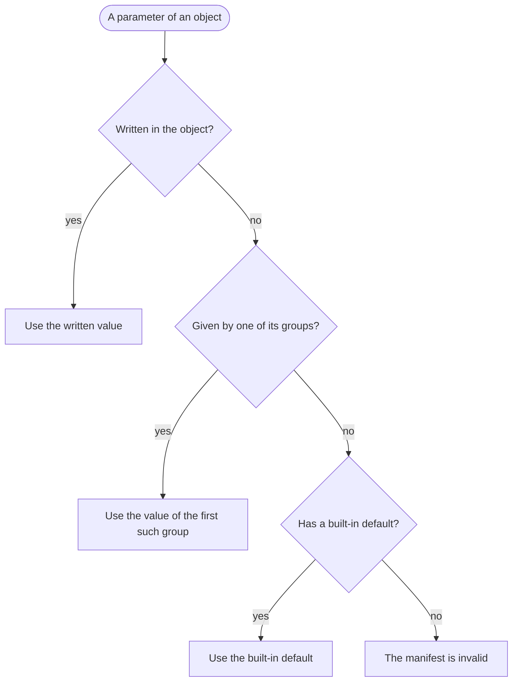

# Groups

A group is a set of objects of one type in the manifest, such as a region of suppliers
or a segment of products.

A group gives default values to its members, so a number shared by a region or a
segment is written once. A value written in an object wins over the value of its group,
and the value of a group wins over the built-in default. A group can be the target of a
disruption or a demand shape, such as an outage of a whole region. Every measure kept
per object is also kept per group.

## What a group is

- A group has an identifier, a `kind` and optional `defaults`.
- The kind is a free word, such as `region`, `segment`, `tier` or `category`. It is not
  `customer` or `product`.
- A group has members of one type only: materials, components, products, suppliers,
  customers or lines. Materials, components and products are three different types.
- A group has at least one member.
- An object lists its groups under the key `groups`, at most one group of each kind. An
  object can be in several groups of different kinds.
- The words `materials`, `components`, `products`, `all`, `written` and `default` are
  not group identifiers.

The example factory has ten groups:

| Group | Kind | Members |
| --- | --- | --- |
| `emea`, `apac`, `amer` | region | suppliers |
| `new-devices`, `spare-parts` | segment | products |
| `semiconductor`, `passive`, `connector`, `display`, `mechanical` | category | materials |

A hidden parameter group of a scenario is not a group in this sense: it names a
parameter to keep from the agent (see [Information](information.md)).

## Defaults

A group gives defaults only under the keys its members use:

| Members | Keys of `defaults` |
| --- | --- |
| materials | `items`, `catalogue` |
| components | `items`, `line_items` |
| products | `items` (`common_share` included), `line_items`, `customer_products` |
| suppliers | `catalogue` |
| customers | `customers`, `customer_products` |
| lines | `lines`, `line_items` |

- A default is a numeric parameter. Discounts cannot be defaults.
- A parameter that cannot be a range is given by a group as a fixed number only.
- A range given by a group is drawn separately for every member. Two members of one
  group can draw two different values.

## Which value wins

A parameter of an object takes the first value found in this order:

1. the value written in the object;
2. the defaults of its groups, in the order the object lists them;
3. the built-in default, for an optional parameter.

A required parameter with no value from any of the three makes the manifest invalid.

Some parameters belong to two objects at once. Their groups are searched in this
order:

- a catalogue entry: the groups of the supplier, then the groups of the material;
- a customer product: the groups of the customer, then the groups of the product;
- a line item: the groups of the line, then the groups of the item.

The world records where each value drawn once per run came from: `written`, the
identifier of a group, or `default`. A value drawn for each event, such as
completeness, follows the same rule of groups and is not in the world. The description
shows the groups as written, and every member with its own value.

For a catalogue entry, a customer product or a line item, "its groups" means the groups
of both objects, in the order above.

## Groups as targets

A group is written as a target in the form `{"<kind>": "<identifier>"}`, such as
`{"region": "apac"}`. Its kind must match the group. It stands for every member of the
group.

- A disruption can target a group whose members are of the type it acts on: a group of
  suppliers for an outage, of materials for a price change, of products for a demand
  shock, of lines for a capacity cut. See [Disruptions](disruptions.md).
- A demand shape and a forecast entry can target a group of customers or of products.
  See [Customers and demand](customers-and-demand.md).
- A warehouse can accept a group of items, written `{"group": "<identifier>"}` in its
  `accepts` list. See [Warehouses and routes](warehouses-and-routes.md).

## Measures per group

Every measure kept per customer, product, supplier and material, line or item is also
kept per group, under the key `groups.<identifier>`.

- A flow or a level of a group is the sum over its members. For a measure kept per
  pair of objects, such as a supplier and a material, the group sums every pair that
  holds one of its members.
- The `condition` of a group of lines is the mean of the conditions of its members.
- A ratio of a group, such as `on_time_share`, is computed from the sums of its
  numerators and denominators over the members, not as a mean of the members' ratios.
- An object in groups of several kinds counts in each of them.

So a study can compare the on-time share of the segments `new-devices` and
`spare-parts`.

## Worked example

A run of `steady-market` on the example factory with seed 0, with no decisions.
The values below are read from the world of the run after its end.

The lead time of `microchip` from `apac-chips`:

1. The catalogue entry writes no `lead_time`.
2. The supplier `apac-chips` is in the group `apac`, which gives a lead time from 3
   to 5. The material `microchip` is in the group `semiconductor`, which gives no lead
   time. So the value comes from `apac`.
3. The range is drawn for this entry alone: 4 for seed 0. The world records
   `"origin": "apac"` and `"drawn": true`.

The same group gives the two entries of `apac-displays-plastics` their own draws:
3 for `lcd-panel` and 5 for `plastic-resin`.

Other values of the same catalogue entry come from other places:

- the completeness, a range from 0.97 to 1 drawn for each delivery, comes from
  `semiconductor`, the group of the material, because neither the entry nor `apac`
  gives one; it is not in the world;
- the cancellation fee, 0.65, is written in the entry.

A written value wins over the group: `amer-metals` is in the group `amer`, which gives
a lead time of 3. Its entry for `copper-wire` takes 3, with origin `amer`. Its entry for
`passive-kit` writes a lead time of 1, which wins, with origin `written`.

A built-in default fills what no one writes: `module-assembly-line` writes no overtime
hours and its groups give none, so it has 0, with origin `default`.

The products `smart-monitor` and `sensor-gateway` are in the segment `new-devices`.
Every customer product of them takes a patience of 2 and a late penalty of 12 from that
group. Over the run, `units_ordered` is 5089.545 for `smart-monitor` and 4263.654 for
`sensor-gateway`; for the group `new-devices` it is 5089.545 + 4263.654 = 9353.199.
