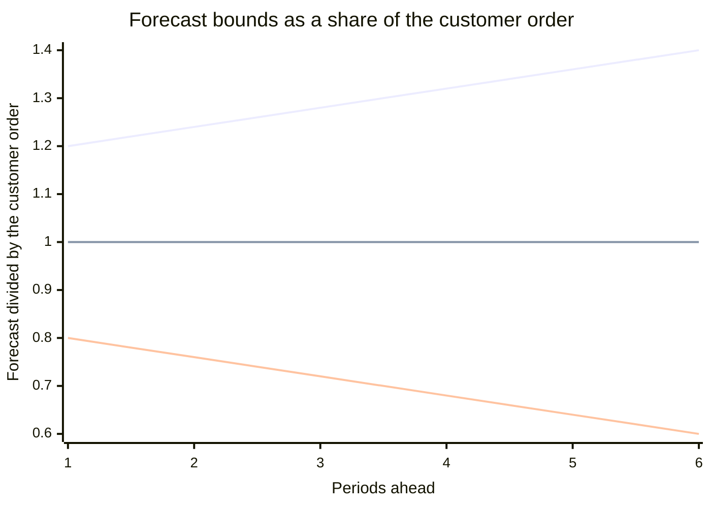
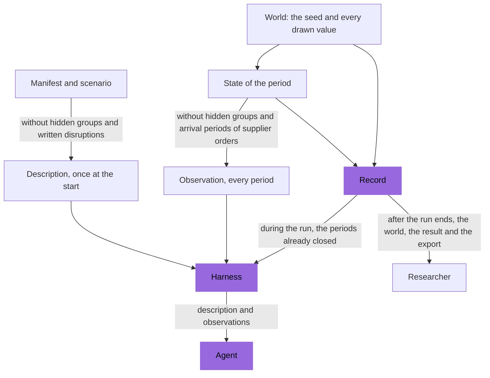

# Information

The agent knows the rules of the factory, not the future. It gets a description of the
factory once, at the start of a run, and an observation at the start of every period.
It never sees the seed or a value drawn for a coming period. A scenario sets three more
things about information: the parameters it hides, the notice of each disruption and
the forecasts of demand with their noise. During a run the HTTP interface shows the
description, the observation and the periods already closed; the world and the result
can be read only once the run ends.

## The description

The agent gets the description once, at the start of the run. The HTTP interface holds
it in `description` of the run, in the responses of `POST /api/v1/runs` and
`GET /api/v1/runs/{id}`. It has three parts.

- `manifest`: the factory. Identifiers, recipes, lines, warehouses, routes, groups and
  the structure of the factory are always shown.
  - A parameter that a scenario may hide is shown as its range, never as the value drawn
    for the run. Examples: the yield of a line and item, the punctuality of a supplier.
  - Every other parameter is shown with the value drawn for the run. Examples: prices,
    lead times, costs and capacities.
  - A price drawn anew every period is shown as its range, with `drawn: period`. Its
    value of the current period is in the observation.
  - A hidden parameter is not shown at all.
- `scenario`: the horizon, the starting state, the demand shapes, the forecast
  parameters, the rules of random disruptions and the list of hidden parameter groups.
- `linear`: true when the manifest is linear.

Every range in the description carries `cut_mean`, the mean of its distribution cut to
`min` and `max`, rounded half to even to 6 decimal places. A normal range keeps its own
`mean`, the uncut mean. A lognormal demand of `median` 35 and `spread` 0.4, cut to 14
to 70, has the `cut_mean` 36.222159.

The description never holds the written disruptions, the disruptions drawn from the
random rules, the seed, or the name and description of the scenario.

## The observation

An observation comes at the start of every period, from
`GET /api/v1/runs/{id}/observation` or in the response to the submission of the
previous period. It holds the whole state the agent may see. No list is shortened.

| Key | What it holds |
| --- | --- |
| `period`, `horizon`, `finished` | Where the run is. |
| `cash` | The cash now. |
| `receivables` | Every receivable not yet paid: shipment, customer, amount and the period of payment. |
| `stock` | The stock of every item each warehouse accepts, 0 included. |
| `space` | For each warehouse, the space its stock uses, the space reserved for production not yet in stock, open supplier orders and transfers on the way to it, and its capacity. |
| `lines` | For each line, its condition, the item it is set for, and the regular, repair and overtime hours it has in the period. |
| `production` | Every production not yet in stock: line, item, recipe, started quantity and ready period. |
| `plans` | Every plan not yet started, with its start period and the keys of its produce decision. |
| `transfers` | Every transfer on the way: item, quantity, source, destination and arrival period. |
| `customer_orders` | Every open customer order: customer, product, quantity, quantity shipped, arrival, due and last period. |
| `supplier_orders` | Every open supplier order: supplier, material, warehouse, quantity, open quantity, unit price, express or not, the period it was placed and its expected arrival. |
| `forecasts` | The forecasts of demand, for each pair of customer and product the scenario targets. |
| `prices` | The price of the current period of every supplier and material whose price is drawn every period. |
| `disruptions` | Every visible disruption: identifier, kind, target, start, effect and, unless hidden, duration. |
| `outcomes` | The outcome of every decision and plan executed in the previous period. |
| `events` | Every event since the previous observation, such as deliveries, new customer orders, breakdowns, finished production, penalties, storage cost and interest. |

- The expected arrival of a supplier order placed by a buy decision is the period it
  was placed plus its lead time, or its express lead time. A delay is not in it. A
  supplier order of the starting state shows the arrival the scenario writes.
- The events show what happened: a delivery with the quantities ordered, arrived,
  accepted and lost and the payment; a breakdown with its loss; a production that
  entered stock with its good units and scrap.
- The events of the close of the last period appear only in the record.
- An observation holds no history. The agent keeps what it wants to remember; the
  record keeps everything.

## What is never shown

A customer order appears when the customer places it. A delivery shows its quantities
when it arrives. No decision shows them earlier: an express order brings its own
delivery values, never those of a normal order still on the way (see
[Suppliers](suppliers.md)).

Until the run ends, the HTTP routes of its world, result and export answer with 409
(see [Who may read what](#who-may-read-what)).

## Hidden parameter groups

A scenario can hide parameter groups, listed in `hidden`. Only these 9 groups can be
hidden:

| Group | What it hides |
| --- | --- |
| `customers.products.demand` | The demand of every customer and product, with its persistence and the common share of every product. |
| `suppliers.catalogue.punctuality` | The chance that a delivery is on time. |
| `suppliers.catalogue.delay` | The extra periods a late delivery takes. |
| `suppliers.catalogue.completeness` | The share of the open quantity that arrives in a delivery. |
| `suppliers.catalogue.acceptance` | The share of arrived units that pass inspection. |
| `lines.items.yield` | The share of started units that come out good. |
| `lines.breakdown_chance` | The chance of a breakdown of a line in a period. |
| `lines.breakdown_loss` | The share of condition a breakdown takes. |
| `disruptions.duration` | The duration of disruptions. |

- A hidden group is left out everywhere: from every object that has it, from the
  defaults of every group, and from the observation.
- With `disruptions.duration` hidden, a visible disruption shows no duration, the rules
  of random disruptions show no duration, and no forecast holds a demand shock.
- Realized outcomes stay visible: the loss of a breakdown, the good units and scrap of
  finished production, the quantities of a delivery and the quantity of a customer
  order.
- A forecast of a pair whose demand is hidden is allowed.

A study can vary the hidden groups as a factor of information.

## Notice of disruptions

A disruption is visible from period `start - notice`. With the default notice of 0, it
is visible from its start period.

- A visible disruption appears in `disruptions` of every observation from its first
  visible period to its last active period. It shows its kind, its target as a list of
  identifiers, its start, its effect and, unless hidden, its duration.
- A random rule keeps every start it draws. A start in a period up to `notice` is
  visible from period 1, so it has less than its full notice.
- A forecast never shows a disruption before it is visible.
- In the scenario `notice`, no delivery of `apac-chips` arrives and no supplier sells
  `microchip-b` in periods 10 to 41, each with a notice of 4. Both disruptions are
  visible from period 6.

See [Disruptions](disruptions.md).

## Forecasts

A scenario may give forecasts of demand. Each entry of `forecasts` has a target of
pairs of customer and product, `periods_ahead`, `noise` and `noise_growth`. A pair has
at most one entry; a pair with no entry has no forecast.

In period t, for each targeted pair and each k from 1 to `periods_ahead` with t + k at
most the horizon, the observation holds a forecast of period t + k:

- It starts from the quantity of the customer order the pair will place in period
  t + k, without the demand shocks not yet visible in period t.
- It multiplies that quantity by `1 + e`, rounds it to 3 decimal places and keeps it at
  or above 0.
- e is the sum of k increments, each drawn with equal chance over its range and
  rounded to 4 decimal places: one between `-noise` and `noise`, and k - 1 between
  `-noise_growth` and `noise_growth`. So e lies between `-w` and `w`, with
  `w = noise + noise_growth * (k - 1)`, and near 0 more often than near `-w` or `w`.
- The increments of a coming period are drawn once. The forecast of that period made
  one period later drops the increment drawn for the farthest distance, so it changes
  from period to period and the range of its error narrows.

With `noise` and `noise_growth` both 0, the forecast equals the coming customer order,
unless a demand shock not yet visible changes it. Larger values give larger errors, and
forecasts further ahead have larger errors. The forecasts are part of the world, so
every agent in the same world sees the same forecasts.

The observation writes them as
`{"<customer>/<product>": [{"period", "quantity"}, ...]}`. In the last period every list
is empty.

The scenario `forecasts` of the library targets every pair 6 periods ahead, with
`noise` 0.20 and `noise_growth` 0.04. A forecast 1 period ahead is within 20 percent of
the customer order; one 6 periods ahead is within 40 percent.



The upper line is the highest forecast, the lower line the lowest, and the middle line
a forecast with no error. Every forecast lies between the upper and the lower line.
Most forecasts lie near the middle line.

## Who may read what

The harness gives the agent the description and observations of its run, closed
periods, check outcomes and only the HTTP routes of its run. The manifest and scenario
routes, `GET /api/v1/manifests/{id}` and `GET /api/v1/scenarios/{id}`, answer any
client, with written disruptions and hidden parameters. The run shows its
`scenario_id`, so a client that knows the seed can start a twin run and read the
future customer orders. The scenario library ships in the package, so a study that
needs surprise uses scenarios of its own. The reference optimizer is given the world of
a finished no-decisions run with the same scenario and seed.



The HTTP interface answers a run like this:

| Route | During the run | After the run ends |
| --- | --- | --- |
| `GET /api/v1/runs/{id}`: the run and its description | yes | yes |
| `GET /api/v1/runs/{id}/observation` | yes | no, answered with 409 |
| `GET /api/v1/runs/{id}/periods`: every closed period | yes | yes |
| `GET /api/v1/runs/{id}/world`: the seed and every drawn value | no, answered with 409 | yes |
| `GET /api/v1/runs/{id}/result`: profit, measures and the seed | no, answered with 409 | yes |
| `GET /api/v1/runs/{id}/export` | no, answered with 409 | yes |

The run in a response of the HTTP interface never holds the seed, the world or the
state.

## Varying the information

What the agent knows is a factor a scenario sets in 3 ways.

| Factor | Key of the scenario | Example levels |
| --- | --- | --- |
| Hidden parameters | `hidden` | none hidden; the yield hidden; the yield, punctuality and demand hidden |
| Forecasts | `forecasts`, with `noise` and `noise_growth` | no forecast; `noise` 0.4; `noise` 0 |
| Notice of disruptions | `notice` of each disruption | 0, seen when it starts; 4, seen 4 periods before it starts |

To make such a variant, read a scenario of the library, change one key and post it as
a new scenario of the same factory, with a new name:

```python
steady_body = call("GET", f"/scenarios/{steady['id']}")["content"]
variant = dict(
    steady_body, name="steady-market-hidden-yield", hidden=["lines.items.yield"]
)
hidden_yield = call("POST", f"/manifests/{factory['id']}/scenarios", variant)
```

`call` is the function of the harness in [Quick start](../start/quick-start.md);
`factory` and `steady` are found there too. The response is 201 with the new scenario,
or 200 when the same scenario is already stored. The scenario library itself does not
change. Run the variant and the original with the same seeds: the two differ in the
factor only. A variant that changes the `notice` of a written disruption may number its
written disruptions in another order.

## Worked example

A run of `forecasts` on the example factory with seed 0. In period 1 the observation
holds 6 forecasts for `equipment-maker/industrial-controller`, one for each of periods
2 to 7. The bound w is 0.20 + 0.04 x (k - 1) for k periods ahead. The errors e are in
`forecast_errors` of the world, which can be read once the run ends.

| Periods ahead | Period | w | e | Customer order | Forecast |
| --- | --- | --- | --- | --- | --- |
| 1 | 2 | 0.20 | -0.0662 | 33.833 | 31.593 |
| 2 | 3 | 0.24 | -0.0889 | 31.094 | 28.330 |
| 3 | 4 | 0.28 | 0.1125 | 30.442 | 33.867 |
| 4 | 5 | 0.32 | -0.0116 | 28.344 | 28.015 |
| 5 | 6 | 0.36 | 0.0995 | 29.705 | 32.661 |
| 6 | 7 | 0.40 | 0.0208 | 30.007 | 30.631 |

For period 2: 33.833 x (1 - 0.0662) = 31.593. In period 2 the forecast of period 3 is
1 period ahead, so it drops the increment of distance 2, -0.0889 - (-0.0592) = -0.0297.
Its e is -0.0592 and it reads 31.094 x (1 - 0.0592) = 29.253.

```mermaid
gantt
    title Forecast windows published in each period
    dateFormat X
    axisFormat %s
    section Published in period 1
    Forecast covers periods 2 to 7 : p1, 2, 8
    section Published in period 2
    Forecast covers periods 3 to 8 : p2, 3, 9
```


