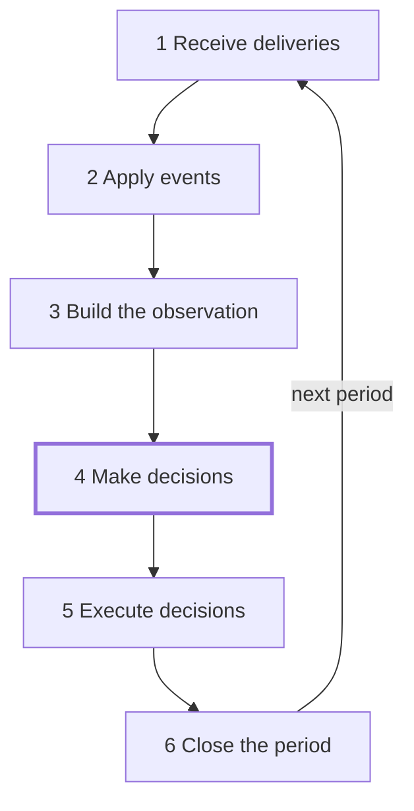

# Period

Every period runs the same six steps in the same order. The agent acts in step 4 only;
the other steps follow the rules of the factory.

## The six steps

1. Receive deliveries. Supplier orders due in the period arrive at their warehouses
   and are paid. Transfers due in the period arrive.
2. Apply events. Customers pay what is due. Disruptions start or end. Lines may break
   down. Customers place new customer orders.
3. Build the observation. The simulator writes what the agent may see. It
   changes nothing.
4. Make decisions. The agent reads the observation and sends the decisions of
   the period.
5. Execute decisions. Each decision is checked and, if it passes, carried out. Ship
   decisions come first, then cancel, transfer, repair, produce and buy decisions.
6. Close the period. Production that is ready enters stock, lines wear, storage is
   paid, late orders pay a penalty and orders past their patience are lost, interest is
   paid or earned, and the measures are recorded.

## When an arrived item can be used

A delivery arrives in step 1, before the decisions. Materials that arrive in a period
can be used by production decided in the same period. A transfer that arrives in step 1
can be shipped in the same period.

## When production enters stock

Production enters stock in step 6 of its ready period. With a lead time of 1, a
production started in a period enters stock at the close of that period, and its units
can be used or shipped from the next period. With a lead time of 2 it enters stock at
the close of the following period. The hours of the line are used in the period the
production starts.

```mermaid
gantt
    title A production with lead time 2 started in period 5
    dateFormat X
    axisFormat %s
    section Line
    Hours used : hours, 5, 6
    section Production
    Not yet in stock : making, 5, 7
    section Stock
    Usable : usable, 7, 9
```

## What is known at the moment of deciding

When it decides, the agent knows:

- the description: the factory and the scenario as far as the scenario shows them;
- the observation of the period: cash, stock, the hours each line has left, open
  customer and supplier orders, production not yet in stock, plans, transfers on the
  way, visible disruptions and forecasts;
- the outcomes of its decisions of the last period and the events since then.

It does not know the drawn values of the world: future demand, whether a delivery will
be late or short, the yields, the breakdowns, or disruptions not yet visible.

## Worked example

A run of `steady-market` on the example factory with seed 0, in which the agent buys
printed circuit boards in period 1 and makes control boards in period 3.

- Period 1, step 5: buy 500 `pcb-blank` from `emea-electronic-parts` into `main-plant`
  at 3.8 each. The supplier order `buy-1-1` is placed with a lead time of 2, so it is
  expected in period 3. Nothing is paid yet.
- Period 3, step 1: the order arrives. Of the 500 units, 490.05 arrive and 9.95 are
  held back; of those that arrive, 481.964 pass acceptance. The factory pays
  481.964 x 3.8 = 1831.4632. The 9.95 held back are due one period later.
- Period 3, step 5: produce 400 `control-board` on `smt-line` with the standard recipe:
  800 `microchip`, 400 `pcb-blank` and 400 `passive-kit` leave stock at once. The line
  is set for no item, so it changes over to `control-board` for 2 hours and 300. The
  line uses 2 + 400 x 0.14 = 58 hours, and the factory pays 300 + 400 x 4.9 = 2260.
- Period 3, step 6: with a lead time of 1 the production enters stock at the close of
  the period: 395.16 good units and 4.84 scrap.
- Period 4, step 1: the 9.95 held back arrive and 9.786 pass acceptance. The 395.16
  control boards can now be used on the final assembly line.
