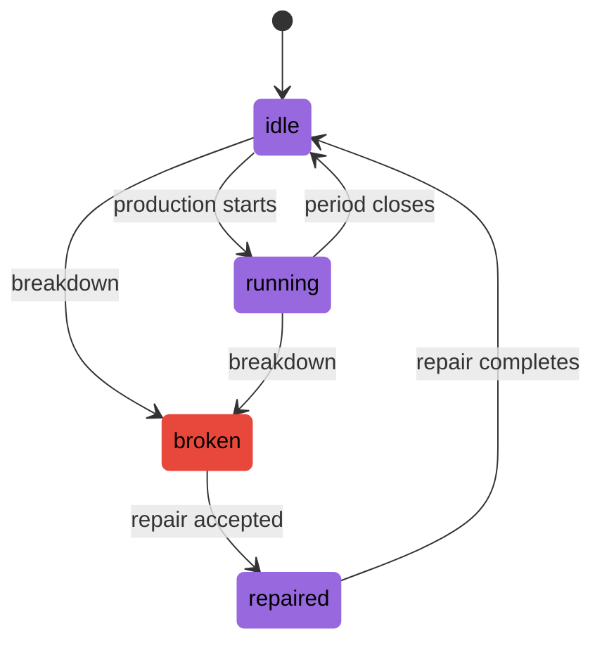
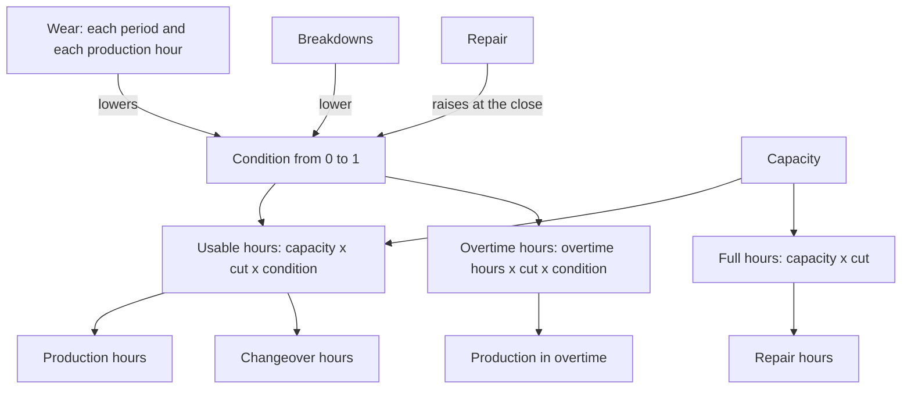

# Production

Lines turn materials into components and components into products.

A recipe says which items, and how many, make one unit of a component or a product.
A line makes some items at one warehouse, and it can use its capacity times its
condition in production hours each period. The condition falls every period and with
every production hour, falls at once in a breakdown, and rises only through a repair
the agent pays for. Overtime adds a few extra hours at a cost per hour. Of the
units started, a share drawn every period comes out good and the rest is scrap.

## Recipes

- A recipe lists the input items and their quantities for one unit of a component or a
  product. A component is made from materials only; a product from components only.
- Every item a line makes has at least one recipe. An item may have several named
  recipes. In the example factory, `control-board` has the recipe `standard` with
  `microchip` and the recipe `alternative` with `microchip-b` from another supplier.
- An item with several recipes names its default recipe. A produce decision that names
  no recipe uses it.
- The inputs leave stock at once when the production starts. The quantity of each
  input is the quantity started times the recipe quantity, rounded up to 3 decimal
  places.

## Lines

- A line works at one warehouse. Its inputs come from that warehouse, and the items it
  makes go to it.
- A line has a list of items it can make. For each item it has the hours per unit, the
  cost per unit, the yield and the production lead time.
- One item may be made on more than one line. In the example factory, `power-module` is
  made on `smt-line` in 0.112 hours per unit and on `module-assembly-line` in 0.18
  hours.

A line can produce while it is working; a breakdown makes it unavailable until a
repair restores its condition.

## Hours and condition

- Capacity is the number of production hours a line has in one period at condition 1.
- Condition is a number from 0 to 1. At condition 0.5 a line has half its capacity for
  production; at 0 it makes nothing.
- Condition changes only the hours. It never changes the yield.
- In each period a line has three limits on its hours. "Cut" is the share of capacity
  left by the capacity cuts that act in the period, 1 when none acts (see
  [Disruptions](disruptions.md)).
  - Regular production hours plus changeover hours are at most capacity x cut x
    condition.
  - Regular production hours, changeover hours and repair hours together are at most
    capacity x cut.
  - Overtime hours are at most overtime hours of the line x cut x condition.
- Each limit is rounded down to 3 decimal places. The observation shows the three
  limits as `regular_hours_available`, `repair_hours_available` and
  `overtime_hours_available`.
- Hours belong to one period. Hours not used are lost. The hours of a production are
  used in the period it starts, whatever its lead time.

## Wear

- At the close of every period the condition of each line becomes:
  condition x (1 - wear per period) - wear per hour x production hours + repairs.
- Production hours are the regular and overtime hours of production started on the
  line in the period. Repair and changeover hours do not wear the line.
- The new condition is rounded down to 12 decimal places.
- A line never recovers on its own.
- The manifest is checked so that wear per hour x (capacity + overtime hours) is at
  most 1 - wear per period, with the largest value of each range. So wear never takes
  the condition below 0.

## Breakdowns

- A breakdown takes a share of the condition of a line: the condition is multiplied by
  (1 - loss), and rounded down to 12 decimal places.
- Breakdowns happen when events are applied, before the agent decides. The
  observation of the period already shows the lower hours.
- A breakdown comes from three sources, in this order: a written `line_breakdown`
  disruption, a random `line_breakdown` disruption, and the chance of a breakdown of the
  line in each period, `breakdown_chance`, with a loss drawn for each breakdown,
  `breakdown_loss`.
- A breakdown with a loss of 1 stops the line: its condition is 0 and it has no
  production hours until it is repaired.
- A breakdown does not change production already started. That production finishes and
  enters stock as planned.
- Whether a line breaks down does not depend on how much it is used. Use lowers the
  condition through wear only.

## Repair

- A repair decision names a line and an amount of condition to restore.
- The amount is added to the condition at the close of the period, after wear.
- The amounts repaired on one line in one period add up to at most its
  `repair_limit`.
- They also add up to at most 1 minus the condition at the moment of deciding. So the
  condition never goes above 1.
- A repair takes amount x `repair_time` hours. These hours count against capacity x
  cut, not against condition. Condition does not limit a repair; the hours left within
  capacity x cut do, so a capacity cut of strength 1 stops every repair while it acts.
- A repair costs amount x `repair_cost`, paid when it is decided.
- Repairs run before production in the order of execution. A repair is therefore
  checked before any production hour of the period is used.

## Overtime

- A line with `overtime_hours` above 0 can produce in overtime. Each overtime hour
  costs `overtime_cost`.
- A produce decision with `overtime` set to true uses only overtime hours for its
  production. Its changeover, if any, still uses regular hours.
- Overtime hours wear the line like regular production hours.
- In the example factory, `smt-line` and `final-assembly-line` have 16 overtime hours
  at 55 per hour. The other two lines have none.

## Changeovers

- A line remembers the item it is set for. At the start of a run it is set for the item
  the scenario names, or for none.
- When a line item has a changeover time or a changeover cost, a production of that
  item on a line set for another item, or for none, first pays a changeover.
- The changeover hours come from the regular hours. The changeover cost is paid with
  the production.
- After a production starts, the line is set for its item. Making a plan does not
  change what the line is set for; running it does.
- Produce decisions of a line run in the order given. So the order matters: on the
  example factory, with `smt-line` set for `control-board` and every changeover at
  2 hours and 300, producing `power-module`, then `control-board`, then
  `power-module` pays 3 changeovers, 6 hours and 900. Producing `control-board`, then
  `power-module` twice pays 1 changeover, 2 hours and 300.
- A manifest with a changeover is an economies-of-scale manifest.

## Yield and scrap

- The yield is the share of started units that come out good. It is drawn for every
  line, item and period.
- A production uses the yield of its start period, times `1 - strength` of every
  `yield_drop` disruption on the line in that period.
- The productions of one line and item started in one period form a batch, whatever
  their recipes and overtime.
- Good units of a batch = started units of the batch x yield, rounded half to even to 3
  decimal places. At a yield of 0.6, one production of 1 board and 1000 productions of
  0.001 boards both give 0.6 good boards.
- In the order of their identifiers, each production of a batch gets the rounded good
  units of the batch up to and including it, less the rounded good units of the batch
  before it. At a yield of 0.6 the first three productions of 0.001 get 0.001, 0 and
  0.001. Scrap of a production = its started units - its good units.
- The inputs of scrap are lost. The production cost is paid on every started unit,
  scrap included.

## Production lead time

- A production started in period t enters stock at the close of period
  t + lead time - 1. With a lead time of 1 it enters stock at the close of its start
  period.
- The lead time of a line item is 1 unless the manifest gives another. Every item of the
  example factory has a lead time of 1.
- Until it enters stock, a production holds the space of its started units in the
  warehouse of the line (see [Warehouses and routes](warehouses-and-routes.md)).

## Costs of a production

A production is paid when it starts, in this order:

1. quantity x `cost` of the line item;
2. with overtime, quantity x hours per unit x `overtime_cost`;
3. the changeover cost, if any.

## Plans

- A produce decision with a `start` after the current period becomes a plan.
- When it is made, a plan is checked only for its start period, its line, its item and
  its recipe. Hours, inputs and space are checked when it runs.
- A plan runs in its start period, before the produce decisions of that period, in the
  order of its identifier. It may then be rejected like any produce decision.
- A plan can be cancelled before it runs, without a fee.

See [Decisions](decisions.md) for the checks and the reasons of rejection.

Production and changeover hours share the usable hours. Production, changeover and
repair hours together share the full hours.

## Worked example

A run of `steady-market` on the example factory with seed 0. The agent makes 400
control boards in period 3 and repairs `smt-line` in period 4, and decides nothing
else.

The line `smt-line` has capacity 80, wear per period 0.005, wear per hour 0.0005,
repair time 16, repair cost 2500 and repair limit 0.5. A control board takes 0.14 hours
and costs 4.9, and a changeover to it takes 2 hours and costs 300. The line starts set
for no item. No breakdown hits the line in periods 1 to 5.

- Period 1: condition 1, so 80 regular hours. Nothing is made.
- Close of period 1: 1 x (1 - 0.005) = 0.995.
- Close of period 2: 0.995 x 0.995 = 0.990025.
- Period 3: regular hours available 80 x 0.990025 = 79.202. Produce 400 `control-board`
  with the standard recipe: 800 `microchip`, 400 `pcb-blank` and 400 `passive-kit`
  leave stock. The line uses 400 x 0.14 = 56 production hours and 2 changeover hours,
  58 of its 79.202. The factory pays 400 x 4.9 = 1960 and the changeover 300. The line
  is now set for `control-board`.
- Close of period 3: the yield of `smt-line` and `control-board` drawn for period 3 is
  0.9879. Good units 400 x 0.9879 = 395.16; scrap 400 - 395.16 = 4.84. The changeover
  hours do not wear the line, so the condition becomes
  0.990025 x 0.995 - 0.0005 x 56 = 0.985074875 - 0.028 = 0.957074875.
- Period 4: regular hours available 80 x 0.957074875 = 76.56599, rounded down to
  76.565. Overtime hours available 16 x 0.957074875 = 15.313. Repair 0.04: it uses
  0.04 x 16 = 0.64 of the 80 full hours and costs 0.04 x 2500 = 100.
- Close of period 4: nothing was made, so the condition becomes
  0.957074875 x 0.995 + 0.04 = 0.952289500625 + 0.04 = 0.992289500625.
- Period 5: regular hours available 80 x 0.992289500625 = 79.383.
