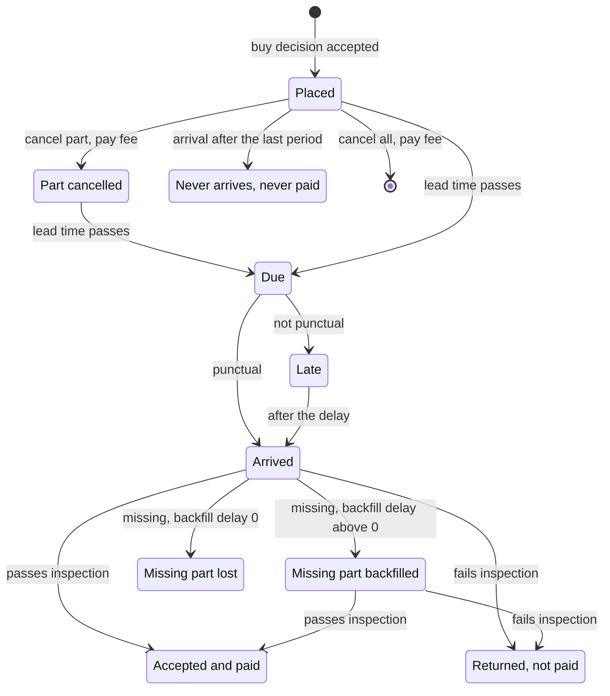

# Suppliers

Suppliers sell materials to the factory.

Each supplier has a catalogue: the materials it sells, each with a price, a lead time
and how reliably it delivers. A buy decision places a supplier order, and nothing is
paid until it arrives. A delivery may be late, may arrive short, and may hold units that
fail inspection. The factory pays only for accepted units, at the price fixed when the
order was placed. An order can be cancelled before it arrives, for a fee per unit. An
express order arrives sooner for an extra price. Only an economies-of-scale manifest has
minimum quantities and discounts.

## The catalogue

Each entry of a catalogue has these parameters:

| Key | Meaning | Drawn |
| --- | --- | --- |
| `price` | Price of one accepted unit. | once per run, or every period |
| `lead_time` | Periods from placing an order to its arrival when it is on time. At least 1. | once per run |
| `max_quantity` | Largest quantity of the material ordered from this supplier in one period. | once per run |
| `punctuality` | Chance that a delivery is on time. | once per run |
| `delay` | Extra periods of a late delivery. At least 1. | once per placing period |
| `completeness` | Share of the open quantity that arrives. | once per placing period |
| `acceptance` | Share of the arrived quantity that passes inspection. | once per placing period |
| `backfill_delay` | Periods after a delivery when the missing part arrives. 0 loses the missing part. Optional, default 0. | once per run |
| `express_lead_time` | Lead time of an express order, at least 1 and below `lead_time`. Optional. | once per run |
| `express_cost` | Extra price per unit of an express order. Given exactly when `express_lead_time` is given. | once per run |
| `cancellation_fee` | Fee per cancelled unit. Optional, default 0. | once per run |
| `min_quantity` | Smallest quantity of one order. Optional. | once per run |
| `discounts` | A list of tiers, each a quantity `from` and a `price`. Optional. | once per run |

A parameter is a fixed number or a range. A catalogue entry may take its values from the
groups of its supplier and of its material, such as a region of suppliers or a category
of materials; see [Groups](groups.md). Two suppliers may sell the same material, each
with its own price, lead time and draws.

## Prices

A price is drawn once per run by default. A range of a price with `drawn: period` is
drawn for every period instead. Every price of every period is drawn from the seed
before period 1, so no decision changes it.

- The description shows the range of a price drawn every period.
- The observation shows, in `prices`, the price of the current period only.

A supplier order keeps the unit price of the period in which it is placed, whatever the
period of its arrival. An agent can therefore buy ahead when a price is low. The example
factory draws no price every period.

## The unit price of an order

The unit price of an order is fixed when the order is placed:

1. Take the catalogue price of the period, or the price of the highest discount tier the
   quantity reaches.
2. Multiply it by the factor of every active `price_change` disruption of the material
   and round it to 4 decimal places.
3. For an express order, add `express_cost`.

## Placing an order

A buy decision names the supplier, the material, the quantity, the warehouse and,
optionally, `express`. It is checked in this order and rejected at the first rule it
breaks:

- the supplier does not exist (`unknown_supplier`);
- the material is not in its catalogue (`not_in_catalogue`);
- the warehouse does not exist (`unknown_warehouse`) or does not accept the material
  (`not_accepted`);
- it asks for express and the entry has no express lead time (`no_express`);
- the quantity is below the minimum quantity (`below_min_quantity`);
- the quantity, plus the orders of the same material from the same supplier already
  accepted in the period, is above the largest quantity (`over_max_quantity`);
- the warehouse has no space for the whole quantity (`not_enough_space`); see
  [Warehouses and routes](warehouses-and-routes.md);
- its cost would take cash, less what the open supplier orders still owe, below minus
  the credit limit (`over_credit_limit`); see [Cash and profit](cash-and-profit.md).

The largest quantity counts express and normal orders together.

An accepted buy decision creates a supplier order with the identifier
`buy-<period>-<n>`. Until it arrives, the open quantity of the order holds its space in
the warehouse and counts against the credit limit at its unit price.

## One draw per kind of order and period

For each supplier, material and placing period, the world holds one set of delivery
values for normal orders: whether the delivery is punctual, its delay, its completeness
and its acceptance. An entry with an express lead time has a second set for express
orders, drawn on its own. Both are drawn before period 1, for every period, whether or
not an order is placed.

All normal orders of one material placed with one supplier in the same period share the
first set, and all express orders the second. Splitting an order does not change whether
it is late or short. An express order shows only its own set: what it brings tells
nothing about a normal order of the same period that is still on the way. An order of
the same material from another supplier, or in another period, has its own sets.

## Punctuality and delay

An order arrives in the period of placing plus its lead time, or plus its express lead
time for an express order. When the draw of its kind of order and period is not
punctual, the order arrives `delay` periods later. A `transport_delay` disruption of the
supplier, active in that period of arrival, adds its own delay.

A delivery that would arrive after the last period never arrives and is never paid.

The observation shows each open supplier order with its expected arrival: the period of
placing plus the lead time used, or the written arrival of a starting supplier order. It
does not show whether the delivery will be late, nor the period of a backfill.

## Completeness and backfill

A delivery brings the open quantity times completeness. The rest is missing.

- With `backfill_delay` 0, the missing part is lost and the order closes.
- With `backfill_delay` above 0, the missing part stays open and arrives
  `backfill_delay` periods after the delivery. This later delivery is the backfill. A
  backfill brings its whole open quantity and closes the order.

A `supplier_outage` disruption holds back a share of what arrives, in a delivery or in a
backfill. The part held back is lost, never backfilled. A backfill is never delayed by a
`transport_delay`.

## Acceptance and payment

The accepted units are the arrived units times acceptance. A backfill uses the
acceptance drawn for the kind of the order and the period in which it was placed.

- Accepted units enter the stock of the warehouse of the order.
- The factory pays accepted units times the unit price of the order, in the same step.
- Units that fail inspection are returned and not paid.

Deliveries arrive in the first step of a period, before the decisions, so accepted units
can be used in the same period; see [Period](period.md).

## Delivery batches

The normal supplier orders of one supplier, material and warehouse placed in one period
that arrive in one period form a delivery batch, and so do the express ones. The
backfills of these orders form a delivery batch of their own. A batch rounds each of its
shares once, from its total:

- units sent = open units of the batch x completeness, rounded half to even to 3 decimal
  places;
- units arrived = units sent x the share every active `supplier_outage` leaves, rounded
  the same way;
- units accepted = units arrived x acceptance x the share every active `quality_drop`
  leaves, rounded the same way.

In the order of their identifiers, each order gets the units of the batch up to and
including it, less the units of the batch before it. At completeness 0.6, one supplier
order of 1 chip and 1000 supplier orders of 0.001 chips in one period both bring 0.6
chips; the first three orders of 0.001 bring 0.001, 0 and 0.001. Orders into two
warehouses, placed in two periods, or one normal and one express, are two batches.

## Starting supplier orders

A scenario can start a run with open supplier orders. Each is placed in period 0 at the
catalogue price, without discount or express, and arrives in full and accepted in the
period the scenario writes. Its price is the price of period 1 when the price is drawn
every period. No disruption acts on it. It can be cancelled like any other open order.

## Cancellation

A cancel decision names a supplier order and a quantity. It is rejected when:

- the order does not exist or is closed (`unknown_order`); an order placed in the
  current period does not exist yet, because cancel decisions run before buy decisions;
- it has no quantity (`wrong_quantity`);
- the quantity is above the open quantity of the order (`over_open_quantity`);
- it leaves part of the order open and the quantity ordered, less all cancellations,
  falls below the minimum quantity (`below_min_quantity`); starting supplier orders are
  not held to this rule;
- it leaves part of the order open and the quantity ordered, less all cancellations,
  falls below the `from` of the discount tier the order was priced at
  (`below_discount_tier`).

An accepted cancel decision lowers the open quantity at once and costs `quantity` times
`cancellation_fee`. The cancelled units free their space and no longer count against the
credit limit. An order with an open quantity of 0 closes. A cancelled unit never
arrives. A cancel decision can also take the open missing part that waits for its
backfill.

The fee is never above the lowest price of its catalogue entry, discounts included. With
a fee of 0, an order costs nothing to cancel before it arrives. Every catalogue entry of
the example factory has a fee of about one tenth of its price.

## Discounts

A discount tier gives a lower price to every unit of an order whose quantity reaches its
`from`. An order takes the price of the highest tier it reaches.

- Tiers rise in `from` and fall in price; the first tier is below the catalogue price.
- The `from` of a tier lies from `min_quantity` to `max_quantity`.
- A tier counts the quantity of one order, not of one period: two orders of 600 pay more
  per unit than one order of 1200 when a tier starts at 1000.

## Disruptions of suppliers

Five kinds of disruption act on these rules; see [Disruptions](disruptions.md).

| Kind | Effect |
| --- | --- |
| `supplier_outage` | Arriving quantity of the supplier times `1 - strength`; the rest is lost. |
| `quality_drop` | Acceptance of the supplier times `1 - strength`. |
| `transport_delay` | A delivery of the supplier that would arrive in an active period arrives `delay` periods later. |
| `material_shortage` | Largest quantity of the material at every supplier times `1 - strength`. |
| `price_change` | Price of the material at every supplier times `factor`, for orders placed while it acts. |

## What the agent sees

The description shows the catalogue, unless the scenario hides a parameter; see
[Information](information.md). Each observation shows, in `events`, every delivery and
backfill with its ordered, arrived, accepted and lost quantities and its payment. The
measures of suppliers include `units_ordered_from_suppliers`, `units_arrived`,
`units_accepted`, `units_rejected_at_inspection`, `units_lost_in_delivery`,
`units_cancelled`, `units_arrived_late`, `material_payment` and `cancellation_fee`.

## The life of a supplier order

At the end of a run, every unit of a supplier order is accepted, returned at inspection,
lost in delivery, cancelled, or still open and never arrived.

## Worked example

A run of `steady-market` on the example factory with seed 0. The supplier
`emea-electronic-parts` sells `pcb-blank` at 3.8000, with a discount tier from 1000
units at 3.6100. Its lead time is 2, its express lead time 1 and its express cost
0.9500. Its backfill delay is 1 and its cancellation fee 0.3800.

Period 1, two buy decisions into `main-plant`:

- `buy-1-1`: 1000 units. The quantity reaches the tier from 1000, so every unit costs
  3.6100 instead of 3.8000. It is expected in period 1 + 2 = 3.
- `buy-1-2`: 200 units, express. 200 is below the tier, so the unit price is 3.8000 +
  0.9500 = 4.7500. It is expected in period 1 + 1 = 2.
- Together 1200 units, within the largest quantity of 2500.

The world holds two sets of values for `emea-electronic-parts`, `pcb-blank` and
period 1. The normal order uses the set of normal orders: punctual, completeness 0.9801,
acceptance 0.9835. The express order uses the set of express orders: punctual,
completeness 0.9627, acceptance 0.9897.

Period 2, step 1, the express order arrives:

- arrived: 200 x 0.9627 = 192.54;
- accepted: 192.54 x 0.9897 = 190.556838, rounded to 190.557;
- paid: 190.557 x 4.75 = 905.14575;
- missing: 200 - 192.54 = 7.46, due in period 2 + 1 = 3.

Period 2, step 5, a cancel decision for 100 units of `buy-1-1` is rejected with
`below_discount_tier`, `asked` 100, `available` 0. It would leave 900 units, below the
tier of 1000 at which the order was priced. A cancel decision for all 1000 units would
pass, for a fee of 1000 x 0.38 = 380.

Period 3, step 1, `buy-1-1` arrives, then the backfill of `buy-1-2`:

- `buy-1-1`: 1000 x 0.9801 = 980.1 arrive; 980.1 x 0.9835 = 963.92835, rounded to
  963.928, are accepted; paid 963.928 x 3.61 = 3479.78008; 1000 - 980.1 = 19.9 are
  missing and due in period 4.
- Backfill of `buy-1-2`: 7.46 arrive; 7.46 x 0.9897 = 7.383162, rounded to 7.383, are
  accepted; paid 7.383 x 4.75 = 35.06925. The order closes.

Period 4, step 1, the backfill of `buy-1-1`: 19.9 arrive; 19.9 x 0.9835 = 19.57165,
rounded to 19.572, are accepted; paid 19.572 x 3.61 = 70.65492. The order closes.

Of the 1000 units of `buy-1-1`, 963.928 + 19.572 = 983.5 are accepted and paid, and 16.5
are returned at inspection.
