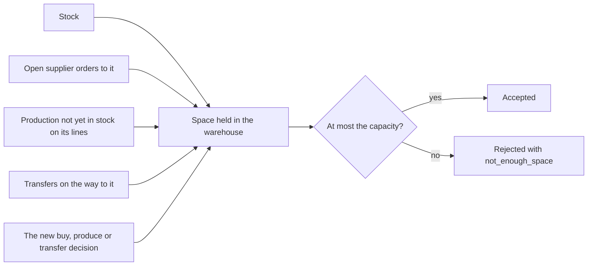

# Warehouses and routes

Warehouses hold the stock of the factory. Routes join them.

A warehouse has a capacity of space and accepts some kinds or groups of items. Every
unit of an item takes a fixed space. A buy, produce or transfer decision is rejected
when the warehouse it fills has no room for it, counting the stock and everything
already on its way there: open supplier orders, production not yet in stock and
transfers. A warehouse therefore never overflows, whatever the world draws. Every unit
in stock pays a storage cost each period, times a factor of its warehouse, and a
transfer carries stock along a route for a cost per unit and a lead time.

## Warehouses

The manifest lists one or more warehouses. Each has these parameters:

| Key | Meaning | Default |
| --- | --- | --- |
| `capacity` | Space the warehouse has. Above 0. | required |
| `storage_factor` | Factor on the storage cost of what it holds. Above 0. | 1 |
| `transport_factor` | Factor on the transport cost of shipments from it. Above 0. | 1 |
| `accepts` | `materials`, `components`, `products`, or groups of items written `{"group": "<id>"}`. | every item |

All four are fixed numbers or lists; none is drawn from a range.

Each line works at one warehouse: its inputs come from it and its output goes to it. A
buy decision names the warehouse its delivery goes to. A ship decision names the
warehouse the shipment leaves from. When the manifest has one warehouse, a decision may
leave the warehouse out.

## Space

Every item has a `space`: the space one unit takes, above 0. The space of a stock is
its quantity times the space of its item.

## What a warehouse accepts

A warehouse holds only the items it accepts: an item is accepted when its kind, or a
group it belongs to, is in `accepts`.

- A buy decision into a warehouse that does not accept the material is rejected with
  `not_accepted`.
- A transfer decision to a warehouse that does not accept the item is rejected with
  `not_accepted`.
- A manifest is refused when the warehouse of a line does not accept an input or the
  output of the line, when a material is accepted by no warehouse, or when an input
  cannot reach the warehouse of its line along routes through warehouses that accept
  it.
- A scenario is refused when its starting stock or starting supplier orders put an item
  in a warehouse that does not accept it.

## Open orders hold their space

The space held in a warehouse is the sum of:

- the space of its stock;
- the space of production not yet in stock on the lines of the warehouse, at the
  quantity started;
- the space of the open quantity of every supplier order to the warehouse;
- the space of every transfer on the way to the warehouse.

A buy, produce or transfer decision is rejected with `not_enough_space` when the space
held in the warehouse it fills, after the decision, would be above the capacity.

- A buy decision adds the space of its whole quantity.
- A produce decision takes its inputs out of stock and adds the space of its whole
  started quantity, both in the warehouse of its line.
- A transfer decision adds the space of its quantity to the destination.

The outcome of a rejection gives two numbers: `asked`, the space the decision would add,
and `available`, the capacity less the space held before the decision.

Ship, cancel, transfer, repair, produce and buy decisions run in this order, and each is
checked against the state the earlier ones leave. A shipment or a cancellation earlier
in a period frees space for a later decision of the same period; see
[Order of execution](decisions.md#order-of-execution).

A delivery never brings more than the open quantity of its order, and production never
yields more than it started. Units lost, returned at inspection or scrapped only free
space. So a warehouse never overflows, whatever the drawn values are. An order due in 10
periods holds its space from the period it is placed.

A scenario is refused when the starting stock and the starting supplier orders of a
warehouse take more space than it has.

The observation shows, for each warehouse, in `space`: `used`, the space of the stock;
`reserved`, the space of production not yet in stock, open supplier orders and
transfers on the way to it; and `capacity`. The free space is `capacity - used -
reserved`.

## Storage cost

Every item has a `storage_cost`: the cost of holding one unit for one period. At the
close of every period, after ready production has entered stock, the factory pays for
every warehouse and item the stock times `storage_cost` times the `storage_factor` of
the warehouse.

A transfer on the way pays storage at the factor of its destination. Production not
yet in stock and open supplier orders pay no storage.

## Transport factor

A shipment to a customer costs the `transport_cost` of the customer and product per
unit, times the `transport_factor` of the warehouse it leaves from; see
[Customers and demand](customers-and-demand.md). The transport factor does
not change the cost of a transfer.

## Routes

A route joins two different warehouses in one direction. The manifest gives at most one
route for each ordered pair of warehouses, under `routes.<from>.<to>`, with two
parameters, each drawn once per run when it is a range:

- `cost`: the cost per unit transferred;
- `lead_time`: the periods a transfer takes. 0 means it arrives at once.

A route from A to B gives no route from B to A.

## Transfers

A transfer names an item, a quantity, a `source` and a `destination`. It is checked in
this order and rejected at the first rule it breaks:

- no route goes from the source to the destination (`unknown_route`);
- the item does not exist, or the destination does not accept it (`not_accepted`);
- the quantity is above the stock of the item in the source (`not_enough_stock`);
- the quantity is above the stock of the item in the source less the units that
  transfers of lead time 0 brought there in the period (`transferred_this_period`);
- the space held in the destination, after the transfer, would be above its capacity
  (`not_enough_space`).

An accepted transfer gets the identifier `transfer-<period>-<n>`. Then:

- the stock in the source falls at once;
- the factory pays the quantity times the `cost` of the route at once;
- with a lead time of 0, the stock in the destination rises at once;
- otherwise the transfer arrives in the first step of the period of the decision plus
  the lead time, and can be shipped in that period;
- while on the way, it holds space in the destination and pays storage at the
  factor of the destination at each close.

Units that a transfer of lead time 0 brings in serve production in the same period and
every decision from the next period on. No other transfer of the period takes them on,
so the units transferred in a period are at most the stock when the transfers start.

No disruption acts on a transfer. A transfer still on the way at the end of a run is
worth nothing; see [Cash and profit](cash-and-profit.md).

## Measures

The measures of warehouses include `space_used`, `stock_space`, `storage_cost` and
`transport_cost`; the measures of routes are `units_transferred` and `transfer_cost`.

## Worked example

The example factory has two warehouses. `main-plant` has a capacity of 116 and
accepts every item. `distribution-centre` has a capacity of 120, a storage factor of
0.6, a transport factor of 0.85, and accepts products only. One route goes from
`main-plant` to `distribution-centre`, with a cost of 0.8 per unit and a lead time
of 1.

A run of `full-warehouse` on the example factory with seed 0. At the start of period 1,
`main-plant` holds:

| Item | Stock | Space per unit | Space |
| --- | --- | --- | --- |
| `lcd-panel` | 505 | 0.020 | 10.1 |
| `connector-pins` | 1554 | 0.001 | 1.554 |
| `copper-wire` | 2823 | 0.001 | 2.823 |
| `plastic-resin` | 415 | 0.002 | 0.83 |
| `steel-sheet` | 1631 | 0.001 | 1.631 |
| `display-unit` | 290 | 0.025 | 7.25 |
| `enclosure` | 5800.009 | 0.015 | 87.000135 |
| All | | | 111.188135 |

Nothing is on its way, so the space held is 111.188135 and the free space is
116 - 111.188135 = 4.811865. Three buys into `main-plant` in period 1:

1. 2000 `microchip` from `apac-chips` add 2000 x 0.001 = 2. The space held becomes
   113.188135, within 116: accepted.
2. 500 `lcd-panel` from `apac-displays-plastics` would add 500 x 0.020 = 10. Only
   116 - 113.188135 = 2.811865 is free: rejected with `not_enough_space`, `asked` 10,
   `available` 2.811865.
3. 140 `lcd-panel` from `apac-displays-plastics` add 140 x 0.020 = 2.8, within
   2.811865: accepted.

The observation of period 2 shows for `main-plant` `used` 111.188135 and `reserved`
2 + 2.8 = 4.8. The 2140 units on order hold this space from period 1 until they
arrive.

A run of `steady-market` on the example factory with seed 0 shows a transfer. In period
1, a produce decision for 100 `industrial-controller` on `final-assembly-line` enters
stock at the close with 99.03 good units. In period 2, a transfer of 90 of them goes
from `main-plant` to `distribution-centre`:

- `main-plant` falls from 99.03 to 9.03 at once;
- the factory pays 90 x 0.8 = 72 at once;
- the destination holds 90 x 0.030 = 2.7 of space for the transfer;
- at the close of period 2 the transfer pays storage at the factor of the destination:
  90 x 0.3299 x 0.6 = 17.8146;
- in step 1 of period 3 the 90 units arrive. The stock of `industrial-controller` in
  `distribution-centre` rises from 270 to 360, and the `used` space of
  `distribution-centre` from 24.3 to 27.
