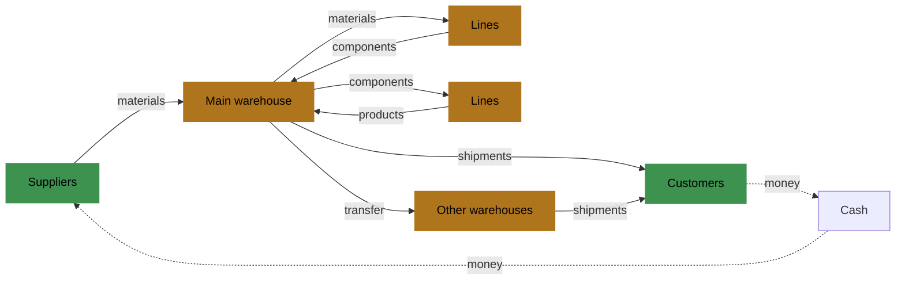

# Concepts

A run is one agent running one factory for a number of periods.

## The factory in one page

- Items. The factory stores three kinds of item. Materials are bought from suppliers.
  Components are made on lines from materials. Products are made on lines from
  components and sold to customers.
- Recipes. A recipe lists the input items and their quantities for one unit of a
  component or a product. An item may have several recipes, such as a standard one and
  an alternative one with another material.
- Suppliers. Each supplier has a catalogue: the materials it sells, each with a price,
  a lead time and how reliably it delivers.
- Customers. Each customer buys some products at a price, places customer orders every
  period and waits a number of periods for them.
- Lines. A line makes some items at one warehouse. It has a number of production hours
  per period and a condition from 0 to 1 that falls with use and time; a repair raises
  it.
- Warehouses and routes. A warehouse has a capacity of space and accepts some items. A
  route transfers stock from one warehouse to another in a number of periods, at a cost
  per unit.
- Cash. The factory pays for materials, production, storage, transport, repairs,
  penalties and interest, and is paid for what it ships. Cash may fall below zero; it
  then pays interest.

Items flow from suppliers through the lines to customers; money flows back.

## The run

- Manifest: the document that describes the factory: its items, partners, lines,
  warehouses, groups and their parameters. A parameter is a fixed number or a range
  from which it is drawn.
- Scenario: the document that describes how a run goes over time: the horizon, the
  starting stock and cash, demand shapes, forecasts, disruptions and the parameters
  kept from the agent.
- Seed: a whole number given at the start of a run.
- World: every random value of the run, drawn from the seed before the first period.
  The world does not depend on any decision, so every agent given the same manifest,
  scenario and seed faces the same demand, deliveries, yields and breakdowns.
- Period: one step of time, numbered from 1. A manifest can name its period, such as
  "week"; the name changes nothing.
- Horizon: the number of periods of the run.

A manifest is linear when no catalogue entry names a minimum quantity or discounts and
no line item names a changeover time or cost. The program of a linear manifest is
linear in every rule but the credit check of a buy decision, which refuses only buy
decisions. It needs one yes-or-no choice in every period with a buy decision: whether
the period buys. An economies-of-scale manifest names a minimum quantity or discounts,
or a changeover time or cost, even 0; its field `linear` is false. Its program needs
more yes-or-no choices. A value of 0 adds no yes-or-no choice to the program. The
example factory is an economies-of-scale manifest.

## Agent and harness

- The agent chooses the decisions of each period: what to ship, cancel, transfer,
  repair, produce and buy. It can be any program, an optimizer, or a person with an AI
  assistant.
- The harness is the program of a study. It starts the run over HTTP, gives the agent
  the description once and an observation every period, and submits the decisions the
  agent returns.
- The harness gives an agent only the description and observations of its run, closed
  periods and check outcomes, and the HTTP routes bound to that run. The agent cannot
  read the manifest and scenario HTTP routes under the study assumption; an agent that
  reaches them anyway cheats, which the simulator cannot technically prevent. A study
  that needs surprise uses unpublished scenarios because the library ships in the
  package. The reference optimizer is given the world of a finished no-decisions run
  with the same scenario and seed.

## Outputs of a run

- Outcome: for each decision, accepted with the identifier of what it created, or
  rejected with a reason and the numbers behind it.
- Event: something that happened, such as a delivery, a breakdown, a new customer
  order or a penalty, with the object it concerns.
- Observation: what the agent sees at the start of each period: cash, stock,
  lines, open orders, visible disruptions, forecasts, and the outcomes and events since
  the last observation.
- Measure: a number recorded each period besides profit, such as the share of units
  shipped on time, for the whole factory and for each object and group.
- Record: everything the simulator stores about the run: every period, the world and
  the result.
- Result: the run as a whole once it is finished: profit and its terms, cash at the
  start and the end, receivables and the measures of the whole run.
