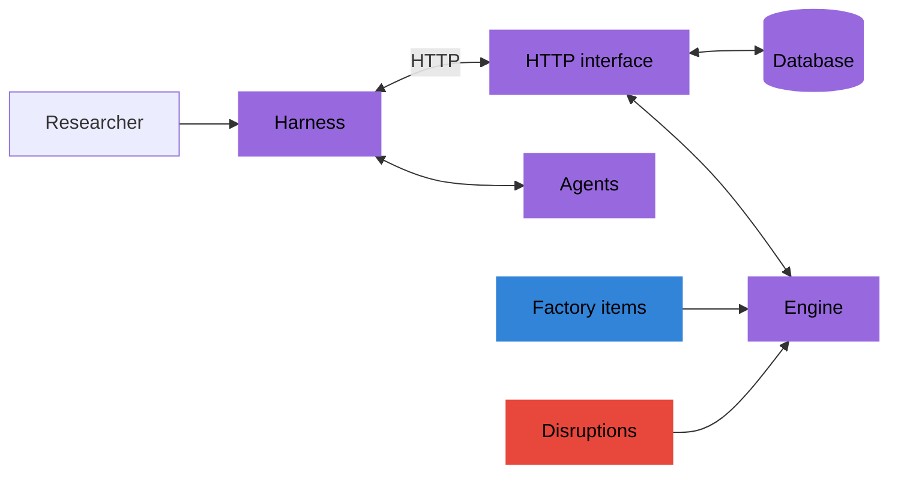
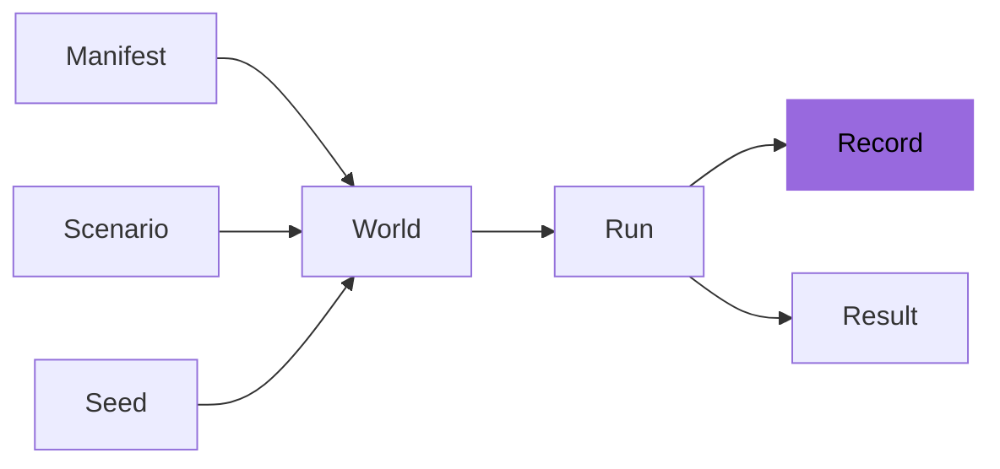

# Overview

The factory simulator is a research instrument. It plays one factory, period by
period. A study harness starts each run and gives an agent the information and HTTP
routes for that run. Every run is recorded, so it can be read, compared and replayed.

## The simulator

- One factory, planned period by period. In each period the agent buys materials,
  makes components and products, transfers stock, repairs lines and ships to customers.
- Any agent: a program of any kind, such as one based on a language model or on linear
  programming, or a person with an AI assistant. The study harness starts its runs and
  passes the description and observations to the agent.
- Every run is recorded. The record holds what happened in every period, the world the
  run was played in and the result. A run can be replayed from its record, and a new
  run can repeat it up to a period and then decide differently.

The study harness talks to the HTTP interface, starts each run and submits the decisions
of the agent. The HTTP interface runs the engine and writes the record to the database.

## Users

- Researchers who compare how agents plan under uncertainty.
- Developers of AI agents who want a hard, repeatable task with one clear score.
- Studies with people, in which a person decides with the help of an AI assistant.

## A study in 5 steps

1. Pick a factory and a scenario: what the factory holds, and how demand, supply and
   disruptions go over time.
2. Pick seeds. A seed fixes every random value of a run.
3. Run each agent on each seed.
4. Read the results: profit and the measures of each run.
5. Compare the agents on the same seeds.

The manifest describes the factory and the scenario describes how the run goes over
time. With a seed they give the world: every random value, drawn once before the first
period. An agent plays the run in that world, and the run leaves its record and
its result.

## Outputs

- One profit per run. Profit is the one number that scores a run.
- Many measures besides profit, such as the share of units shipped on time, the units
  lost and the decisions rejected, for the whole factory and for each line, warehouse,
  partner and group.
- The same world for every agent. Given the same manifest, scenario and seed, every
  agent meets the same demand, deliveries, yields, breakdowns and
  disruptions, whatever it decides.
- A full record of every run.
- A reference: the profit of the reference optimizer, which knows the whole world. A run
  is scored as a share of the way from the profit of no decisions to the reference.

## Contents of the package

- The example factory: an electronics factory with minimum quantities, discounts and
  changeovers. See [Example factory](../library/example-factory.md).
- The scenario library: 23 scenarios on the example factory, each testing one
  mechanism, such as a supplier outage or a season of demand. See
  [Scenario library](../library/scenario-library.md).
- The benchmark: a client that plays a run over HTTP, seven optimizers, the reference
  among them, and the informed optimizer, a diagnostic. See
  [Playing a run](../benchmark/playing-a-run.md).
- A stress test that plays the optimizers on the scenario library and reports their
  scores. See [Stress test](../benchmark/stress-test.md).

## Scope

- It is one factory, not a network of factories or firms.
- Some processes are left out: fixed costs per order, all-or-nothing shipments,
  defects that reach customers, lots and first-in first-out stock, calendar dates,
  changes to customer orders, and holding hours or materials for a plan.
- It has no screen for people. A person takes part through a harness that shows the
  observation and sends the decisions.

Every limit, with what it means for a study, is on [Limits](../reference/limits.md).
