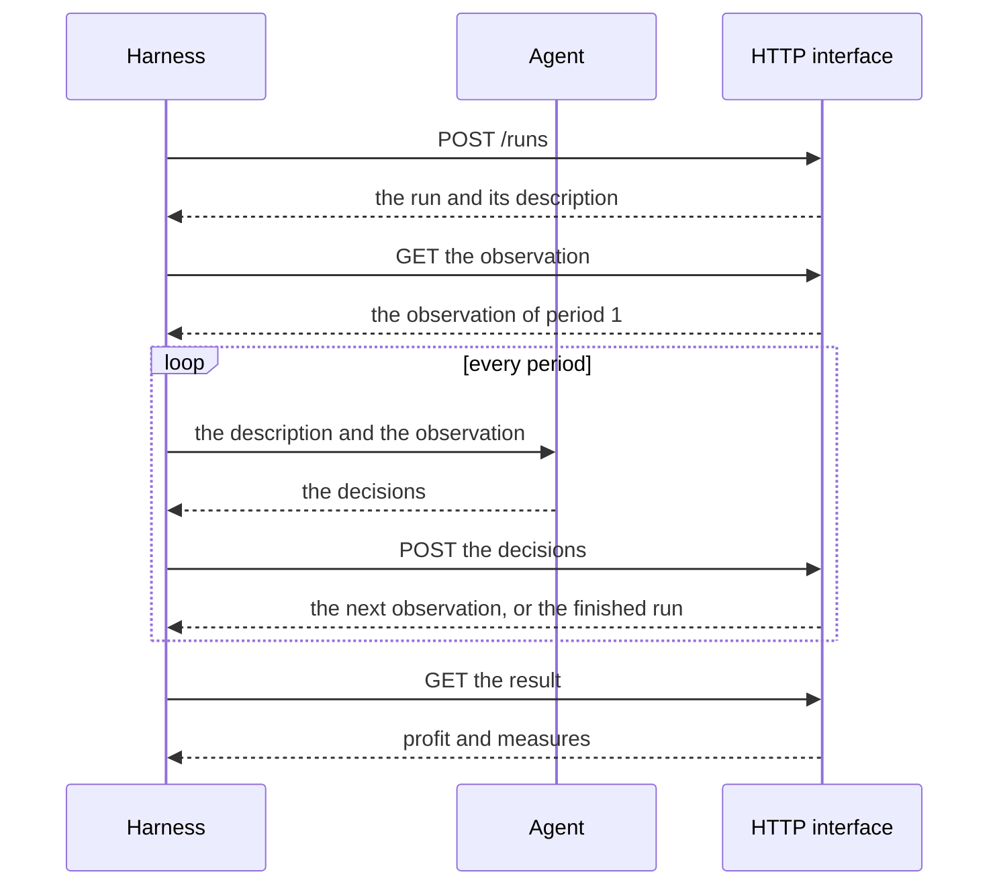

# Quick start

This page installs the simulator, starts the server and plays a first run. It needs
Python 3.14, uv, the Python package manager, and a copy of the repository.

## Smallest example

From the root of the repository, install the package:

```sh
uv sync
```

The server keeps every run in one database file. Create its folder, then start the
server:

```sh
mkdir -p data/records
FACTORY_SIMULATOR_DATABASE_URL=duckdb:///data/records/runs.duckdb \
  uv run uvicorn factory_simulator.api.main:app
```

The server listens on `http://127.0.0.1:8000`. On its first start it loads the example
factory and the scenario library.

## Factories and scenarios

```sh
curl http://127.0.0.1:8000/api/v1/manifests
```

The response lists each factory with its identifier, name and description. The example
factory has the name `Electronics factory with economies of scale` and the description
`The electronics factory with minimum quantities, discounts and changeovers: large buys and long production runs cost less per unit.`
`GET /api/v1/manifests/{id}/scenarios` lists the scenarios of one factory.

## A first run

This program uses the standard library only. It starts a run of `steady-market` on the
example factory with seed 7, decides nothing in each of the 52 periods and prints the
profit. Numbers with a fraction are read as `Decimal`, so no digit is lost.

```python
import json
from decimal import Decimal
from urllib.request import Request, urlopen

API = "http://127.0.0.1:8000/api/v1"


def call(method: str, path: str, body: object = None) -> dict:
    data = None if body is None else json.dumps(body).encode()
    request = Request(
        API + path,
        data=data,
        method=method,
        headers={"Content-Type": "application/json"},
    )
    with urlopen(request) as response:
        return json.loads(response.read(), parse_float=Decimal)


manifests = call("GET", "/manifests")["manifests"]
name = "Electronics factory with economies of scale"
factory = next(m for m in manifests if m["name"] == name)
scenarios = call("GET", f"/manifests/{factory['id']}/scenarios")["scenarios"]
steady = next(s for s in scenarios if s["name"] == "steady-market")
run = call("POST", "/runs", {"scenario_id": steady["id"], "seed": 7})

observation = call("GET", f"/runs/{run['id']}/observation")
while True:
    answer = call(
        "POST",
        f"/runs/{run['id']}/decisions",
        {"period": observation["period"], "decisions": []},
    )
    if answer.get("finished"):
        break
    observation = answer

print(call("GET", f"/runs/{run['id']}/result")["profit"])
```

It prints `-709331.2306`. The run takes about 3 seconds.



## The result

`GET /api/v1/runs/{id}/result` responds once the run is finished. It holds the seed, the
number of periods, the profit and its terms, the cash at the start and at the end, the
receivables and the measures of the whole run. The profit is negative here: with no
decision the factory buys nothing, makes nothing, ships nothing and pays a penalty for
every order it loses.

## Location of the record

Every run is stored in `data/records/runs.duckdb`, the file the server was started
with. `GET /api/v1/runs/{id}/periods` gives every period of a run.
`GET /api/v1/runs/{id}/export` gives a finished run as one ZIP file that can be read
without the package.

## Errors

An error response holds one key, `detail`, with the text `<key>: <problem>`, such as
`period: is 2, the run is in period 1` when a submission names another period than the
current one. Every code and text of an error is in
[HTTP interface](../reference/http-interface.md#errors).
