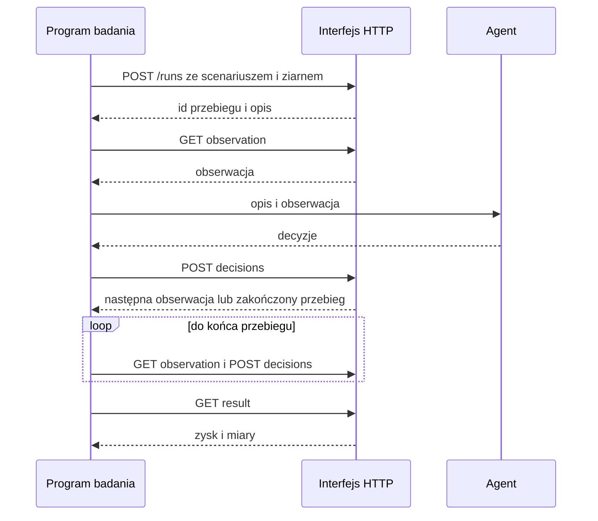
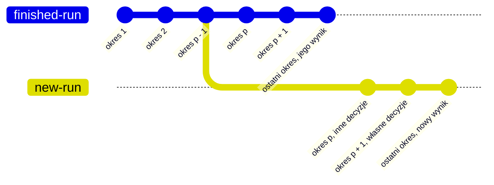

# Rozgrywanie przebiegu

Benchmark to część pakietu, która gra przebiegi przez HTTP: klient i 8 agentów, czyli
brak decyzji, optymalizator odniesienia, 5 optymalizatorów z ograniczoną wiedzą
i optymalizator poinformowany, diagnostyka grana przy współczynnikach wartości końcowej
1.01 i 1.2. Agent każdego rodzaju gra przez ten sam interfejs HTTP.

## Najmniejszy przykład

Jeden przebieg to pętla kilku żądań, narysowana jako sekwencja na stronie
[Szybki start](../start/quick-start.md):

1. `POST /api/v1/runs` z `{"scenario_id": ..., "seed": ...}`. Odpowiedź zawiera
   identyfikator przebiegu i opis.
2. `GET /api/v1/runs/{id}/observation` daje obserwację okresu 1.
3. Agent zwraca decyzje okresu.
4. `POST /api/v1/runs/{id}/decisions` z `{"period": t, "decisions": [...]}`.
   Odpowiedź to obserwacja następnego okresu albo, po ostatnim okresie, przebieg z
   `finished: true`.
5. Decydowanie i zgłaszanie powtarzają się, aż przebieg się skończy.
6. `GET /api/v1/runs/{id}/result` daje zysk i miary.



Agent to funkcja opisu i obserwacji, która zwraca listę decyzji w kształtach ze strony
[Decyzje](../rules/decisions.md). Ten agent wysyła każde otwarte zamówienie klienta, od
najwcześniejszego terminu, z zapasu, który znajdzie:

```python
def ship_from_stock(description: dict, observation: dict) -> list[dict]:
    stock = {
        warehouse: dict(items) for warehouse, items in observation["stock"].items()
    }
    decisions = []
    for order in sorted(observation["customer_orders"], key=lambda o: o["due"]):
        open_quantity = order["quantity"] - order["shipped"]
        for warehouse, items in stock.items():
            quantity = min(open_quantity, items.get(order["product"], 0))
            if quantity > 0:
                decisions.append(
                    {
                        "kind": "ship",
                        "order": order["id"],
                        "quantity": quantity,
                        "warehouse": warehouse,
                    }
                )
                items[order["product"]] -= quantity
                open_quantity -= quantity
    return decisions
```

Program badania rozpoczyna każdy przebieg, przekazuje
agentowi opis, obserwacje, zamknięte okresy i wyniki sprawdzeń oraz zgłasza decyzje,
które agent zwraca. Badanie, które opiera się na ukrytych informacjach, trzyma ścieżki
HTTP manifestów i scenariuszy poza zasięgiem agenta. Optymalizator odniesienia
otrzymuje świat zakończonego przebiegu braku decyzji z tym samym scenariuszem
i ziarnem. Program badania można napisać w dowolnym języku, który wysyła żądania HTTP.
Ten, oparty na bibliotece standardowej, gra powyższego agenta:

```python
import json
from decimal import Decimal
from urllib.error import HTTPError
from urllib.request import Request, urlopen

API = "http://127.0.0.1:8000/api/v1"


def call(method: str, path: str, body: object = None) -> dict:
    data = None if body is None else json.dumps(body, default=str).encode()
    request = Request(
        API + path,
        data=data,
        method=method,
        headers={"Content-Type": "application/json"},
    )
    try:
        with urlopen(request) as response:
            return json.loads(response.read(), parse_float=Decimal)
    except HTTPError as error:
        detail = json.loads(error.read())["detail"]
        raise RuntimeError(f"{method} {path}: {error.code} {detail}") from None


def play(scenario_id: str, seed: int, decide) -> dict:
    run = call("POST", "/runs", {"scenario_id": scenario_id, "seed": seed})
    observation = call("GET", f"/runs/{run['id']}/observation")
    while True:
        decisions = decide(run["description"], observation)
        body = {"period": observation["period"], "decisions": decisions}
        answer = call("POST", f"/runs/{run['id']}/decisions", body)
        if answer.get("finished"):
            return call("GET", f"/runs/{run['id']}/result")
        observation = answer
```

Tu `scenario_id` to identyfikator `steady-market` z
`GET /api/v1/manifests/{manifest_id}/scenarios`.
`play(scenario_id, 7, ship_from_stock)["profit"]` daje `-693395.167545` na fabryce
przykładowej, wobec `-709331.2306` dla braku decyzji.

### Dokładne liczby dziesiętne

- Każda kwota, ilość i część jest liczbą dziesiętną. Czytaj każdą odpowiedź przez
  `json.loads(text, parse_float=Decimal)`. Liczba z częścią ułamkową staje się wtedy
  `Decimal`, liczba całkowita `int`, i żadna cyfra nie ginie.
- Liczba zmiennoprzecinkowa (float) gubi cyfry. Nigdy nie licz decyzji we floatach i
  nie wysyłaj takiego wyniku.
- Wysyłaj `Decimal` jako tekst dziesiętny. `json.dumps(body, default=str)` zapisuje
  `Decimal("12.5")` jako `"12.5"`, a interfejs HTTP czyta to jako 12.5.
- Ilość ma najwyżej 3 miejsca po przecinku, a kwota naprawy najwyżej 4. Zaokrąglaj w
  dół przed wysłaniem: `quantity.quantize(Decimal("0.001"), rounding=ROUND_DOWN)`.
- Ziarno to liczba całkowita od 0 do 2 do potęgi 128 minus 1, wysłana jako liczba JSON
  albo jako tekst (`7` lub `"7"`).

## Klient pakietu

Moduł `factory_simulator.benchmark.client` gra przebiegi przez HTTP jak każdy program
badania. Bierze `httpx2.Client`, którego bazowy adres URL to interfejs HTTP. Agent
klienta to każda funkcja opisu i obserwacji, która zwraca listę decyzji, `Agent` w tym
module; oba argumenty to słowniki z liczbami `Decimal`. `ship_from_stock` wyżej jest
takim agentem. Klient gra go tak:

```python
import httpx2 as httpx

from factory_simulator.benchmark.client import (
    find_manifest,
    find_scenario,
    play_run,
    start_run,
)

with httpx.Client(base_url="http://127.0.0.1:8000/api/v1") as client:
    manifest_id = find_manifest(client, "Electronics factory with economies of scale")
    scenario_id = find_scenario(client, manifest_id, "steady-market")
    for seed in (101, 102, 103):
        run = start_run(client, scenario_id, seed)
        result = play_run(client, run, ship_from_stock)
        print(seed, result["profit"])
```

- `play_run(client, run, agent)` daje agentowi opis i każdą obserwację, zgłasza jego
  decyzje dla okresu obserwacji, aż przebieg się skończy, i podaje wynik przebiegu.
- Agent, który ma pamięć, na przykład wygładzony popyt, jest tworzony od nowa dla
  każdego przebiegu. Dlatego żadna pamięć nie przechodzi z jednego przebiegu na
  następny.
- Agent, który sprawdza swoje decyzje, dostaje sprawdzenie związane z jego
  przebiegiem: `functools.partial(create_check, client, run["id"])`, z
  `create_check` z tego samego modułu. Bierze okres i listę decyzji i podaje
  ich wyniki.
- `read_world(client, run_id)` podaje świat zakończonego przebiegu, a
  `read_periods(client, run_id)` już zamknięte okresy przebiegu.
- `create_shown_description(client, manifest_id, seed, scenario_content)` wysyła
  bliźniaka scenariusza, jego treść z pustym `hidden` i nazwą `<name>`, jeśli ją ma,
  jako `<name>-shown`, uruchamia przebieg bliźniaka z tym ziarnem i podaje opis tego
  przebiegu. Przebieg bliźniaka nigdy nie jest grany. Jego opis pokazuje każdą grupę
  parametrów jako zakres z jego `cut_mean`, nigdy wartość losowaną na okres. Nie czyta
  `GET /api/v1/scenarios/{id}`.
- Odpowiedź z kodem 400 lub wyższym zgłasza `RuntimeError` z metodą, ścieżką, kodem i
  szczegółem, na przykład `GET /runs/1f3a: 404 run_id: unknown run 1f3a`. Treść, która
  nie jest obiektem JSON, zgłasza `RuntimeError` zakończony "not a JSON object".
- `find_manifest` i `find_scenario` zgłaszają `ValueError` dla nazwy, która nie jest
  zapisana, na przykład `no manifest named Electronics factory`.

## Badania z człowiekiem i asystentem AI

Człowiek bierze udział przez program badania. Symulator nie ma ekranu. Program badania
pokazuje człowiekowi opis i obserwację oraz zgłasza decyzje, które człowiek wybiera z
pomocą asystenta AI.

- Bez limitu czasu. Przebieg czeka na swoje zgłoszenie tak długo, jak trzeba, minuty
  lub dni. Po ponownym uruchomieniu serwera niezakończony przebieg idzie dalej od
  swojego zapisu przebiegu.
- `POST /api/v1/runs/{id}/checks` przyjmuje tę samą treść co zgłoszenie i podaje
  wynik, jaki każda decyzja miałaby teraz, bez zmiany przebiegu. Człowiek lub asystent
  może sprawdzać dowolną liczbę razy w okresie, a potem zgłosić.
- Zapis przebiegu przechowuje każde sprawdzenie oraz każde zgłoszenie odrzucone z
  odpowiedzią 422 albo 409 za inny okres jako interakcję, osobno od przebiegu. Eksport
  je zawiera, więc badanie widzi, jak człowiek sprawdzał decyzje przed zgłoszeniem.
- Zapis przebiegu zawiera tylko stronę symulatora. Rady, które dostał człowiek, tekst
  asystenta i czas, jaki zajęło to człowiekowi, przechowuje samo badanie. Żaden wiersz
  zapisu przebiegu nie zawiera godziny zegarowej.
- Każdy agent badania dostaje ten sam opis i te same obserwacje przez ten sam program
  badania. Dlatego człowieka i program porównuje się w tych samych światach.

## Odgałęzienia dla pytania "co jeśli"

Odgałęzienie to nowy przebieg, który powtarza zakończony przebieg do wybranego okresu z
tymi samymi zgłoszeniami i dalej idzie z innymi decyzjami.



- `POST /api/v1/runs/{id}/forks` z `{"period": p}` tworzy odgałęzienie zakończonego
  przebiegu `id`. Odpowiedź, 201, to nowy przebieg w okresie p, niezakończony.
- Nowy przebieg ma ten sam scenariusz i to samo ziarno, więc ten sam świat. Okresy 1
  do p - 1 powtarzają zgłoszenia zakończonego przebiegu i dają te same wiersze. Od
  okresu p program badania prowadzi go jak każdy przebieg.
- p to liczba od 1 do horyzontu. Każdy inny okres dostaje odpowiedź 422. Przebieg,
  który nie jest zakończony, dostaje odpowiedź 409.
- Z przebiegu można utworzyć dowolnie wiele odgałęzień, od dowolnego okresu.
- Nowy przebieg zaczyna bez interakcji. Jego eksport podaje przebieg, z którego
  pochodzi, i okres, w `forked_from` i `forked_from_period` w `run.json`.
- Agent nowego przebiegu dostaje opis i obserwację okresu p.
  `GET /api/v1/runs/{id}/periods` nowego przebiegu podaje już zamknięte okresy, z
  których agent może odbudować swoją pamięć.

Różnica między zyskiem nowego przebiegu a zyskiem zakończonego przebiegu to wartość
innych decyzji od okresu p, w tym samym świecie. Przykład: utwórz odgałęzienie
przebiegu optymalizatora kroczącego na początku przerwy w dostawach, pozwól innemu
agentowi grać od tego miejsca i porównaj oba zyski.

## Błędy

Odpowiedź na każdy błąd to `{"detail": "<key>: <problem>"}`, na przykład
`{"detail": "run_id: unknown run 1f3a"}`.

| Kod | Kiedy | Co zrobić |
| --- | --- | --- |
| 404 | Manifest, scenariusz lub przebieg nie istnieje. | Sprawdź identyfikator. |
| 409 | Zgłoszenie lub sprawdzenie podaje inny okres niż bieżący. | Odczytaj obserwację jeszcze raz i zgłoś dla jej `period`. |
| 409 | Przebieg jest zakończony, a program badania zgłasza, sprawdza lub czyta obserwację. | Odczytaj wynik przebiegu. |
| 409 | Przebieg nie jest zakończony, a program badania czyta wynik przebiegu, świat lub eksport albo tworzy odgałęzienie. | Najpierw zakończ przebieg. |
| 409 | Przebieg do odtworzenia lub odgałęzienia nie zgadza się ze swoim zapisem przebiegu albo z wersjami, które teraz działają. | Użyj wersji, które zapisały przebieg. |
| 422 | Treść żądania łamie swoją formę: nieznany klucz, zły typ, ilość nie większa od 0 lub ze zbyt wieloma miejscami po przecinku, ziarno, które nie jest liczbą całkowitą. | Popraw treść. Szczegół podaje klucz, na przykład `decisions.0.quantity: has more than 3 places`. |

- Zgłoszenie z odpowiedzią 409 lub 422 jest odrzucone w całości. Przebieg zostaje w
  swoim okresie, a program badania zgłasza jeszcze raz. Zapis przebiegu przechowuje
  zgłoszenie odrzucone z odpowiedzią 422 albo 409 za inny okres jako interakcję,
  osobno od przebiegu.
- Odrzucone zgłoszenie to nie odrzucona decyzja. Decyzja w poprawnej formie, która
  łamie regułę fabryki, na przykład wysyłka większa niż zapas, jest odrzucana z
  powodem. Okres i tak się zamyka, a wynik decyzji wraca w następnej obserwacji.
  Zobacz [Decyzje](../rules/decisions.md).
- Dwa zgłoszenia na jeden okres: jedno jest wykonane, drugie dostaje odpowiedź 409.
