# Test przeciążający

Test przeciążający uruchamia agentów benchmarku na bibliotece scenariuszy, sprawdza
każdy przebieg i zapisuje raport.

## Najmniejszy przykład

Test leży w `tests/stress/` repozytorium i uruchamia się go ręcznie:

```sh
uv run pytest tests/stress -m stress -n 0 --stress-seeds 1 --stress-scenarios steady-market
```

Zwykłe uruchomienie `pytest` go pomija: `-m "not stress"` stoi w `addopts` w
`pyproject.toml`.

| Opcja | Domyślnie | Ustawia |
| --- | --- | --- |
| `--stress-seeds` | 20 | Liczbę ziaren, co najmniej 1; n gra ziarna od 0 do n - 1. |
| `--stress-scenarios` | `all` | Scenariusze, nazwy oddzielone przecinkami. |
| `--stress-workers` | liczba procesorów | Procesy, które grają światy naraz. |
| `--stress-time-limit` | 600 | Sekundy, jakie może trwać każde rozwiązanie. |
| `--stress-evaluation` | wyłączona | Gra ziarna ewaluacyjne od 1000 do 1019 zamiast od 0 do n - 1. |

- Uruchamia własny serwer na `data/records/stress.duckdb`, z załadowanymi przykładami i
  `--timeout-keep-alive 30`.
- Wysyła do serwera manifest przykładowy i każdy plik scenariusza z pakietu i gra
  dokładnie te identyfikatory scenariuszy, które podają odpowiedzi. Wcześniejsza wersja
  scenariusza, którą przechowuje baza danych, nigdy nie jest grana.
- Obok wybranych scenariuszy gra ich kontrole informacyjne. Kontrola informacyjna
  scenariusza to ten scenariusz bez jednego zabiegu informacyjnego, taki sam w każdym
  innym kluczu. `forecasts` ma dwie: `forecasts-without-forecasts`, z ukrytym popytem i
  bez prognoz, oraz `forecasts-shown`, z tymi samymi prognozami i bez niczego ukrytego.
  `hidden-groups` ma `hidden-groups-shown`, bez niczego ukrytego i z popytem nadal
  mnożonym przez 2.5. `notice` ma `supplier-outage`, z tymi samymi dwoma zakłóceniami
  widocznymi dopiero, gdy się zaczynają. Test przeciążający buduje pierwsze trzy z
  plików ich scenariuszy i kończy się błędem, gdy kontrola różni się od swojego
  scenariusza w czymś więcej niż jej zabieg albo gdy jej prognozy zawierają inne szoki
  popytu, przez ukryte `disruptions.duration` lub inną zapowiedź szoku. Scenariusz i
  jego kontrola losują ten sam świat przy tym samym ziarnie.
- Świat to jeden scenariusz i jedno ziarno. W każdym świecie gra, w tej kolejności, brak
  decyzji, odniesienie, potem optymalizator na cały horyzont, kroczący, dopasowany,
  krótkowzroczny i buforowy kroczący. W scenariuszu, który ukrywa grupę parametrów inną
  niż czas trwania zakłóceń, gra potem dwa razy optymalizator poinformowany, przy
  współczynnikach wartości końcowej 1.01 (`informed_optimizer`) i 1.2
  (`buffered_informed_optimizer`), każdy z opisem przebiegu bliźniaka. Świat pierwszego
  ziarna każdego scenariusza gra dwa razy.
- Prowadzi indeks `data/records/stress-runs.csv`, jeden wiersz na przebieg, z jego
  zyskiem, sekundami, rozwiązaniami, naruszeniami, ustawieniami, wersją, kodem,
  środowiskiem solvera, sprawdzeniami, jedną kolumną na każdą nazwaną miarę i wynikami,
  które czyta wartość decyzji: sztukami zamówionymi, wysłanymi i kupionymi oraz okresami
  zamkniętymi poniżej limitu kredytowego. Ustawienia zawierają limit czasu i
  współczynniki wartości końcowej 1.01 i 1.2. Kod to SHA-256 jednego wiersza na każdy
  plik Pythona w `src/factory_simulator`, z SHA-256 jego bajtów i jego ścieżką, w
  kolejności ścieżek, więc zmiana pakietu, także zmiana nazwy pliku, gra każdy świat od
  nowa, a zmiana samych testów nie. Środowisko solvera podaje wersje Pythona, numpy,
  scipy i solvera HiGHS w scipy oraz system, maszynę i bibliotekę C, na których grają
  przebiegi, więc zmiana któregokolwiek z nich także gra każdy świat od nowa. Indeks z
  innymi kolumnami, niż zapisuje test, jest odrzucany: najpierw trzeba go przenieść.
- Wiersze świata są zapisywane, gdy skończą się wszystkie jego przebiegi, przez nowy
  plik, który potem zastępuje indeks, więc zatrzymanie zostawia indeks cały. Świat
  potrzebuje każdego agenta w pierwszej grze, a dla pierwszego ziarna także w drugiej.
  Świat, który indeks zawiera w całości, dla tych samych ustawień, wersji, kodu i
  środowiska solvera, jest pomijany, więc zatrzymany test wznawia się. Świat bez
  przebiegu braku decyzji lub odniesienia jest grany od nowa w całości; każdy inny świat
  gra od nowa brakujących agentów, w każdej swojej grze. Gdy ostatni wiersz indeksu
  został ucięty przez zatrzymanie, test najpierw przenosi ten wiersz do
  `data/records/stress-runs.csv.cut`. Dwa wiersze tego samego przebiegu świata, z tym
  samym identyfikatorem scenariusza, ziarnem, agentem, grą, ustawieniami, wersją, kodem
  i środowiskiem solvera, oba zostają w indeksie, a raport liczy późniejszy. Test kończy
  się błędem, gdy różnią się czymś więcej niż identyfikatorem przebiegu, sekundami i
  czasem, chyba że jeden z nich ma rozwiązanie zatrzymane na limicie czasu. Kończy się
  błędem także wtedy, gdy po grze świat nadal nie ma jakiegoś przebiegu, z naruszeniem,
  które podaje brakujące przebiegi.
- Sprawdzenia wiersza to SHA-256 jednego wiersza dla `tests/stress/checks.py`, a potem
  jednego dla `tests/factories/strategies.py`, każdy zbudowany jak wiersz kodu:
  sprawdzenia przebiegu i rodzaje kosztów, które one czytają. Przed grą test
  przeciążający sprawdza od nowa każdy świat indeksu tych samych ustawień, wersji, kodu
  i środowiska solvera, który ma wiersz innych sprawdzeń. Czyta z serwera opis, wynik i
  okresy każdego przebiegu świata, stosuje bieżące sprawdzenia i zapisuje nowe
  naruszenia i sprawdzenia w indeksie, więc zmiana samych sprawdzeń nie gra od nowa
  żadnego świata. Świat z przebiegiem, którego serwer nie może odczytać, zachowuje swoje
  wiersze, a test przeciążający kończy się błędem z naruszeniem, które podaje ten
  przebieg i mówi, że bieżące sprawdzenia się nie odbyły.
- Sprawdza każdy przebieg: przebieg nie zgłasza błędu i kończy się po swoim horyzoncie;
  zysk to przychód minus koszty plus otrzymane odsetki i wartość odzysku;
  `profit_so_far` ostatniego okresu plus wartość odzysku to zysk; księga sumuje się do
  zmiany gotówki; sztuki zamówień klientów i zamówień u dostawców się bilansują; dla
  każdej pozycji, łącznie we wszystkich magazynach, zapas początkowy, sztuki przyjęte od
  dostawców i dobre sztuki linii równają się zapasowi przy ostatnim zamknięciu, sztukom
  zużytym przez produkcję, sztukom wysłanym i sztukom przesunięć w drodze; żadna decyzja
  optymalizatora nie jest odrzucona. Świat grany dwa razy daje oba razy te same okresy i
  ten sam wynik, chyba że przebieg ma rozwiązanie zatrzymane na limicie czasu. Test
  kończy się błędem z listą wszystkich naruszeń.
- Świata nie da się ocenić, gdy odniesienie nie daje więcej zysku niż brak decyzji albo
  gdy rozwiązanie odniesienia kończy się bez rozwiązania dopuszczalnego. Świat, którego
  nie da się ocenić, nie jest naruszeniem: raport liczy go z jego przyczyną, pomija w
  każdym znormalizowanym wyniku i wypisuje z zyskami jego przebiegów. Odniesienie nigdy
  nie anuluje zamówienia u dostawcy i wykonuje przesunięcia okresu w kolejności swoich
  tras, więc w świecie, którego nie da się ocenić, może istnieć lepsza decyzja.
- Pisze raport do nowego folderu `data/reports/<YYYY-MM-DDTHHMMSS>-stress/`:
  `report.md`, `runs.csv`, wiersze indeksu jego światów z ich znormalizowanymi wynikami,
  oraz `scores.png`, wykres pudełkowy znormalizowanych wyników dla każdego scenariusza i
  optymalizatora z ograniczoną wiedzą. Czyta tylko wiersze bieżących ustawień, wersji,
  kodu i środowiska solvera i odrzuca wiersz innego środowiska solvera.
- `report.md` zaczyna się od wersji, kodu, środowiska solvera, sprawdzeń, analizy,
  polecenia, manifestu, ziaren, protokołu, ustawień, światów zagranych i tych, których
  nie da się ocenić, z liczbą każdej przyczyny, oraz średnich sekund świata. Sekcje:
  - `## Scenarios`: każdy scenariusz raportu z jego identyfikatorem.
  - `## Scores`: zdanie, które mówi, co ogranicza największa luka, potem dla każdego
    scenariusza, dla odniesienia, każdego optymalizatora z ograniczoną wiedzą i każdego
    przebiegu poinformowanego, w światach, które da się ocenić, średnia, kwartyle i
    mediana znormalizowanego wyniku, to, czy program był liniowy czy całkowitoliczbowy,
    i największa luka jego rozwiązań całkowitoliczbowych w pieniądzu, także rozwiązania
    na limicie luki; kreska oznacza agenta bez rozwiązania całkowitoliczbowego z
    rozwiązaniem w tych światach.
  - `## Calibration`: zdanie, które podaje regułę poniżej, a potem dla każdego
    scenariusza jego światy, te, których nie da się ocenić, ziarna porównane, średni
    wynik kalibracji, trudność z jej błędem standardowym oraz dolną i górną granicą jej
    95-procentowego przedziału, to, czy scenariusz jest dość trudny, oraz to, czy
    nazwana miara zmienia się w spodziewanym kierunku wobec `steady-market`. Werdykt
    czyta jeden optymalizator z ograniczoną wiedzą, ustalony przed przebiegiem: buforowy
    kroczący. Jego luka w świecie to zysk odniesienia minus jego zysk. Wynik kalibracji
    świata to 1 minus ta luka przez mianownik `steady-market` w tym samym ziarnie, czyli
    zysk odniesienia minus zysk braku decyzji tam; w `steady-market` jest to
    znormalizowany wynik tego optymalizatora. Strata wspólna odniesienia i
    optymalizatora go nie zmienia, podobnie jak mianownik scenariusza i inne
    optymalizatory z ograniczoną wiedzą. Trudność to średnia po ziarnach wyniku
    kalibracji minus wynik kalibracji `steady-market` w tym samym ziarnie. Przedział to
    przedział Studenta z poprawką na skośność według Halla (1992). Przy n ziarnach,
    kwantylu t 0.975 rozkładu t Studenta o n - 1 stopniach swobody i różnicach o
    średniej m, odchyleniu standardowym s i skośności g (trzeci moment centralny przez
    drugi do potęgi 1.5) każda granica to m - s * w, gdzie w = 3 * y / (c * c + c + 1),
    a c to pierwiastek sześcienny z 1 + g * y, przy y = t / sqrt(n) - g / (6 * n) dla
    dolnej i y = -t / sqrt(n) - g / (6 * n) dla górnej granicy. Bez skośności, jak przy
    2 ziarnach, jest to trudność minus i plus t błędów standardowych; skośne różnice
    przesuwają go w stronę długiego ogona. Każda granica ma 3 miejsca po przecinku; przy
    jednym ziarnie błąd standardowy i obie granice mają `-`. Każdy przedział dotyczy
    własnego scenariusza: przy średniej różnicy -0.03 około 1 scenariusz na 20 nadal ma
    `yes` albo `no`. Scenariusz jest dość trudny (`yes`), gdy górna granica wynosi
    najwyżej -0.03; `no`, gdy dolna granica wynosi co najmniej -0.03; `undecided` w
    pozostałych przypadkach. Scenariusz, którego odczyt zawiera wiedzę z góry, ma
    `foresight`, bez werdyktu: jego luka zawiera to, co odniesienie wie o zakłóceniu,
    zanim zobaczy je optymalizator z ograniczoną wiedzą. Scenariusz ma `incomplete`, gdy
    ziarno nie ma wyniku kalibracji w nim albo w `steady-market`: rozwiązanie jego
    odniesienia kończy się bez rozwiązania dopuszczalnego albo tego świata
    `steady-market` nie da się ocenić. Zbudowane kontrole nie mają tu wiersza.
  - `## Decision value`: zdanie, które mówi, że wynik może wzrosnąć, gdy zysk spada, bo
    jego mianownik, zysk odniesienia minus zysk braku decyzji, różni się między
    światami, i co znaczy każdy odczyt. Potem dla każdego scenariusza, po wszystkich
    jego światach, średnie zysków braku decyzji i odniesienia, mianownik, najlepszy zysk
    z ograniczoną wiedzą, czyli najwyższy zysk pięciu optymalizatorów z ograniczoną
    wiedzą w świecie, jego luka do odniesienia, poziomy realizacji odniesienia i
    najlepszego przebiegu z ograniczoną wiedzą oraz sztuki utracone, sztuki kupione i
    okresy zamknięte poniżej limitu kredytowego przez odniesienie. Potem dla każdego
    scenariusza poza `steady-market` średnie różnic wobec `steady-market` w tym samym
    ziarnie najlepszego wyniku z ograniczoną wiedzą, najlepszego zysku z ograniczoną
    wiedzą, luki i mianownika, obok odczytu scenariusza i jego uzasadnienia: tego, co
    polityka może jeszcze zrobić, i straty, której żadna polityka nie uniknie,
    policzonych przy środku popytu. Odczyt to adaptacja, przeciążenie, wiedza z góry,
    odbudowa albo informacja, lub kilka z nich razem. Wiedza z góry oznacza stratę,
    której unika tylko odniesienie, bo czyta cały świat: optymalizator z ograniczoną
    wiedzą widzi zakłócenie od jego początku albo od jego zapowiedzi.
  - `## Information controls`: zdanie, które mówi, czym jest kontrola informacyjna, że
    błąd standardowy efektu obejmuje średnią jego różnic, jak w kalibracji, i że różnica
    wobec `steady-market` nie jest efektem informacji, a potem dla każdego scenariusza i
    jego kontroli zabieg, identyfikator kontroli, to, co oba mają wspólne, ziarna
    ocenione w obu oraz efekt zabiegu dla buforowego optymalizatora kroczącego,
    zdefiniowany w [Glosariuszu](../reference/glossary.md), z jego błędem standardowym i
    granicami jego 95-procentowego przedziału; `None.`, gdy pary nie ma.
  - `## Disclosure effect`: zdanie, które podaje obie polityki, to, co jest ujawniane,
    to, że obie są ustalone przed przebiegiem, i to, że każdy efekt jest diagnostyką, a
    potem dla każdego scenariusza z przebiegami poinformowanymi zabieg, przebieg
    poinformowany, przebieg kroczący, ziarna ocenione w obu oraz efekt ujawnienia z jego
    błędem standardowym i granicami jego 95-procentowego przedziału; `None.`, gdy
    przebiegów poinformowanych nie ma. Efekt ujawnienia, zdefiniowany w
    [Glosariuszu](../reference/glossary.md), porównuje optymalizator poinformowany przy
    współczynniku wartości końcowej 1.2 z buforowym optymalizatorem kroczącym w tym
    samym świecie i może być ujemny. Przy jednym ziarnie nie ma błędu standardowego ani
    granic.
  - `## Unscorable worlds`: zdanie, które mówi, kiedy świata nie da się ocenić i że może
    w nim istnieć lepsza decyzja, a potem dla każdego takiego świata jego scenariusz,
    ziarno i przyczyna, zyski braku decyzji i odniesienia oraz najwyższy zysk pięciu
    optymalizatorów z ograniczoną wiedzą z optymalizatorem, który go osiąga; `None.`,
    gdy takiego świata nie ma.
  - `## Not repeatable`, `## Solves without a solution` i `## Violations`, która podaje
    naruszenia wierszy bieżących sprawdzeń, przebiegi, których serwer nie może odczytać,
    przebiegi, których brakuje światu, i różniące się wiersze jednego przebiegu.

## Okna zakłóceń

Zapisane zakłócenia kończą się najpóźniej w okresie 41. Losowe awarie mogą wystąpić w
całym horyzoncie. Pasek kończy się na początku okresu po ostatnim aktywnym.

```mermaid
gantt
    title Zapisane zakłócenia w 52 okresach
    dateFormat X
    axisFormat %s
    section Horyzont
    okresy 1 do 52 : horizon, 1, 53
    section Dostawcy
    supplier-outage : supplier_outage, 10, 42
    zapowiedź widoczna : notice_visible, 6, 10
    zapowiedź działa : notice_acting, 10, 42
    material-shortage : material_shortage, 10, 42
    quality-crisis : quality_acting, 9, 41
    price-change : price_acting, 8, 40
    transport-delays : transport_delays, 12, 42
    regional-crisis : regional_crisis, 16, 42
    section Linie
    capacity-cut : capacity_cut, 18, 42
    line-breakdown : line_breakdown, 18, 19
    line-breakdown cięcie : line_cut, 22, 38
    frequent-breakdowns cięcie : frequent_cut, 34, 42
    yield-drop : yield_drop, 7, 41
    section Popyt
    demand-surge : demand_surge, 14, 42
    surge-and-breakdown wzrost : surge, 14, 42
    surge-and-breakdown awaria : surge_breakdown, 16, 17
```



## Kalibracja

Start, zakłócenia, kształty popytu i jakość prognoz każdego scenariusza opisuje strona
[Biblioteka scenariuszy](../library/scenario-library.md).

Na ziarnach rozwojowych od 0 do 19 jest 520 światów z 23 scenariuszy i 3 kontroli oraz
3948 przebiegów z powtórzeniami ziarna 0, a żaden przebieg nie ma naruszenia. 4 światów
nie da się ocenić: rozwiązanie optymalizatora odniesienia nie znajduje rozwiązania
dopuszczalnego w swoich limitach. 6 scenariuszy nie przechodzi sprawdzenia kierunku:
`decline`, `product-life-cycle`, `price-change`, `full-warehouse`, `forecasts` i
`yield-drop`.

Trudność ma `yes` dla `yield-drop`, `no` dla 8 scenariuszy, `undecided` dla 3,
`incomplete` dla `surge-and-breakdown` i `foresight` dla 9; `steady-market` jest
scenariuszem porównania dla każdego innego scenariusza. Zabieg zapowiedzi dodaje 0.290
wobec swojej kontroli, z 95-procentowym przedziałem od 0.256 do 0.328. Przedziały
zabiegów prognoz i ukrytych grup obejmują 0.

Ziarna tworzą dwa zbiory. Ziarna poniżej 1000 to ziarna rozwojowe: gra je każde
uruchomienie bez `--stress-evaluation`, a uruchomienie, które sięga ziarna 1000, kończy
się błędem. Ziarna od 1000 do 1019 to ziarna ewaluacyjne. Gra je jedna ewaluacja
potwierdzająca, z `--stress-evaluation`, `--stress-scenarios all` i 20 ziarnami: 23
scenariusze biblioteki i 3 zbudowane kontrole informacyjne, 520 światów.

Ewaluacja gra tylko przy definicjach zamrożonych w `tests/stress/protocol.py`: wersji,
kodzie, środowisku solvera, sprawdzeniach, analizie, ustawieniach, identyfikatorze
manifestu i identyfikatorze każdego scenariusza. Analiza to SHA-256 jednego wiersza dla
każdego z `tests/stress/playing.py`, `tests/stress/controls.py`,
`tests/stress/report.py`, `tests/stress/test_stress.py` i `tests/factories/client.py`, w
tej kolejności, każdy zbudowany jak wiersz kodu: agenci, nazwane miary, kontrole, każdy
wzór raportu, światy grane dwa razy, przebiegi, które czyta raport, oraz gry braku
decyzji i odniesienia. Ewaluacja kończy się błędem, gdy protokół nie ma zamrożonych
definicji albo ma pustą, gdy dwa zbiory ziaren się nakładają, gdy budżet różni się od
liczby ziaren ewaluacyjnych razy liczba scenariuszy, gdy bieżąca definicja różni się od
zamrożonej wartości, gdy indeks ma przebieg ziarna ewaluacyjnego przy innej wersji,
kodzie, środowisku solvera, ustawieniach lub identyfikatorze scenariusza, albo gdy
wcześniejsza ewaluacja tych samych ziaren zaczęła się przy innych definicjach. Przed grą
każda ewaluacja zapisuje swój start, z czasem, ziarnami i definicjami, do
`stress-evaluations.json` obok indeksu, więc przeniesiony indeks nie ukrywa ewaluacji.
Sprawdzenie czyta tylko te dwa pliki: indeks albo start w kopii repozytorium lub
przeniesiony poza `data/records` mu umyka. Protokół nie ma zamrożonych definicji, więc
ewaluacja od razu kończy się błędem.

Każdy raport podaje analizę (`- Analysis:`) i wiersz `- Protocol:` z rodzajem
uruchomienia i dwoma zbiorami ziaren, na przykład
`development; development seeds 0 to 999, evaluation seeds 1000 to 1019`. Raport
ewaluacji podaje `confirmatory evaluation of the frozen definitions` i jej budżet 520
światów. Zawiera każdy werdykt, przedział, świat, którego nie da się ocenić, i
naruszenie takie, jakie wyszły.

## Badanie skali

`tests/stress/scale.py` gra badanie skali: manifesty wygenerowane z kilku wzorców liczb
obiektów, każdy z każdym ziarnem generatora, w ekonomii dopasowanej. Jego protokół,
`ScaleProtocol`, podaje wzorce, ekonomię, ziarna generatora, scenariusz pisany do
każdego manifestu, ziarna przebiegów i agentów, najpierw brak decyzji i odniesienie.

- `play_scale_study` odrzuca protokół w innej ekonomii niż `matched`, z mniej niż dwoma
  wzorcami albo taki, którego agenci nie zaczynają się od braku decyzji i odniesienia,
  zanim wygeneruje manifest.
- Gra każdy świat raz: wzorzec, ziarno generatora i ziarno. Każdy świat daje wiersz z
  identyfikatorem i opisem swojego manifestu, pozycjami, wejściami receptur, wpisami
  katalogu, produktami klienta i liniami, klasą, pokryciem użytecznego popytu i udziałem
  marży z jego profilu ekonomicznego, zyskami braku decyzji i odniesienia, ich różnicą i
  znormalizowanym wynikiem każdego innego agenta.
- `scale_lines` podaje regułę światów, których nie da się ocenić, tabelę światów oraz
  dla każdego wzorca jego światy, światy, których nie da się ocenić, i średni najlepszy
  wynik reszty.
- Świat, którego nie da się ocenić, zachowuje swój wiersz z profilem i oboma zyskami,
  nie ma wyniku, liczy się w swoim wzorcu i nie wchodzi do średniej. Żaden świat nie
  jest pomijany ani zastępowany.
- Nie uruchamia go żadne polecenie; badanie wywołuje go przez klienta interfejsu HTTP.

## Błędy

Test kończy się błędem, gdy świat narusza bilans, decyzja zostaje odrzucona albo dwa
powtórzone przebiegi się różnią. Raport wymienia każde naruszenie.
