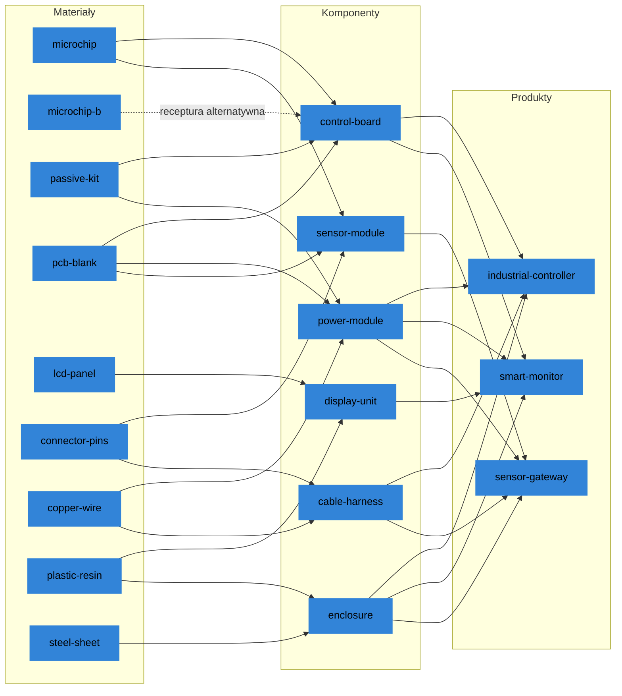

# Fabryka przykładowa

Pakiet zawiera jedną fabrykę elektroniki z korzyściami skali. Ładuje się ona do bazy
danych przy starcie serwera.

- Jej nazwa to `Electronics factory with economies of scale`. To manifest z
  korzyściami skali: ma minimalne ilości, rabaty i przezbrojenia (zobacz
  [Korzyści skali](example-plant-and-cash.md#korzyści-skali)).
- Nazywa okres "week". Pieniądze są w jednej walucie, zapisanej bez znaku.
- Ma 3 produkty, 6 komponentów, 9 materiałów, 4 dostawców, 4 klientów, 4 linie,
  2 magazyny, 1 trasę i 10 grup.
- `GET /api/v1/manifests` podaje ją z identyfikatorem, nazwą i opisem (zobacz
  [Szybki start](../start/quick-start.md)).

## Pozycje

### Materiały

| Materiał | Jednostka | Kategoria | Miejsce na sztukę | Sprzedaje |
| --- | --- | --- | --- | --- |
| `microchip` | sztuka | `semiconductor` | 0.001 | `apac-chips` |
| `microchip-b` | sztuka | `semiconductor` | 0.001 | `emea-electronic-parts` |
| `passive-kit` | zestaw | `passive` | 0.002 | `emea-electronic-parts`, `amer-metals` |
| `pcb-blank` | sztuka | `passive` | 0.002 | `emea-electronic-parts` |
| `lcd-panel` | sztuka | `display` | 0.020 | `apac-displays-plastics`, `emea-electronic-parts` |
| `connector-pins` | zestaw | `connector` | 0.001 | `emea-electronic-parts` |
| `copper-wire` | metr | `connector` | 0.001 | `amer-metals`, `emea-electronic-parts` |
| `plastic-resin` | kg | `mechanical` | 0.002 | `apac-displays-plastics` |
| `steel-sheet` | kg | `mechanical` | 0.001 | `amer-metals` |

`microchip-b` to układ z innego regionu. Używa go tylko alternatywna receptura
`control-board`.

### Komponenty

| Komponent | Receptura: pozycje wejściowe na jedną sztukę | Linia | Miejsce na sztukę |
| --- | --- | --- | --- |
| `control-board` | standardowa: 2 `microchip`, 1 `pcb-blank`, 1 `passive-kit`; alternatywna: 2 `microchip-b`, 1 `pcb-blank`, 1 `passive-kit` | `smt-line` | 0.003 |
| `power-module` | 2 `passive-kit`, 1 `pcb-blank`, 1.5 `copper-wire` | `smt-line` lub `module-assembly-line` | 0.003 |
| `sensor-module` | 1 `microchip`, 1 `pcb-blank`, 2 `connector-pins` | `smt-line` | 0.002 |
| `display-unit` | 1 `lcd-panel`, 0.3 `plastic-resin` | `module-assembly-line` | 0.025 |
| `enclosure` | 2 `steel-sheet`, 0.4 `plastic-resin` | `moulding-line` | 0.015 |
| `cable-harness` | 3 `copper-wire`, 2 `connector-pins` | `module-assembly-line` | 0.004 |

Receptura standardowa jest domyślną recepturą `control-board`. Receptura alternatywna
kosztuje około 10 procent więcej: 26.50 za płytkę wobec 24.10, z kosztem linii, przy
zwykłych cenach.

### Produkty

| Produkt | Receptura: pozycje wejściowe na jedną sztukę | Segment | Miejsce na sztukę |
| --- | --- | --- | --- |
| `industrial-controller` | 1 `control-board`, 1 `power-module`, 1 `enclosure`, 1 `cable-harness` | `spare-parts` | 0.030 |
| `smart-monitor` | 1 `display-unit`, 1 `control-board`, 1 `power-module`, 1 `enclosure` | `new-devices` | 0.040 |
| `sensor-gateway` | 1 `sensor-module`, 1 `power-module`, 1 `enclosure`, 1 `cable-harness` | `new-devices` | 0.020 |

Każdy produkt powstaje na `final-assembly-line`. Komponenty mają wspólne materiały, a
produkty wspólne komponenty. Każdy produkt potrzebuje `power-module` i `enclosure`.
Każdy komponent poza `display-unit` i `enclosure` potrzebuje `pcb-blank` lub
`connector-pins`. Dlatego brak jednego materiału dotyka kilku produktów.

### Drzewo receptur

Krawędź kropkowana to alternatywna receptura `control-board`: bierze `microchip-b`
zamiast `microchip`, z tymi samymi `pcb-blank` i `passive-kit`.

## Dostawcy

Czterech dostawców w trzech regionach. Region daje swoim dostawcom czas realizacji i
punktualność.

| Region | Czas realizacji | Punktualność | Opóźnienie, gdy spóźniona | Dosłanie po |
| --- | --- | --- | --- | --- |
| `emea` | 2 | 0.90 do 0.97 | 1 | 1 |
| `apac` | 3 do 5 | 0.80 do 0.92 | 1 do 2 | 2 |
| `amer` | 3 | 0.88 do 0.95 | 1 do 2 | 2 |

Zakres jest losowany raz na przebieg dla każdego wpisu katalogu. Dlatego ziarna
zmieniają czas realizacji każdego wpisu katalogu `apac`. Kategoria materiałów daje
kompletność i przyjęcie swoich dostaw, każdą jako zakres w granicach od 0.95 do 1.

| Dostawca | Region | Materiał | Cena | Ekspres |
| --- | --- | --- | --- | --- |
| `apac-chips` | `apac` | `microchip` | 6.00 do 7.50, moda 6.50 | 2 okresy, 1.625 więcej |
| `apac-displays-plastics` | `apac` | `lcd-panel` | 34.00 do 42.00, moda 38.00 | 2 okresy, 9.50 więcej |
| `apac-displays-plastics` | `apac` | `plastic-resin` | 2.20 | 2 okresy, 0.55 więcej |
| `emea-electronic-parts` | `emea` | `microchip-b` | 7.70 | 1 okres, 1.925 więcej |
| `emea-electronic-parts` | `emea` | `passive-kit` | 2.20 do 2.60, moda 2.40 | 1 okres, 0.60 więcej |
| `emea-electronic-parts` | `emea` | `pcb-blank` | 3.80 | 1 okres, 0.95 więcej |
| `emea-electronic-parts` | `emea` | `connector-pins` | 0.90 | 1 okres, 0.225 więcej |
| `emea-electronic-parts` | `emea` | `lcd-panel` | 45.60 | 1 okres, 11.40 więcej |
| `emea-electronic-parts` | `emea` | `copper-wire` | 0.5175 | 1 okres, 0.1294 więcej |
| `amer-metals` | `amer` | `copper-wire` | 0.45 | 1 okres, 0.1125 więcej |
| `amer-metals` | `amer` | `steel-sheet` | 1.10 | 1 okres, 0.275 więcej |
| `amer-metals` | `amer` | `passive-kit` | 2.76 | brak |

- Trzy zakresy cen są trójkątne i losowane raz na przebieg. Dlatego ziarna zmieniają
  też koszt układów, zestawów pasywnych i paneli.
- Każdy wpis katalogu ma największą ilość na okres, od 500 dla `lcd-panel` do 4000
  dla `copper-wire`, oraz opłatę za anulowanie równą 10 procent ceny.
- `amer-metals` podaje w swoim wpisie katalogu czas realizacji 1 dla `passive-kit`.
  Ten wpis nie ma zamówienia ekspresowego.

### Drudzy dostawcy

Trzy materiały mają drugiego dostawcę, szybszego i droższego niż pierwszy:

| Materiał | Pierwszy dostawca | Drugi dostawca |
| --- | --- | --- |
| `passive-kit` | `emea-electronic-parts`, 2.40, 2 okresy | `amer-metals`, 2.76, 1 okres |
| `lcd-panel` | `apac-displays-plastics`, 38.00, 3 do 5 okresów | `emea-electronic-parts`, 45.60, 2 okresy |
| `copper-wire` | `amer-metals`, 0.45, 3 okresy | `emea-electronic-parts`, 0.5175, 2 okresy |

`microchip`, `pcb-blank`, `connector-pins`, `plastic-resin` i `steel-sheet` mają po
jednym dostawcy. Zamiast `microchip` fabryka może użyć alternatywnej receptury
`control-board` i kupić `microchip-b` od `emea-electronic-parts`. `sensor-module` nie
ma alternatywy. Zobacz [Dostawcy](../rules/suppliers.md).

## Klienci

Czterech klientów. Każdy kupuje część produktów:

| Klient | Płaci po | `industrial-controller` | `smart-monitor` | `sensor-gateway` |
| --- | --- | --- | --- | --- |
| `tier1-distributor` | 4 okresach | 144.00 | 189.00 | 108.00 |
| `equipment-maker` | 6 okresach | 152.00 | 199.50 | 114.00 |
| `retail-chain` | 8 okresach | nie kupuje | 193.20 | 110.40 |
| `system-integrator` | 2 okresach | 160.00 | nie kupuje | 120.00 |

Ceny są za sztukę. Przy środku popytu 10 par razem zamawia na okres 90
`industrial-controller`, 95 `smart-monitor` i 80 `sensor-gateway`.

| Para | Zakres popytu | Środek |
| --- | --- | --- |
| `tier1-distributor`, `industrial-controller` | normalny, 27 do 63 | średnia 45 |
| `equipment-maker`, `industrial-controller` | normalny, 18 do 42 | średnia 30 |
| `system-integrator`, `industrial-controller` | normalny, 9 do 21 | średnia 15 |
| `tier1-distributor`, `smart-monitor` | logarytmiczno-normalny, 14 do 70 | mediana 35 |
| `equipment-maker`, `smart-monitor` | logarytmiczno-normalny, 8 do 40 | mediana 20 |
| `retail-chain`, `smart-monitor` | logarytmiczno-normalny, 16 do 80 | mediana 40 |
| `tier1-distributor`, `sensor-gateway` | logarytmiczno-normalny, 8 do 40 | mediana 20 |
| `equipment-maker`, `sensor-gateway` | logarytmiczno-normalny, 8 do 40 | mediana 20 |
| `retail-chain`, `sensor-gateway` | logarytmiczno-normalny, 6 do 30 | mediana 15 |
| `system-integrator`, `sensor-gateway` | logarytmiczno-normalny, 10 do 50 | mediana 25 |

Segment produktu ustala, jak jego klienci zamawiają i czekają:

| Segment | Produkty | Termin po | Cierpliwość | Kara za spóźnienie | Kara za utraconą sprzedaż | Trwałość popytu | Zmienność popytu |
| --- | --- | --- | --- | --- | --- | --- | --- |
| `spare-parts` | `industrial-controller` | 2 okresach | 4 | 3 | 20 | 0.6 | około 0.12 |
| `new-devices` | `smart-monitor`, `sensor-gateway` | 1 okresie | 2 | 12 | 30 | 0.3 | około 0.34 |

Kary są za sztukę. Kara za spóźnienie jest za każdy okres spóźnienia. Zmienność popytu
to odchylenie standardowe podzielone przez średnią. Popyt na nowe urządzenia waha się
bardziej. Ich termin przypada wcześniej, a spóźnienie kosztuje więcej. Zobacz
[Klienci i popyt](../rules/customers-and-demand.md).

## Grupy

| Grupa | Rodzaj | Członkowie | Co daje |
| --- | --- | --- | --- |
| `emea`, `apac`, `amer` | region | dostawcy | Czas realizacji, punktualność, opóźnienie i czas do dosłania w ich katalogu. |
| `new-devices`, `spare-parts` | segment | produkty | Czas realizacji zamówień klientów, cierpliwość, kary i trwałość popytu. |
| `semiconductor`, `passive`, `connector`, `display`, `mechanical` | kategoria | materiały | Kompletność i przyjęcie ich dostaw. |

Grupa jest też celem zakłóceń i ma własne miary. `regional-crisis` z biblioteki
uderza w region `apac`. Zobacz [Grupy](../rules/groups.md).
