# Przykładowy zakład i gotówka

Fabryka przykładowa ma cztery linie produkcyjne, dwa magazyny i jedną trasę.

## Linie

Cztery linie, wszystkie w `main-plant`, z różną liczbą godzin:

| Linia | Godziny na okres | Nadgodziny | Pozycje: godziny i koszt na sztukę |
| --- | --- | --- | --- |
| `smt-line` | 80 | 16 godzin po 55 | `control-board` 0.140 i 4.90; `power-module` 0.112 i 3.92; `sensor-module` 0.112 i 3.92 |
| `module-assembly-line` | 64 | brak | `display-unit` 0.300 i 10.50; `cable-harness` 0.150 i 5.25; `power-module` 0.180 i 6.30 |
| `moulding-line` | 64 | brak | `enclosure` 0.200 i 6.00 |
| `final-assembly-line` | 72 | 16 godzin po 55 | `industrial-controller` 0.320 i 11.20; `smart-monitor` 0.250 i 8.75; `sensor-gateway` 0.180 i 6.30 |

- `power-module` powstaje na dwóch liniach. Na `module-assembly-line` zajmuje około
  60 procent więcej godzin, kosztuje 6.30 wobec 3.92 i ma niższy uzysk: 0.95 do 0.98
  wobec 0.96 do 0.99.
- Przy środku popytu `smt-line`, `module-assembly-line` i `moulding-line` wykorzystują
  około 84 do 87 procent swoich godzin. `final-assembly-line` wykorzystuje około 94
  procent: nie ma wolnych godzin.
- Zakresy uzysku leżą w granicach od 0.95 do 1. Uzysk jest losowany dla każdej linii,
  pozycji i okresu.

| Linia | Szansa awarii na okres | Utracony stan | Pełna naprawa: koszt i godziny | Naprawa na okres najwyżej |
| --- | --- | --- | --- | --- |
| `smt-line` | 0.020 | 0.10 do 0.30 | 2500, 16 | 0.5 |
| `module-assembly-line` | 0.015 | 0.10 do 0.25 | 1200, 8 | 0.6 |
| `moulding-line` | 0.030 | 0.15 do 0.40 | 1800, 12 | 0.5 |
| `final-assembly-line` | 0.010 | 0.05 do 0.20 | 800, 8 | 0.7 |

Zobacz [Produkcja](../rules/production.md).

## Magazyny i trasa

| Magazyn | Miejsce | Przechowuje | Współczynnik składowania | Współczynnik transportu |
| --- | --- | --- | --- | --- |
| `main-plant` | 116 | każdą pozycję | 1 | 1 |
| `distribution-centre` | 120 | tylko produkty | 0.6 | 0.85 |

Współczynnik składowania mnoży koszt składowania tego, co magazyn przechowuje.
Współczynnik transportu mnoży koszt transportu wysyłek z tego magazynu.

- Materiały docierają do `main-plant`. Każda linia bierze z niego swoje pozycje
  wejściowe i tam oddaje to, co wytworzy.
- Jedna trasa, z `main-plant` do `distribution-centre`, trwa 1 okres i kosztuje 0.80
  za sztukę. Trasy powrotnej nie ma.
- Produkt można wysłać z każdego z dwóch magazynów. Z `distribution-centre` składowanie
  i wysyłka kosztują mniej, ale produkt trzeba tam przesunąć okres wcześniej.
- W scenariuszu `steady-market` zapas początkowy zajmuje 47.97 ze 116 jednostek
  miejsca w `main-plant` i 2.025 ze 120 w `distribution-centre`.

Zobacz [Magazyny i trasy](../rules/warehouses-and-routes.md).

### Miejsca

```mermaid
flowchart LR
    subgraph region_apac[APAC]
        apac_chips[apac-chips]
        apac_displays_plastics[apac-displays-plastics]
    end
    subgraph region_emea[EMEA]
        emea_electronic_parts[emea-electronic-parts]
    end
    subgraph region_amer[AMER]
        amer_metals[amer-metals]
    end
    subgraph main_plant["main-plant, 116 jednostek miejsca"]
        smt_line["smt-line, 80 godzin"]
        module_assembly_line["module-assembly-line, 64 godziny"]
        moulding_line["moulding-line, 64 godziny"]
        final_assembly_line["final-assembly-line, 72 godziny"]
    end
    distribution_centre["distribution-centre, 120 jednostek miejsca, tylko produkty"]
    subgraph customers[Klienci]
        tier1_distributor[tier1-distributor]
        equipment_maker[equipment-maker]
        retail_chain[retail-chain]
        system_integrator[system-integrator]
    end
    apac_chips -->|"3 do 5 okresów"| main_plant
    apac_displays_plastics -->|"3 do 5 okresów"| main_plant
    emea_electronic_parts -->|"2 okresy"| main_plant
    amer_metals -->|"3 okresy, passive-kit 1"| main_plant
    main_plant -->|"trasa, 1 okres, 0.80 za sztukę"| distribution_centre
    main_plant -->|"wysyłki"| customers
    distribution_centre -->|"wysyłki"| customers
    classDef item fill:#3284D8,stroke:#3284D8,color:#000000
    classDef place fill:#AF751D,stroke:#AF751D,color:#000000
    classDef partner fill:#3D9250,stroke:#3D9250,color:#000000
    classDef system fill:#9869DE,stroke:#9869DE,color:#000000
    classDef disruption fill:#E8473C,stroke:#E8473C,color:#000000
    class apac_chips,apac_displays_plastics,emea_electronic_parts,amer_metals partner
    class tier1_distributor,equipment_maker,retail_chain,system_integrator partner
    class smt_line,module_assembly_line,moulding_line,final_assembly_line place
    class distribution_centre place
```

Materiały docierają z trzech regionów do głównego zakładu. Produkty wychodzą z
głównego zakładu albo, okres po przesunięciu, z centrum dystrybucji.

## Gotówka

- Limit kredytowy: 80000.
- Odsetki na okres: 0.0003 od gotówki powyżej 0, 0.0015 od 0 do -80000, 0.0040
  poniżej -80000.
- Gotówkę początkową ustala scenariusz: 0 w każdym scenariuszu biblioteki
  poza `cash-squeeze`.

Zobacz [Gotówka i zysk](../rules/cash-and-profit.md).

## Korzyści skali

Fabryka ma 2 minimalne ilości, 4 progi rabatu i 6 przezbrojeń:

| Gdzie | Reguła | Liczba |
| --- | --- | --- |
| `microchip` w `apac-chips` | minimalna ilość | 500 na zamówienie |
| `lcd-panel` w `apac-displays-plastics` | minimalna ilość | 100 na zamówienie |
| `microchip` w `apac-chips` | próg rabatu | 5.85 od 1000 sztuk |
| `microchip` w `apac-chips` | próg rabatu | 5.70 od 1500 sztuk |
| `passive-kit` w `emea-electronic-parts` | próg rabatu | 2.10 od 1500 sztuk |
| `pcb-blank` w `emea-electronic-parts` | próg rabatu | 3.61 od 1000 sztuk |
| `control-board` na `smt-line` | przezbrojenie | 2 godziny i 300 |
| `power-module` na `smt-line` | przezbrojenie | 2 godziny i 300 |
| `sensor-module` na `smt-line` | przezbrojenie | 2 godziny i 300 |
| `industrial-controller` na `final-assembly-line` | przezbrojenie | 1 godzina i 150 |
| `smart-monitor` na `final-assembly-line` | przezbrojenie | 1 godzina i 150 |
| `sensor-gateway` na `final-assembly-line` | przezbrojenie | 1 godzina i 150 |

- Każda cena rabatowa jest niższa od najniższej ceny swojego wpisu katalogu: 5.85 i
  5.70 wobec 6.00, 2.10 wobec 2.20, 3.61 wobec 3.80.
- Drudzy dostawcy materiału nie mają minimalnej ilości ani rabatu.
- `module-assembly-line` i `moulding-line` nie mają przezbrojenia. Dlatego
  `power-module` na `module-assembly-line` go nie ma.
- Scenariusze biblioteki zaczynają z każdą linią nieustawioną na żadną pozycję. Dlatego
  pierwsza produkcja na `smt-line` i na `final-assembly-line` płaci za przezbrojenie.

Dlatego duże zakupy i długie serie jednej pozycji na linii kosztują mniej za sztukę.
Najlepsze decyzje wymagają wtedy programu z wyborami tak albo nie. Zobacz
[Składanie zamówienia](../rules/suppliers.md#składanie-zamówienia),
[Rabaty](../rules/suppliers.md#rabaty) i
[Przezbrojenia](../rules/production.md#przezbrojenia).

## Źródła liczb

Każda liczba pochodzi z jednego z tych źródeł:

- Ceny materiałów to ceny rynkowe dużych zamówień. 32-bitowy mikrokontroler kosztuje
  około 3 do 8, 10-calowy panel przemysłowy około 30 do 60, 4-warstwowa płytka około
  2 do 6. Zakres ceny obejmuje dobry i trudny okres rynku.
- Drugi dostawca jest o 15 lub 20 procent droższy niż zwykła cena pierwszego.
  Zamówienie ekspresowe kosztuje o 25 procent ceny więcej. Anulowanie kosztuje
  10 procent.
- Czasy realizacji wynikają z przewozu. Droga lądowa w Europie trwa około 2 okresów.
  Transport morski i lotniczy z Azji z odprawą celną trwa 3 do 5. Transport morski
  lub kolejowy z obu Ameryk trwa około 3.
- Największa ilość na okres wpisu katalogu to co najmniej dwa razy potrzeba jednego
  okresu przy najwyższym popycie.
- Godziny to zmiany po 8 godzin. 80 to dwie zmiany przez 5 dni. 64 to dwie zmiany przez
  4 dni. 72 to dwie zmiany przez 4 dni i jeszcze jedna zmiana. Nadgodziny to dwie
  zmiany w sobotę. Godzina linii kosztuje 35 za pracę i energię, na linii formowania
  30. Godzina nadliczbowa kosztuje 55.
- Godziny na sztukę wynikają z minut osadzania elementów, montażu i testu każdej
  pozycji.
- Składowanie kosztuje 0.5 procent wartości pozycji na okres, około 25 procent przez
  52 okresy. Materiał jest wart 40 procent swojej ceny na końcu przebiegu. Komponent
  lub produkt jest wart 80 procent wartości odzysku swoich pozycji wejściowych.
- Ceny sprzedaży to 90 do 100 procent ceny katalogowej. Cena katalogowa to 2 do 2.5
  razy koszt sztuki. Ten koszt to 65.98 dla `industrial-controller`, 104.28 dla
  `smart-monitor` i 53.00 dla `sensor-gateway`.
- Terminy płatności wynikają ze zwykłych warunków handlu. Dystrybutor płaci po 30
  dniach, około 4 okresach. Producent sprzętu płaci po 45 dniach, 6 okresach. Sieć
  handlowa płaci po 60 dniach, 8 okresach. Integrator płaci po każdym etapie projektu,
  po około 2 okresach.
- Popyt na część zamienną waha się o około 0.12 swojej średniej, a na nowe urządzenie
  o około 0.34.
- Główny zakład mieści 3 okresy potrzeby materiałów i komponentów, jeden cykl zamówień
  u dostawców w drodze i jeden okres produkcji, z około 25 procent wolnego miejsca.
  Centrum dystrybucji mieści około 15 okresów produktów.
- Limit kredytowy to około 2 okresy sprzedaży. Sprzedaż przy środku popytu to 40869 na
  okres. Stopy odsetek to około 1.6, 8 i 23 procent przez 52 okresy.
- Zakupy to około 12451 na okres. Każdy scenariusz biblioteki poza `cash-squeeze`
  zaczyna bez gotówki i kupuje na kredyt.
- Minimalne ilości i rabaty wynikają z opakowań. Pudełko 500 układów to około jeden
  okres potrzeby, a progi rabatów to dwa i trzy pudełka. 100 paneli to jedna paleta.
  Przezbrojenie `smt-line` to 2 godziny na wymianę podajników i szablonu. Przezbrojenie
  `final-assembly-line` to godzina na wymianę stanowiska testowego i uchwytów.
