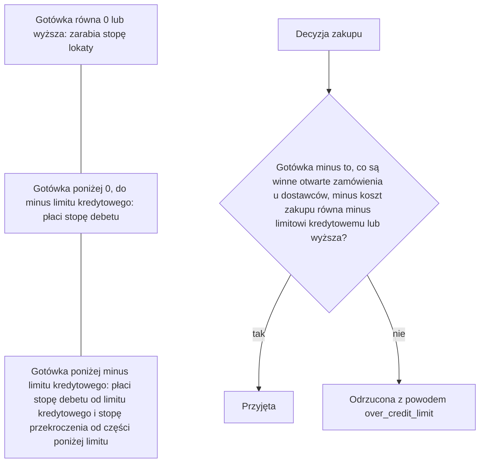
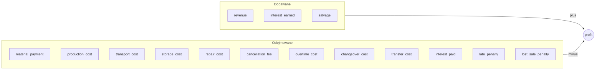

# Gotówka i zysk

Gotówka to pieniądze, które ma fabryka. Zysk to jedyna liczba, która ocenia przebieg.

Fabryka zaczyna przebieg z gotówką, którą podaje scenariusz. Gotówka może spaść poniżej
zera. Przy zamknięciu każdego okresu gotówka zarabia lub płaci odsetki według jednej z
trzech stóp manifestu. Zakup zostaje odrzucony, gdy jego koszt razem z tym, co są
jeszcze winne otwarte zamówienia u dostawców, zabrałby gotówkę poniżej minus limitu
kredytowego. Żadna inna decyzja nie jest odrzucana z powodu gotówki. Zysk to przychód
minus każdy koszt i każda kara, plus wartość odzysku zapasu na końcu. Produkcja i
przesunięcia, które nie trafiły jeszcze do zapasu, zamówienia u dostawców, które nie
dotarły, i zamówienia klientów przed okresem terminu nie liczą się wcale.

## Gotówka na początku

- `start.cash` scenariusza to gotówka w okresie 1, przed pierwszym krokiem. Może być
  poniżej 0. Domyślnie wynosi 0.
- Scenariusze biblioteki zaczynają z 0. Wyjątkiem jest `cash-squeeze`, który zaczyna z
  -120000.
- Każdy ruch gotówki to wiersz księgi kasowej, z rodzajem, krokiem i odwołaniem.
  `GET /api/v1/runs/{id}/periods` zwraca księgę kasową każdego okresu.

## Odsetki

Manifest ustala cztery stałe liczby pod `cash`:

| Klucz | Znaczenie | Fabryka przykładowa |
| --- | --- | --- |
| `credit_limit` | Kwota L. Gotówka poniżej -L płaci stopę przekroczenia. | 80000 |
| `credit_interest` | Część gotówki równej 0 lub wyższej, zarabiana w okresie. | 0.0003 |
| `debit_interest` | Część gotówki poniżej 0, do -L, płacona w okresie. | 0.0015 |
| `overdraft_interest` | Część gotówki poniżej -L, płacona w okresie. | 0.0040 |

- Każda stopa wynosi od 0 do 1. Stopy nie maleją od jednej do następnej:
  `credit_interest` <= `debit_interest` <= `overdraft_interest`. Manifest, który łamie
  tę zasadę, zostaje odrzucony.
- Odsetki to ostatni ruch gotówki w okresie. Liczy się je przy zamknięciu okresu, po
  składowaniu i karach, od gotówki c w tej chwili:

  ```text
  c >= 0:        earned = c * credit_interest
  -L <= c < 0:   paid   = -c * debit_interest
  c < -L:        paid   = L * debit_interest + (-c - L) * overdraft_interest
  ```

- Odsetki zaokrągla się do 4 miejsc po przecinku na niekorzyść fabryki: odsetki
  zarobione w dół, odsetki zapłacone w górę.
- Księga kasowa zapisuje je jako `interest_earned` lub `interest_paid`. Zdarzenie
  `interest` podaje kwotę.



Trzy przedziały gotówki przy zamknięciu okresu i sprawdzenie zakupu.

## Limit kredytowy przy zakupach

Zakup zostaje odrzucony z powodem `over_credit_limit`, gdy:

```text
cash - committed - quantity * unit price < -credit limit
```

- `cash` to gotówka w chwili sprawdzenia. Uwzględnia decyzje wysyłki, anulowania,
  przesunięcia, naprawy i produkcji z tego okresu; zakupy przyjęte przed tym zakupem
  liczą się w `committed`.
- `committed` to suma otwartej ilości razy cena za sztukę po wszystkich otwartych
  zamówieniach u dostawców, także początkowych zamówieniach i brakujących częściach,
  które jeszcze mają dotrzeć. To kwota, którą fabryka jest jeszcze winna, gdy wszystko
  otwarte dotrze w całości i przejdzie kontrolę przy przyjęciu.
- Cenę za sztukę ustala się w chwili złożenia zamówienia, z rabatem, zmianą ceny i
  dopłatą ekspresową (zobacz [Dostawcy](suppliers.md)).
- Wynik decyzji podaje `asked`, ilość razy cena za sztukę, z najwyżej 7 miejscami po
  przecinku, i `available`, gotówka plus limit kredytowy minus `committed`, z miejscami
  gotówki, najwyżej 11. `available` może być poniżej 0 i wtedy każdy zakup zostaje
  odrzucony.
- To ostatnie sprawdzenie zakupu. Zakup, który nie przejdzie wcześniejszego
  sprawdzenia, zostaje odrzucony z tamtego powodu (zobacz [Decyzje](decisions.md)).
- Decyzje wysyłki, anulowania, przesunięcia, naprawy i produkcji nigdy nie są
  odrzucane z powodu gotówki.
- Fabryka poniżej minus limitu kredytowego kupuje znowu, gdy płatności za wysłane
  sztuki podniosą `available` do kosztu zakupu. Start, którego zapas nigdy nie
  przyniesie tyle, odrzuca każdy zakup przebiegu.
- Gotówka może mimo to spaść poniżej minus limitu kredytowego. Dzieje się tak przez
  koszty, które nie są zakupami, takie jak produkcja, składowanie, kary i odsetki, oraz
  przez płatności za zamówienia złożone wcześniej. Gotówka poniżej limitu płaci wtedy
  stopę przekroczenia.

## Zysk

```text
profit = revenue
         - material_payment - production_cost - overtime_cost - changeover_cost
         - transport_cost - transfer_cost - storage_cost - repair_cost
         - cancellation_fee
         - interest_paid + interest_earned
         - late_penalty - lost_sale_penalty
         + salvage
```

| Składnik | Co zawiera | Zasady |
| --- | --- | --- |
| `revenue` | Cena każdej wysłanej sztuki, zapłaconej lub nie. | [Klienci i popyt](customers-and-demand.md) |
| `material_payment` | Przyjęte sztuki zamówień u dostawców razy cena za sztukę. | [Dostawcy](suppliers.md) |
| `production_cost` | Rozpoczęte sztuki razy koszt za sztukę na linii. | [Produkcja](production.md) |
| `overtime_cost` | Nadgodziny razy koszt za nadgodzinę. | [Produkcja](production.md) |
| `changeover_cost` | Koszt ustawienia linii na pozycję. | [Produkcja](production.md) |
| `transport_cost` | Wysłane sztuki razy koszt transportu razy współczynnik transportu. | [Klienci i popyt](customers-and-demand.md) |
| `transfer_cost` | Przesunięte sztuki razy koszt trasy. | [Magazyny i trasy](warehouses-and-routes.md) |
| `storage_cost` | Zapas i przesunięcia w drodze razy koszt składowania razy współczynnik składowania, w każdym okresie. | [Magazyny i trasy](warehouses-and-routes.md) |
| `repair_cost` | Przywrócony stan razy koszt naprawy. | [Produkcja](production.md) |
| `cancellation_fee` | Anulowane sztuki zamówień u dostawców razy opłata. | [Dostawcy](suppliers.md) |
| `interest_paid`, `interest_earned` | Odsetki przy zamknięciu każdego okresu. | [Odsetki](cash-and-profit.md#odsetki) |
| `late_penalty`, `lost_sale_penalty` | Kary zamówień klientów. | [Klienci i popyt](customers-and-demand.md) |
| `salvage` | Zapas na końcu razy wartość odzysku. | [Wartość odzysku](cash-and-profit.md#wartość-odzysku) |

- Tę samą liczbę liczy się z gotówki:

  ```text
  profit = cash at end - cash at start + receivables at end + salvage
  ```

  Każdy koszt i każda kara zabiera gotówkę. Cały przychód jest albo zapłacony,
  albo wciąż jest należnością.
- `GET /api/v1/runs/{id}/result` podaje po końcu przebiegu `profit`, `cash_at_start`,
  `cash_at_end`, `receivables` i `terms`. `terms` zawiera każdy składnik wzoru jako
  kwotę równą 0 lub wyższą.
- Miary zapisuje się obok zysku. Nie zmieniają go.



Składniki zysku, tak jak nazywa je `GET /api/v1/runs/{id}/result`.

## Wartość odzysku

- `salvage_value` pozycji to pieniądze, jakie jedna sztuka w zapasie jest warta na
  końcu przebiegu. Zakres losuje się raz na przebieg.
- salvage = suma po magazynach i pozycjach: zapas na końcu razy wartość odzysku.
- Manifest zostaje odrzucony, gdy wartość odzysku może być wyższa niż koszt pozycji:
  - dla materiału: jego najniższa cena w dowolnym katalogu, z rabatami;
  - dla komponentu lub produktu: wartości odzysku pozycji wejściowych jednej sztuki
    plus koszt za sztukę na linii, dla najtańszej receptury i linii.
- Scenariusz zostaje odrzucony, gdy jego zmiany cen mogłyby obniżyć najniższą cenę
  materiału poniżej jego wartości odzysku.
- Dlatego kupienie lub wytworzenie pozycji tylko po to, by mieć ją na końcu, nigdy nie
  podnosi zysku.

## Koniec przebiegu

Przebieg kończy się przy zamknięciu ostatniego okresu. Wtedy:

- Zapas liczy się według wartości odzysku.
- Produkcja, która nie trafiła jeszcze do zapasu, i przesunięcia w drodze są nic
  niewarte. Ich koszty pozostają zapłacone.
- Należności liczą się w całości, także te z okresem płatności po ostatnim okresie.
- Zamówienia u dostawców, które nie dotarły, nie są płacone. Nie liczą się wcale.
- Każde otwarte zamówienie klienta, którego okres terminu nadszedł, przepada przy
  zamknięciu ostatniego okresu i płaci karę za utraconą sprzedaż za niewysłane sztuki.
- Zamówienia klientów przed okresem terminu nic nie płacą i nic nie przynoszą.

## Przykład

Przebieg `cash-squeeze` na fabryce przykładowej z ziarnem 7. `cash-squeeze` to
`steady-market` z gotówką na początku -120000. Agent próbuje jednego zakupu w
okresie 1 i nic więcej nie decyduje. Limit kredytowy wynosi 80000.

- Okres 1, krok 5: sprawdza się decyzję
  `{"kind": "buy", "supplier": "emea-electronic-parts", "material": "lcd-panel", "quantity": 100, "warehouse": "main-plant"}`.
  Cena wynosi 45.6.
  - Nic jeszcze nie zapłacono ani nie otrzymano, więc gotówka wynosi -120000.
    Żadne zamówienie u dostawcy nie jest otwarte, więc `committed` wynosi 0.
  - asked = 100 x 45.6 = 4560.
  - available = -120000 + 80000 - 0 = -40000.
  - -120000 - 0 - 4560 = -124560 jest poniżej -80000. Zakup zostaje
    odrzucony z powodem `over_credit_limit`, `asked` 4560 i `available` -40000.
- Okres 1, krok 6: składowanie zapasu początkowego kosztuje 472.3753. Gotówka wynosi
  -120000 - 472.3753 = -120472.3753, poniżej -80000.
  - odsetki = 80000 x 0.0015 + (120472.3753 - 80000) x 0.0040 = 120 + 161.8895012 =
    281.8895012, w górę do 281.8896.
  - Gotówka przy zamknięciu wynosi -120754.2649.
- Koniec przebiegu: nic nie zostało wysłane, wytworzone ani kupione, więc zapas się nie
  zmienia. Składowanie wynosi 52 x 472.3753 = 24563.5156, a wartość odzysku zapasu
  początkowego 27434.2103.

| Składnik | Kwota |
| --- | --- |
| `revenue` | 0 |
| `storage_cost` | 24563.5156 |
| `interest_paid` | 87014.0268 |
| `late_penalty` | 274633.248 |
| `lost_sale_penalty` | 376982.56 |
| `salvage` | 27434.2103 |
| każdy inny składnik | 0 |

- Ze składników: 0 - 24563.5156 - 87014.0268 - 274633.248 - 376982.56 + 27434.2103 =
  -735759.1401.
- Z gotówki: -883193.3504 - (-120000) + 0 + 27434.2103 = -735759.1401.

`steady-market` z ziarnem 7 i bez decyzji ma zysk -709331.2306. Każdy składnik poza
odsetkami jest taki sam. Różnica 26427.9095 to o 26427.9095 więcej zapłaconych
odsetek.
