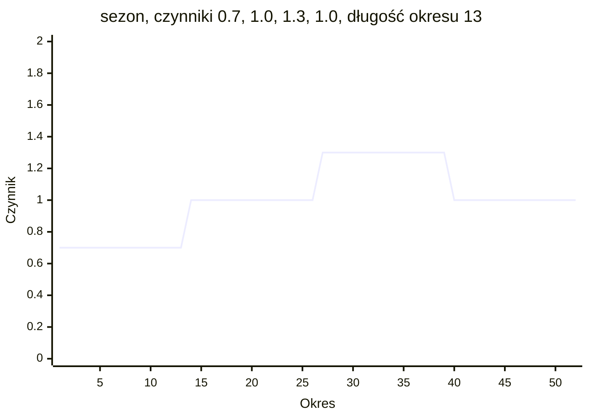
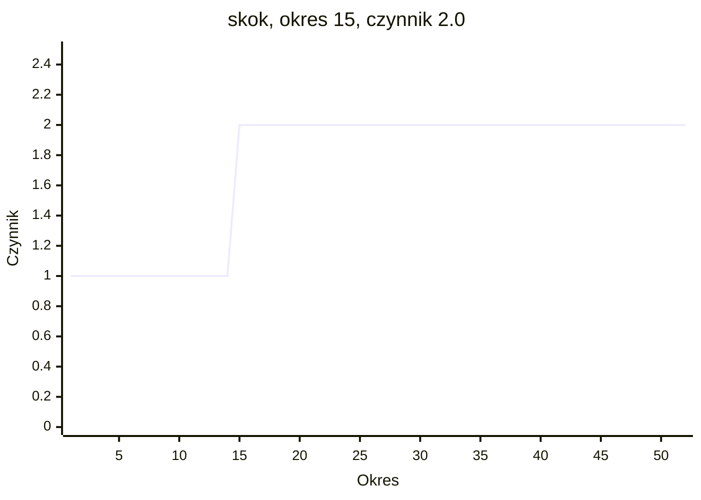
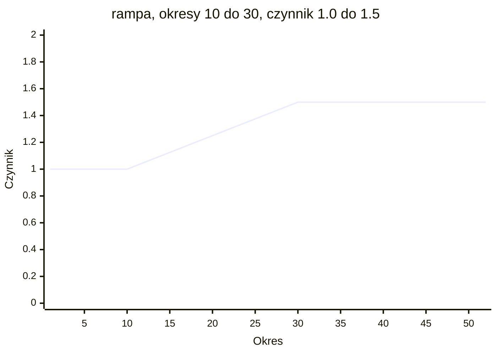
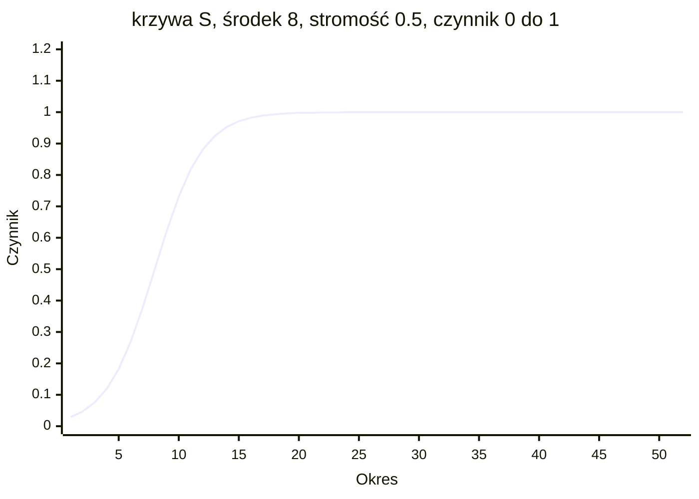
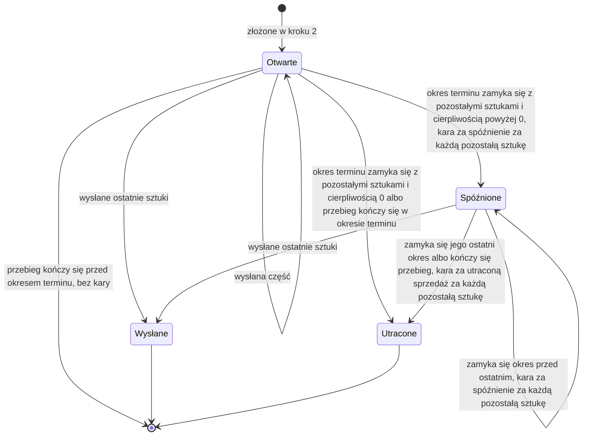

# Klienci i popyt

Klienci kupują produkty.

Dla każdej pary klienta i produktu świat zawiera popyt bazowy na każdy okres. Kształty
popytu ze scenariusza mnożą go w czasie. Popyt okresu staje się jednym zamówieniem
klienta, z okresem terminu o czas realizacji później. Każda sztuka niewysłana do
zamknięcia swojego okresu terminu płaci karę za spóźnienie za każdy okres, aż zostanie
wysłana albo przepadnie. Sztuki wciąż niewysłane, gdy kończy się cierpliwość, przepadają
z karą za utraconą sprzedaż. Wysłana sztuka zarabia swoją cenę, kosztuje koszt
transportu i jest płacona po terminie płatności klienta.

## Popyt bazowy

- Każda para klienta i produktu ma popyt bazowy na okres: `demand` w
  `customers.<id>.products.<product>` w manifeście. Jest stałą liczbą albo zakresem.
- Zakres jest losowany na nowo dla każdego okresu. Wszystkie losowania są robione z
  ziarna przed okresem 1. Cztery rozkłady opisuje strona
  [Losowość i uczciwość](randomness-and-fairness.md).
- Popyt bazowy nigdy nie zależy od decyzji. Każdy agent, który dostaje ten sam
  manifest, scenariusz i ziarno, ma ten sam popyt bazowy.
- Scenariusz może ukryć popyt każdej pary, z jego trwałością i częścią wspólną
  (zobacz [Informacje](information.md)).

## Trwałość popytu

`demand_persistence` p pary to część od 0 do 1, domyślnie 0. Przenosi część
poprzedniego popytu bazowego na następny okres:

```text
base(1) = draw(1)
base(t) = p * base(t - 1) + (1 - p) * draw(t)
```

draw(t) to wartość wylosowana z zakresu w okresie t. Wynik jest zaokrąglany połówkowo
do parzystej do 3 miejsc po przecinku. Przy p = 0 każdy okres jest losowany osobno. Przy
p = 0.5, base(1) = 40 i draw(2) = 30 daje base(2) = 20 + 15 = 35. Manifest, który
podaje `demand_persistence` dla stałego `demand`, jest odrzucany.

## Część wspólna

`common_share` s produktu to część od 0 do 1, domyślnie 0. To część zmienności
popytu, którą wszyscy klienci produktu mają wspólną.

- Każdy okres losuje jedną wspólną liczbę losową dla produktu i jedną własną liczbę
  losową dla każdej pary.
- Każda liczba losowa jest zamieniana na wartość standardowego rozkładu normalnego.
  Obie wartości są mieszane:

  ```text
  z = sqrt(s) * common value + sqrt(1 - s) * own value
  ```

- z jest zamieniane z powrotem na liczbę losową. Para losuje z nią swój popyt z
  własnego zakresu i rozkładu.
- z znów jest wartością standardowego rozkładu normalnego. Dlatego każda para zachowuje
  swój zakres, swoją średnią i to, jak bardzo się zmienia. Zmienia się tylko część
  zmienności, która jest wspólna.
- Przy s = 0 każda para zmienia się osobno. Przy s = 1 każdy klient produktu losuje z
  tą samą liczbą losową. Większe s sprawia, że klienci produktu zamawiają więcej albo
  mniej w tych samych okresach.
- Trwałość popytu działa po tym losowaniu.
- Część wspólna powyżej 0 jest odrzucana dla produktu, który mniej niż dwóch klientów
  kupuje z zakresem popytu.
- Każdy produkt fabryki przykładowej ma część wspólną 0.

## Kształty popytu

Kształt popytu to czynnik w czasie, który mnoży popyt bazowy. Scenariusz podaje swoje
kształty w `demand_shapes`. t oznacza okres:

| Rodzaj | Klucze | Czynnik w okresie t |
| --- | --- | --- |
| `trend` | `rate` | (1 + rate) do potęgi (t - 1) |
| `season` | `factors`, `period_length` | `factors[i]`, gdzie i = floor((t - 1) / period_length) mod (liczba czynników), licząc od 0 |
| `step` | `period`, `factor` | `factor`, gdy t >= period, w przeciwnym razie 1 |
| `ramp` | `first`, `last`, `from_factor`, `to_factor` | `from_factor`, gdy t <= first; `to_factor`, gdy t >= last; w przeciwnym razie from_factor + (to_factor - from_factor) * (t - first) / (last - first) |
| `s_curve` | `middle`, `steepness`, `from_factor`, `to_factor` | from_factor + (to_factor - from_factor) / (1 + exp(-steepness * (t - middle))) |

- Trend wynosi 1 w okresie 1 i w każdym kolejnym okresie jest mnożony przez
  (1 + rate). Ujemne `rate` sprawia, że spada.
- Sezon dzieli okresy na bloki po `period_length`. Blok 1 używa pierwszego czynnika,
  blok 2 drugiego, a po ostatnim czynniku lista zaczyna się od nowa.
- Skok zmienia czynnik raz, w okresie `period`, do końca przebiegu.
- Rampa biegnie w linii prostej od `from_factor` w okresie `first` do `to_factor` w
  okresie `last`.
- Krzywa S jest w połowie drogi między swoimi dwoma czynnikami w okresie `middle`.
  Większe `steepness` przyspiesza zmianę. Daleko przed środkiem czynnik wynosi
  `from_factor`.
- Każdy czynnik wynosi co najmniej 0. `rate` jest powyżej -1. `factors` ma co
  najmniej 1 wpis, a `period_length` wynosi co najmniej 1. W rampie `first` jest przed
  `last`. `steepness` jest powyżej 0. `period`, `first`, `last` i `middle` są liczbami
  całkowitymi i mogą leżeć poza horyzontem. `rate` i czynniki mają 4 miejsca po
  przecinku.
- `target` to `all`, jeden klient, jeden produkt, jedna para klienta i produktu albo
  grupa klientów lub produktów (zobacz [Grupy](groups.md)).
- Gdy kilka kształtów ma tę parę za cel, ich czynniki się mnożą. Para, która nie jest
  celem żadnego kształtu, ma czynnik 1.
- Kształty są stałymi liczbami scenariusza, takimi samymi dla każdego ziarna. Agent
  widzi je w opisie.

Pięć wykresów pokazuje czynnik każdego rodzaju w 52 okresach.

```mermaid
xychart-beta
    title "trend, rate 0.0100"
    x-axis "Okres" 1 --> 52
    y-axis "Czynnik" 0 --> 2
    line [1.000, 1.010, 1.020, 1.030, 1.041, 1.051, 1.062, 1.072, 1.083, 1.094, 1.105, 1.116, 1.127, 1.138, 1.149, 1.161, 1.173, 1.184, 1.196, 1.208, 1.220, 1.232, 1.245, 1.257, 1.270, 1.282, 1.295, 1.308, 1.321, 1.335, 1.348, 1.361, 1.375, 1.389, 1.403, 1.417, 1.431, 1.445, 1.460, 1.474, 1.489, 1.504, 1.519, 1.534, 1.549, 1.565, 1.580, 1.596, 1.612, 1.628, 1.645, 1.661]
```

Trend z `rate` 0.0100: 1 w okresie 1 i 1.01 do potęgi 51 = 1.661 w okresie 52.



Sezon z `factors` 0.7000, 1.0000, 1.3000 i 1.0000 oraz `period_length` 13: 0.7 w
okresach od 1 do 13, 1.0 od 14 do 26, 1.3 od 27 do 39 i 1.0 od 40 do 52.



Skok w okresie 15 z czynnikiem 2.0000: 1 w okresach od 1 do 14 i 2 od okresu 15.
Scenariusz `demand-step` podnosi każdy produkt do czynnika 6.0000 od okresu 11.



Rampa z `first` 10, `last` 30, `from_factor` 1.0000 i `to_factor` 1.5000: 1 do okresu
10, 1 + 0.5 x 10 / 20 = 1.25 w okresie 20 i 1.5 od okresu 30.



Krzywa S z `middle` 8, `steepness` 0.5000, `from_factor` 0.0000 i `to_factor` 1.0000:
1 / (1 + exp(3.5)) = 0.029 w okresie 1, 0.5 w okresie 8 i 0.998 w okresie 20.

## Popyt okresu

Popyt pary w okresie t to:

```text
demand(t) = base(t) * factor of every shape that targets the pair
                    * factor of every demand_shock acting on the product
```

zaokrąglony połówkowo do parzystej do 3 miejsc po przecinku. Zakłócenie rodzaju
`demand_shock` opisuje strona [Zakłócenia](disruptions.md).

Przy popycie bazowym 40, trendzie z `rate` 0.0100 i skoku od okresu 3 z czynnikiem 1.5
popyt okresu 3 wynosi 40 x 1.01 x 1.01 x 1.5 = 61.206.

## Zamówienia klientów

- W kroku 2 każdego okresu każda para, której popyt w okresie jest powyżej 0, składa
  jedno zamówienie klienta na tę ilość. Pary idą w kolejności klienta, potem
  produktu.
- Identyfikator zamówienia to `order-<period>-<n>`, gdzie n liczy nowe zamówienia
  okresu od 1.
- Okres terminu to okres, w którym zamówienie wpływa, plus `lead_time` pary. Przy czasie
  realizacji 0 okres terminu to okres, w którym zamówienie wpływa.
- Ostatni okres to okres terminu plus `patience` pary.
- Ilość i okres terminu zamówienia nigdy się nie zmieniają.
- Scenariusz może podać początkowe zamówienia klientów w `start.customer_orders`.
  Każde podaje parę, ilość i okres terminu, wpływa w okresie 0, ma identyfikator
  `order-0-<n>` i ma cierpliwość, cenę i kary swojej pary.
- Obserwacja pokazuje każde otwarte zamówienie klienta: jego ilość, wysłane sztuki
  oraz okres wpłynięcia, okres terminu i ostatni okres. Agent dowiaduje się o
  zamówieniu w okresie, w którym ono wpływa. Przyszły popyt widzi tylko przez
  prognozy (zobacz [Informacje](information.md)).



Zamówienie klienta od wpłynięcia do końca. Utracone sztuki płacą karę za utraconą
sprzedaż i w tym okresie nie płacą kary za spóźnienie.

## Kary za spóźnienie i za utraconą sprzedaż

Przy zamknięciu każdego okresu każde otwarte zamówienie klienta jest sprawdzane w tej
kolejności:

1. Gdy okres jest ostatnim okresem zamówienia albo gdy okres jest ostatnim okresem
   przebiegu i okres terminu zamówienia już nadszedł, niewysłane sztuki przepadają.
   Kosztują `lost_sale_penalty` za sztukę, a zamówienie się zamyka.
2. W przeciwnym razie, gdy okres jest okresem terminu albo późniejszym, niewysłane
   sztuki kosztują `late_penalty` za sztukę.

- Dlatego zamówienie z cierpliwością P płaci karę za spóźnienie w P okresach, a potem
  przepada.
- Przy cierpliwości 0 zamówienie przepada przy zamknięciu swojego okresu terminu, bez
  kary za spóźnienie.
- Gdy przebieg się kończy, przepada każde otwarte zamówienie, którego okres terminu
  nadszedł. Zamówienie, którego termin jeszcze nie nadszedł, nic nie płaci.
- Każda kara od razu zabiera gotówkę. Zdarzenia `late_penalty` i `lost_sale` podają
  sztuki i kwotę. `lost_sale` ma też `at_end`: true, gdy zamówienie przepada przez
  koniec przebiegu przed swoim ostatnim okresem.

## Wysyłki

Decyzja wysyłki podaje otwarte zamówienie klienta, ilość i magazyn. Jest odrzucana, gdy
ilość jest większa niż to, co zostało z zamówienia, albo większa niż zapas produktu w
magazynie (zobacz [Decyzje](decisions.md)).

- Zamówienie można wysyłać w częściach, z kilku magazynów, w dowolnym okresie od jego
  wpłynięcia do jego ostatniego okresu.
- Wysyłka dociera do klienta w okresie, w którym zostaje wysłana. Nic nie jest w drodze
  do klienta.
- Przychód to ilość x `price` pary. Liczy się w chwili wysłania sztuki, zapłaconej
  albo nie.
- Koszt transportu to ilość x `transport_cost` pary x `transport_factor` magazynu, z
  którego wychodzą sztuki. Od razu zabiera gotówkę. Współczynnik transportu wynosi 1,
  chyba że manifest go ustawia (zobacz [Magazyny i trasy](warehouses-and-routes.md)).
- Zamówienie, z którego nic nie zostało, zamyka się.

## Termin płatności i należności

- `payment_terms` klienta to liczba okresów, domyślnie 0.
- Przy terminie płatności 0 gotówka rośnie o przychód od razu.
- W przeciwnym razie przychód staje się należnością: wysyłka, klient, kwota i okres
  płatności, czyli okres wysyłki plus termin płatności. Klient płaci ją w kroku 2
  okresu płatności.
- Klient zawsze płaci należność w całości.
- Należność z okresem płatności po ostatnim okresie zostaje niezapłacona i liczy się w
  całości do zysku (zobacz [Gotówka i zysk](cash-and-profit.md)).
- Obserwacja pokazuje każdą niezapłaconą należność.

## Przykład

Przebieg `steady-market` na fabryce przykładowej z ziarnem 7. W okresie 1 agent
wysyła jedno zamówienie klienta. Nie decyduje nic więcej.

| Para | Czas realizacji | Cierpliwość | Kara za spóźnienie | Kara za utraconą sprzedaż | Cena | Koszt transportu |
| --- | --- | --- | --- | --- | --- | --- |
| `tier1-distributor`, `industrial-controller` | 2 | 4 | 3 | 20 | 144 | 3.2 |
| `tier1-distributor`, `sensor-gateway` | 1 | 2 | 12 | 30 | 108 | 2.4 |

Czas realizacji, cierpliwość i kary pochodzą z grup `spare-parts` i `new-devices`.
`tier1-distributor` ma termin płatności 4. `distribution-centre` ma współczynnik
transportu 0.85.

- Okres 1, krok 2: `steady-market` nie ma kształtu popytu, więc każde zamówienie to
  popyt bazowy swojej pary. `tier1-distributor` składa `order-1-8` na 43.754
  `industrial-controller`, z okresem terminu 1 + 2 = 3 i ostatnim okresem 3 + 4 = 7.
  Składa też `order-1-9` na 13.384 `sensor-gateway`, z okresem terminu 1 + 1 = 2 i
  ostatnim okresem 2 + 2 = 4.
- Okres 1, krok 5: decyzja
  `{"kind": "ship", "order": "order-1-8", "quantity": 43.754, "warehouse": "distribution-centre"}`
  jest przyjęta jako `ship-1-1`. Zamówienie się zamyka.
  - Przychód: 43.754 x 144 = 6300.576.
  - Koszt transportu, zapłacony od razu: 43.754 x 3.2 x 0.85 = 119.01088.
  - 6300.576 staje się należnością z okresem płatności 1 + 4 = 5.
- Okres 2, krok 6: `order-1-9` jest w swoim okresie terminu z 13.384 pozostałymi
  sztukami. Płaci 13.384 x 12 = 160.608.
- Okres 3, krok 6: `order-1-9` jest spóźnione. Znowu płaci 160.608.
- Okres 4, krok 6: okres 4 to ostatni okres `order-1-9`. Jego 13.384 sztuki
  przepadają i kosztują 13.384 x 30 = 401.52, bez kary za spóźnienie.
- Okres 5, krok 2: `tier1-distributor` płaci 6300.576.

Przebieg podaje te same liczby: należność w obserwacji, zdarzenia `late_penalty`,
`lost_sale` i `customer_payment` oraz księgę kasową z `GET /api/v1/runs/{id}/periods`.
