# Zakłócenia

Zakłócenie zmienia część fabryki lub jej partnerów na kilka okresów.

Zakłócenie ma rodzaj, cel, początek, czas trwania i jedną wartość działania. Jest
dziewięć rodzajów: trzy działają na dostawców i ich dostawy, dwa na materiały, jeden na
produkty i trzy na linie. Scenariusz zapisuje zakłócenie ze stałym początkiem albo
podaje regułę, która losuje zakłócenia z ziarna. Jedno zakłócenie może na kilka okresów
podnieść szansę innego. Agent widzi zakłócenie od pewnej liczby okresów przed jego
początkiem. Ta liczba to zapowiedź.

## Dziewięć rodzajów

| Rodzaj | Cel | Klucz działania | Działanie, póki zakłócenie trwa | Miara, którą zmienia |
| --- | --- | --- | --- | --- |
| `supplier_outage` | dostawcy | `strength` | Ilość, która dociera od dostawcy, jest mnożona przez (1 - strength), także w dosłaniach. Wstrzymana część przepada. | `units_arrived` |
| `quality_drop` | dostawcy | `strength` | Przyjęta część dostawy od dostawcy jest mnożona przez (1 - strength), także w dosłaniach. | `units_rejected_at_inspection` |
| `transport_delay` | dostawcy | `delay` | Zamówienie u dostawcy, które dotarłoby w okresie działania zakłócenia, dociera `delay` okresów później. | `units_arrived_late` |
| `material_shortage` | materiały | `strength` | Największa ilość materiału na okres u każdego dostawcy jest mnożona przez (1 - strength). | `decisions_rejected` |
| `price_change` | materiały | `factor` | Cena materiału u każdego dostawcy jest mnożona przez czynnik, dla zamówień u dostawców złożonych w czasie działania. | `material_payment` |
| `demand_shock` | produkty | `factor` | Popyt każdego klienta na produkt jest mnożony przez czynnik. | `units_ordered` |
| `line_breakdown` | linie | `loss` | Stan linii jest mnożony przez (1 - loss), raz, w okresie początku. Nie ma czasu trwania. | `condition` |
| `capacity_cut` | linie | `strength` | Zdolność i nadgodziny linii są mnożone przez (1 - strength). | `units_started` |
| `yield_drop` | linie | `strength` | Uzysk produkcji rozpoczętej na linii w czasie działania jest mnożony przez (1 - strength). | `units_scrap` |

Zasady wartości działania:

- `strength` i `loss` to części od 0 do 1. `factor` jest powyżej 0. `delay` to liczba
  całkowita okresów, co najmniej 1.
- Dwa zakłócenia tego samego rodzaju na tym samym celu działają oba: ich części
  (1 - strength), ich części (1 - loss) lub ich czynniki się mnożą. Dwa opóźnienia
  transportu sumują swoje opóźnienia.
- Opóźnienie transportu stosuje się raz, przy złożeniu zamówienia. Okres dotarcia to
  okres złożenia plus czas realizacji, plus opóźnienie spóźnionej dostawy, plus
  opóźnienia każdego opóźnienia transportu, które działa w tym okresie dotarcia.
  Dosłanie nie jest opóźniane.
- Przestój powoduje utratę części, którą wstrzymuje. Dosłanie pokrywa tylko
  część wstrzymaną przez kompletność (zobacz [Dostawcy](suppliers.md)).
- Limit zakupu przy niedoborze materiału zaokrągla się w dół do 3 miejsc po przecinku.
- Scenariusz zostaje odrzucony, gdy jego zmiany cen mogłyby obniżyć najniższą cenę
  materiału poniżej jego wartości odzysku albo poniżej opłaty za anulowanie u
  dostawcy, który go sprzedaje.
- Żadne zakłócenie nie działa na początkowe zamówienia u dostawców ze scenariusza.
  Docierają w całości i są przyjęte.
- Awaria linii obniża godziny linii w okresie swojego początku; zobacz
  [Produkcja](production.md).

## Kiedy zakłócenie działa

- Zakłócenie działa w okresach od początku do początek + czas trwania - 1. Zakłócenie z
  początkiem 10 i czasem trwania 3 działa w okresach 10, 11 i 12.
- `line_breakdown` działa tylko w okresie swojego początku.
- Zdarzenie podaje początek zakłócenia w okresie jego początku, a koniec w pierwszym
  okresie, w którym już nie działa. Awaria linii jest podawana jako zdarzenie awarii.

## Cele

Cel to jedna z trzech rzeczy:

- lista identyfikatorów, na przykład `["apac-chips"]`;
- `all`: każdy obiekt rodzaju, na który działa zakłócenie, na przykład każdy dostawca;
- grupa, zapisana jako jej rodzaj i identyfikator, na przykład `{"region": "apac"}`.
  Członkowie grupy muszą być rodzaju, na który działa zakłócenie.

Obserwacja pokazuje każdy cel jako posortowaną listę identyfikatorów, które obejmuje.
Zobacz [Grupy](groups.md).

## Zakłócenia zapisane

Zakłócenie zapisane ma `kind`, `target`, `start`, `duration` (nie dla
`line_breakdown`), swój klucz działania i `notice` (domyślnie 0). Jego początek leży w
horyzoncie, a początek minus zapowiedź wynosi co najmniej 1. Dlatego nigdy nie jest
widoczne przed okresem 1. Każdy klucz jest stałą liczbą.

## Zakłócenia losowe

Zakłócenie losowe to nazwana reguła scenariusza. Jej zakłócenia losuje się z ziarna
razem z resztą świata, przed okresem 1.

- Reguła ma `name`, `kind`, `target`, `chance`, swój klucz działania, `duration` (nie
  dla `line_breakdown`) oraz opcjonalnie `notice` i `choose`.
- Działanie może być stałą liczbą albo zakresem dowolnego z czterech rozkładów. Czas
  trwania i `delay` opóźnienia transportu mogą być stałą liczbą albo zakresem z równą
  szansą (zobacz [Losowość i uczciwość](randomness-and-fairness.md)).
- Każde wylosowane zakłócenie trafia w dokładnie jeden cel.
- Bez `choose` w każdym okresie każdy cel reguły zaczyna własne zakłócenie z szansą
  reguły.
- Z `choose: one` w każdym okresie z szansą reguły zaczyna się jedno zakłócenie.
  Trafia w cel, którego własne losowanie w tym okresie jest najmniejsze. Dodanie celu
  do reguły zmienia wybór tylko w okresach, w których wygrywa nowy cel.
- Czas trwania i działanie wylosowanego zakłócenia to wartości wylosowane w okresie
  jego początku.
- Reguła zachowuje każdy wylosowany początek. Początek w okresie do `notice` włącznie
  jest widoczny od okresu 1.
- Reguła nie zaczyna niczego na celu, na którym wciąż działa wcześniejsze zakłócenie tej
  samej reguły. Z `choose: one`, gdy wybrany cel jest takim celem, w tym okresie nic się
  nie zaczyna.
- Potem wylosowane zakłócenie działa dokładnie tak jak zapisane. Jego identyfikator to
  `<name>/<start>/<target>`.
- Każda reguła losuje z własnego strumienia liczb, oznaczonego jej nazwą. Dodanie,
  usunięcie lub zmiana kolejności reguły nie zmienia żadnego losowania innych reguł.

## Zakłócenie losowe o zapisanym początku

- Reguła może mieć zapisany `start`. Wtedy nie ma `chance` ani `choose`.
- Reguła zaczyna dokładnie jedno zakłócenie, w tym okresie. Losuje się tylko jego cel,
  tak samo jak przy `choose: one`. Jego czas trwania i działanie losuje się w tym
  okresie.
- Jego początek leży od `notice` + 1 do horyzontu.
- Badanie wie wtedy, kiedy przyjdzie zakłócenie, a agent nie wie, w który cel ono
  trafi.

## Kaskady

- Reguła może podnieść szansę innej reguły kluczem `raises`. Podaje w nim nazwę innej
  reguły (`rule`), czynnik powyżej 1 (`factor`) i liczbę okresów, co najmniej 1
  (`periods`).
- Gdy reguła podnosząca zaczyna zakłócenie w okresie s, na dowolnym celu, szansa
  nazwanej reguły wynosi szansa x czynnik, najwyżej 1. Trwa to w okresach od s + 1 do
  s + periods, na każdym celu nazwanej reguły.
- Gdy dwa okna na siebie zachodzą, szansy nie mnoży się dwa razy. W okresie wewnątrz
  kilku okien liczy się największy czynnik. Podniesiona szansa trwa, aż skończy się
  późniejsze okno.
- Kaskada ma jeden poziom. Reguła wskazana przez `raises` nie ma własnego `raises` ani
  zapisanego początku. Żadna reguła nie wskazuje samej siebie.
- Reguła z zapisanym początkiem może podnieść inną regułę. Sama nie może być
  podniesiona, bo nie ma szansy.
- Podniesienie zmienia tylko to, czy nazwana reguła zaczyna zakłócenie. Każda reguła
  losuje te same liczby z podniesieniem i bez niego.

Przykład: reguła `apac-outage` podnosi `apac-transport`, której szansa wynosi 0.04,
czynnikiem 5 na 4 okresy. Gdy przestój zaczyna się w okresie 20, szansa opóźnienia
transportu wynosi 0.04 x 5 = 0.2 w każdym z okresów 21 do 24. Jeśli drugi przestój
zaczyna się w okresie 22, szansa w okresach 23 i 24 wynosi 0.2, a nie 1, i zostaje 0.2
do okresu 26. Jeśli zamiast tego inna reguła podnosi `apac-transport` czynnikiem 3 na
4 okresy i zaczyna w okresie 22, okresy 21 do 24 zachowują 0.2, a okresy 25 i 26 mają
0.04 x 3 = 0.12.

## Zapowiedź

- Zakłócenie jest widoczne od okresu początek minus zapowiedź. Przy zapowiedzi 0 jest
  widoczne od swojego początku.
- Od tego okresu do swojego ostatniego okresu obserwacja wymienia je w `disruptions` z
  identyfikatorem, rodzajem, celem, początkiem, czasem trwania i działaniem.
- Opis przebiegu pokazuje reguły zakłóceń losowych, ale nie zakłócenia zapisane.
  Agent dowiaduje się o zakłóceniu zapisanym dopiero wtedy, gdy staje się ono
  widoczne.
- Gdy scenariusz ukrywa czas trwania zakłóceń, obserwacja nie pokazuje czasu trwania, a
  żadna prognoza nie zawiera szoku popytu.
- Prognoza zawiera szok popytu dopiero od okresu, w którym szok jest widoczny.

Opis, obserwację i ukryte grupy parametrów przedstawia strona
[Informacje](information.md).

```mermaid
gantt
    title Początek 10, czas trwania 32, zapowiedź 4
    dateFormat X
    axisFormat %s
    section Obserwacja
    Widoczne przed działaniem : notice, 6, 10
    Widoczne i działa : shown, 10, 42
    section Działanie
    Działa : acting, 10, 42
```

Scenariusz `notice` z biblioteki zapisuje przestój i niedobór materiału z tymi
wartościami. Oba są widoczne od okresu 6 i działają w okresach 10 do 41.

## Przykład

Przebieg `supplier-outage` na fabryce przykładowej z ziarnem 0. Scenariusz zapisuje
`supplier_outage` o sile 1 na `apac-chips` i `material_shortage` o sile 1 na
`microchip-b`, oba z początkiem 10, czasem trwania 32 i zapowiedzią 0. Oba działają w
okresach 10 do 41. Agent kupuje 500 `microchip`, minimalną ilość, od `apac-chips` w
okresie 6. W okresie 10 próbuje kupić 100 `microchip-b` od `emea-electronic-parts` i
nic więcej nie decyduje.

- Okres 6: zamówienie `buy-6-1` zostaje złożone po 6.3762 za sztukę, ze spodziewanym
  dotarciem w okresie 10. Obserwacja okresu 6 nie pokazuje zakłócenia: przy
  zapowiedzi 0 przestój nie jest jeszcze widoczny.
- Okres 10, pierwszy okres obu zakłóceń: dostawa `buy-6-1` przychodzi na czas. Jej
  kompletność wynosi 0.9768, więc dotarłoby 500 x 0.9768 = 488.4 sztuki, a 11.6 zostaje
  wstrzymane. Przestój mnoży 488.4 sztuki przez (1 - 1) = 0. Zdarzenie dostawy pokazuje:
  dotarło 0, przyjęto 0, przepadło 488.4, płatność 0.
- 11.6 sztuki wstrzymane przez kompletność mają przyjść jako dosłanie 2 okresy później,
  w okresie 12.
- Okres 10: niedobór mnoży przez (1 - 1) = 0 największą ilość `microchip-b` na
  okres, 1500. Decyzja zakupu
  `{"kind": "buy", "supplier": "emea-electronic-parts", "material": "microchip-b", "quantity": 100, "warehouse": "main-plant"}`
  zostaje odrzucona z `over_max_quantity`, `asked` 100 i `available` 0.
- Okres 12: przestój wciąż działa, więc dosłanie też zostaje obcięte. Zdarzenie
  dosłania pokazuje: zamówiono 11.6, dotarło 0, przepadło 11.6. Zamówienie zamyka się.
- Okres 42: 2 zdarzenia `disruption_ended` podają koniec obu zakłóceń. Obserwacja
  okresu 42 już ich nie wymienia.

Z 500 zamówionych sztuk 488.4 + 11.6 = 500 przepada. Fabryka przyjmuje i opłaca
0 sztuk.
