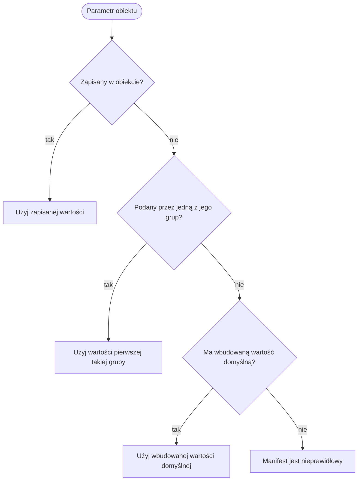

# Grupy

Grupa to zbiór obiektów jednego typu w manifeście, na przykład region dostawców albo
segment produktów.

Grupa daje wartości domyślne swoim członkom. Dzięki temu liczbę wspólną dla regionu lub
segmentu zapisuje się raz. Wartość zapisana w obiekcie wygrywa z wartością jego grupy,
a wartość grupy wygrywa z wbudowaną wartością domyślną. Grupa może być celem zakłócenia
lub kształtu popytu, na przykład przestoju całego regionu. Każda miara liczona dla
obiektu jest też liczona dla grupy.

## Czym jest grupa

- Grupa ma identyfikator, `kind` i opcjonalne `defaults`.
- Rodzaj to dowolne słowo, na przykład `region`, `segment`, `tier` lub `category`. Nie
  może to być `customer` ani `product`.
- Grupa ma członków tylko jednego typu: materiały, komponenty, produkty, dostawców,
  klientów lub linie. Materiały, komponenty i produkty to trzy różne typy.
- Grupa ma co najmniej jednego członka.
- Obiekt wymienia swoje grupy pod kluczem `groups`, najwyżej jedną grupę każdego
  rodzaju. Obiekt może należeć do kilku grup różnych rodzajów.
- Słowa `materials`, `components`, `products`, `all`, `written` i `default` nie są
  identyfikatorami grup.

Fabryka przykładowa ma dziesięć grup:

| Grupa | Rodzaj | Członkowie |
| --- | --- | --- |
| `emea`, `apac`, `amer` | region | dostawcy |
| `new-devices`, `spare-parts` | segment | produkty |
| `semiconductor`, `passive`, `connector`, `display`, `mechanical` | category | materiały |

Ukryta grupa parametrów scenariusza nie jest grupą w tym sensie. Wskazuje parametr,
który ma pozostać ukryty przed agentem (zobacz [Informacje](information.md)).

## Wartości domyślne

Grupa daje wartości domyślne tylko pod kluczami, których używają jej członkowie:

| Członkowie | Klucze `defaults` |
| --- | --- |
| materiały | `items`, `catalogue` |
| komponenty | `items`, `line_items` |
| produkty | `items` (także `common_share`), `line_items`, `customer_products` |
| dostawcy | `catalogue` |
| klienci | `customers`, `customer_products` |
| linie | `lines`, `line_items` |

- Wartość domyślna to parametr liczbowy. Rabaty nie mogą być wartościami domyślnymi.
- Parametr, który nie może być zakresem, grupa podaje tylko jako stałą liczbę.
- Zakres podany przez grupę losuje się osobno dla każdego członka. Dwaj członkowie
  jednej grupy mogą wylosować dwie różne wartości.

## Która wartość wygrywa

Parametr obiektu przyjmuje pierwszą wartość znalezioną w tej kolejności:

1. wartość zapisana w obiekcie;
2. wartości domyślne jego grup, w kolejności, w jakiej obiekt je wymienia;
3. wbudowana wartość domyślna, dla parametru opcjonalnego.

Wymagany parametr bez wartości z żadnego z tych trzech miejsc czyni manifest
nieprawidłowym.

Niektóre parametry należą naraz do dwóch obiektów. Ich grupy przeszukuje się w tej
kolejności:

- wpis katalogu: grupy dostawcy, potem grupy materiału;
- produkt klienta: grupy klienta, potem grupy produktu;
- wpis linii: grupy linii, potem grupy pozycji.

Świat zapisuje, skąd pochodzi każda wartość losowana raz na przebieg: `written`,
identyfikator grupy albo `default`. Wartość losowana dla każdego zdarzenia, na przykład
kompletność, podlega tej samej regule grup i nie ma jej w świecie. Opis pokazuje
grupy tak, jak zostały zapisane, i każdego członka z jego własną wartością.

Dla wpisu katalogu, produktu klienta lub wpisu linii "jego grupy" oznacza grupy
obu obiektów, w kolejności podanej wyżej.

## Grupy jako cele

Grupę zapisuje się jako cel w postaci `{"<kind>": "<identifier>"}`, na przykład
`{"region": "apac"}`. Jej rodzaj musi zgadzać się z grupą. Oznacza każdego członka
grupy.

- Zakłócenie może mieć za cel grupę, której członkowie są typu, na który działa:
  grupę dostawców dla przestoju, materiałów dla zmiany ceny, produktów dla szoku popytu,
  linii dla obniżenia zdolności. Zobacz [Zakłócenia](disruptions.md).
- Kształt popytu i wpis prognozy mogą mieć za cel grupę klientów lub produktów. Zobacz
  [Klienci i popyt](customers-and-demand.md).
- Magazyn może przyjmować grupę pozycji, zapisaną jako `{"group": "<identifier>"}` na
  jego liście `accepts`. Zobacz [Magazyny i trasy](warehouses-and-routes.md).

## Miary dla grup

Każda miara liczona dla klienta, produktu, dostawcy i materiału, linii lub pozycji jest
też liczona dla grupy, pod kluczem `groups.<identifier>`.

- Przepływ lub poziom grupy to suma po jej członkach. Dla miary liczonej dla pary
  obiektów, na przykład dostawcy i materiału, grupa sumuje każdą parę, która zawiera
  jednego z jej członków.
- `condition` grupy linii to średnia stanów jej członków.
- Stosunek dla grupy, na przykład `on_time_share`, liczy się z sum liczników i
  mianowników po członkach, a nie jako średnią stosunków członków.
- Obiekt w grupach kilku rodzajów liczy się w każdej z nich.

Dzięki temu badanie może porównać udział sztuk wysłanych na czas w segmentach
`new-devices` i `spare-parts`.

## Przykład

Przebieg `steady-market` na fabryce przykładowej z ziarnem 0, bez decyzji.
Wartości poniżej odczytano ze świata przebiegu po jego końcu.

Czas realizacji `microchip` od `apac-chips`:

1. Wpis katalogu nie zapisuje `lead_time`.
2. Dostawca `apac-chips` należy do grupy `apac`, która podaje czas realizacji od 3
   do 5. Materiał `microchip` należy do grupy `semiconductor`, która nie podaje czasu
   realizacji. Dlatego wartość pochodzi z `apac`.
3. Zakres losuje się tylko dla tego wpisu katalogu: 4 dla ziarna 0. Świat zapisuje
   `"origin": "apac"` i `"drawn": true`.

Ta sama grupa daje dwóm wpisom katalogu `apac-displays-plastics` ich własne
losowania: 3 dla `lcd-panel` i 5 dla `plastic-resin`.

Inne wartości tego samego wpisu katalogu pochodzą z innych miejsc:

- kompletność, zakres od 0.97 do 1 losowany dla każdej dostawy, pochodzi z
  `semiconductor`, grupy materiału, bo ani wpis katalogu, ani `apac` jej nie podaje;
  nie ma jej w świecie;
- opłata za anulowanie, 0.65, jest zapisana we wpisie katalogu.

Wartość zapisana wygrywa z grupą: `amer-metals` należy do grupy `amer`, która podaje
czas realizacji 3. Jego wpis katalogu dla `copper-wire` przyjmuje 3, z pochodzeniem
`amer`. Jego wpis katalogu dla `passive-kit` zapisuje czas realizacji 1, który
wygrywa, z pochodzeniem `written`.

Wbudowana wartość domyślna wypełnia to, czego nikt nie zapisuje: `module-assembly-line`
nie zapisuje nadgodzin, a jej grupy ich nie podają, więc ma 0, z pochodzeniem
`default`.

Produkty `smart-monitor` i `sensor-gateway` należą do segmentu `new-devices`. Każdy ich
produkt klienta przyjmuje z tej grupy cierpliwość 2 i karę za spóźnienie 12. W całym
przebiegu `units_ordered` wynosi 5089.545 dla `smart-monitor` i 4263.654 dla
`sensor-gateway`. Dla grupy `new-devices` wynosi 5089.545 + 4263.654 = 9353.199.
