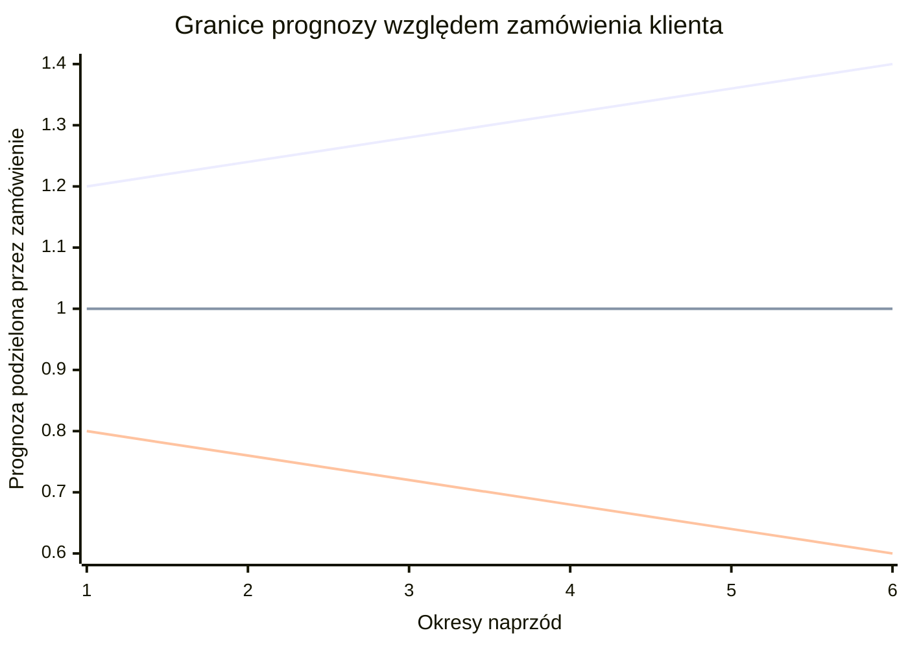
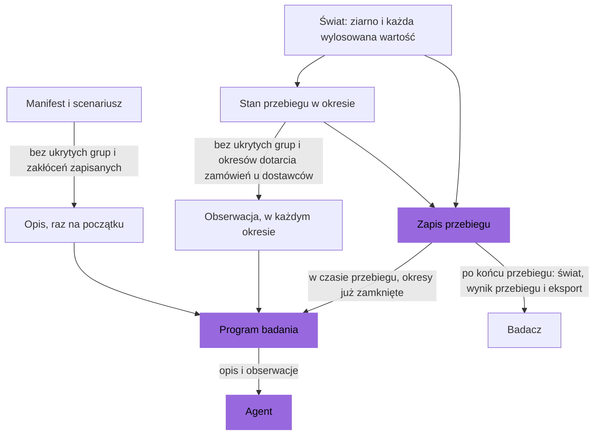

# Informacje

Agent zna reguły fabryki, ale nie zna przyszłości. Dostaje opis fabryki raz, na
początku przebiegu, i obserwację na początku każdego okresu. Nigdy nie widzi ziarna
ani wartości wylosowanej dla nadchodzącego okresu. Scenariusz ustala jeszcze trzy
rzeczy o informacji: parametry, które ukrywa, zapowiedź każdego zakłócenia i prognozy
popytu z ich szumem. W czasie przebiegu interfejs HTTP pokazuje opis, obserwację i
okresy już zamknięte. Świat i wynik przebiegu można odczytać dopiero po końcu
przebiegu.

## Opis

Agent dostaje opis raz, na początku przebiegu. Interfejs HTTP trzyma go w `description`
przebiegu, w odpowiedzi na `POST /api/v1/runs` i `GET /api/v1/runs/{id}`. Opis ma trzy
części.

- `manifest`: fabryka. Identyfikatory, receptury, linie, magazyny, trasy, grupy i
  budowa fabryki są zawsze pokazane.
  - Parametr, który scenariusz może ukryć, jest pokazany jako jego zakres, nigdy jako
    wartość wylosowana dla przebiegu. Przykłady: uzysk linii i pozycji, punktualność
    dostawcy.
  - Każdy inny parametr jest pokazany z wartością wylosowaną dla przebiegu. Przykłady:
    ceny, czasy realizacji, koszty i zdolności.
  - Cena losowana na nowo w każdym okresie jest pokazana jako jej zakres, z
    `drawn: period`. Jej wartość w bieżącym okresie jest w obserwacji.
  - Ukryty parametr nie jest pokazany wcale.
- `scenario`: horyzont, stan początkowy, kształty popytu, parametry prognoz, reguły
  zakłóceń losowych i lista ukrytych grup parametrów.
- `linear`: true, gdy manifest jest liniowy.

Każdy zakres w opisie ma `cut_mean`, średnią swojego rozkładu obciętego do `min` i
`max`, zaokrągloną połówkowo do parzystej do 6 miejsc po przecinku. Zakres normalny
zachowuje swoją `mean`, średnią bez obcięcia. Popyt logarytmicznie normalny z `median`
35 i `spread` 0.4, obcięty do zakresu od 14 do 70, ma `cut_mean` 36.222159.

Opis nigdy nie zawiera zakłóceń zapisanych, zakłóceń wylosowanych z reguł losowych,
ziarna ani nazwy i opisu scenariusza.

## Obserwacja

Obserwacja przychodzi na początku każdego okresu, z
`GET /api/v1/runs/{id}/observation` albo w odpowiedzi na zgłoszenie poprzedniego
okresu. Zawiera cały stan przebiegu, który agent może zobaczyć. Żadna lista nie
jest skrócona.

| Klucz | Co zawiera |
| --- | --- |
| `period`, `horizon`, `finished` | Gdzie jest przebieg. |
| `cash` | Gotówkę teraz. |
| `receivables` | Każdą jeszcze niezapłaconą należność: wysyłkę, klienta, kwotę i okres płatności. |
| `stock` | Zapas każdej pozycji, którą przyjmuje każdy magazyn, także równy 0. |
| `space` | Dla każdego magazynu: miejsce, które zajmuje jego zapas, miejsce zarezerwowane dla produkcji jeszcze nie w zapasie, otwartych zamówień u dostawców i przesunięć w drodze do niego, oraz jego pojemność. |
| `lines` | Dla każdej linii: jej stan, pozycję, na którą jest ustawiona, oraz zwykłe godziny, godziny naprawy i nadgodziny, jakie ma w okresie. |
| `production` | Każdą produkcję jeszcze nie w zapasie: linię, pozycję, recepturę, rozpoczętą ilość i okres gotowości. |
| `plans` | Każdy plan, który jeszcze się nie zaczął, z okresem początkowym i kluczami jego decyzji produkcji. |
| `transfers` | Każde przesunięcie w drodze: pozycję, ilość, magazyn źródłowy, magazyn docelowy i okres dotarcia. |
| `customer_orders` | Każde otwarte zamówienie klienta: klienta, produkt, ilość, wysłaną ilość, okres wpłynięcia, okres terminu i ostatni okres. |
| `supplier_orders` | Każde otwarte zamówienie u dostawcy: dostawcę, materiał, magazyn, ilość, otwartą ilość, cenę za sztukę, czy jest ekspresowe, okres złożenia i spodziewany okres dotarcia. |
| `forecasts` | Prognozy popytu dla każdej pary klienta i produktu, którą wskazuje scenariusz. |
| `prices` | Cenę bieżącego okresu każdego dostawcy i materiału, którego cena jest losowana w każdym okresie. |
| `disruptions` | Każde widoczne zakłócenie: identyfikator, rodzaj, cel, początek, działanie i, jeśli nie jest ukryty, czas trwania. |
| `outcomes` | Wynik każdej decyzji i każdego planu wykonanych w poprzednim okresie. |
| `events` | Każde zdarzenie od poprzedniej obserwacji, na przykład dostawy, nowe zamówienia klientów, awarie, zakończoną produkcję, kary, koszt składowania i odsetki. |

- Spodziewany okres dotarcia zamówienia u dostawcy złożonego decyzją zakupu to okres
  złożenia plus czas realizacji albo ekspresowy czas realizacji. Opóźnienie nie jest w
  nim ujęte. Zamówienie u dostawcy ze stanu początkowego pokazuje okres dotarcia
  zapisany w scenariuszu.
- Zdarzenia pokazują, co się stało. Dostawa: ilość zamówiona, dostarczona, przyjęta i
  utracona oraz płatność. Awaria: jej strata. Produkcja, która trafiła do zapasu:
  dobre sztuki i braki.
- Zdarzenia z zamknięcia ostatniego okresu są tylko w zapisie przebiegu.
- Obserwacja nie zawiera historii. Agent sam przechowuje to, co chce pamiętać.
  Zapis przebiegu przechowuje wszystko.

## Czego nigdy nie widać

Zamówienie klienta pojawia się, gdy klient je składa. Dostawa pokazuje swoje ilości,
gdy dociera. Żadna decyzja nie pokazuje ich wcześniej: zamówienie ekspresowe przynosi
własne wartości dostawy, nigdy wartości zamówienia zwykłego, które jest jeszcze
w drodze (zobacz [Dostawcy](suppliers.md)).

Do końca przebiegu ścieżki HTTP jego świata, wyniku i eksportu odpowiadają kodem 409
(zobacz [Kto co może czytać](#kto-co-może-czytać)).

## Ukryte grupy parametrów

Scenariusz może ukryć grupy parametrów, wymienione w `hidden`. Można ukryć tylko tych
9 grup:

| Grupa | Co ukrywa |
| --- | --- |
| `customers.products.demand` | Popyt każdego klienta i produktu, z jego trwałością, oraz część wspólną każdego produktu. |
| `suppliers.catalogue.punctuality` | Szansę, że dostawa jest na czas. |
| `suppliers.catalogue.delay` | Dodatkowe okresy, jakie trwa spóźniona dostawa. |
| `suppliers.catalogue.completeness` | Część otwartej ilości, która dociera w dostawie. |
| `suppliers.catalogue.acceptance` | Część sztuk, które dotarły, która przechodzi kontrolę. |
| `lines.items.yield` | Część rozpoczętych sztuk, które wychodzą dobre. |
| `lines.breakdown_chance` | Szansę awarii linii w okresie. |
| `lines.breakdown_loss` | Część stanu, którą zabiera awaria. |
| `disruptions.duration` | Czas trwania zakłóceń. |

- Ukryta grupa jest pominięta wszędzie: w każdym obiekcie, który ją ma, w wartościach
  domyślnych każdej grupy i w obserwacji.
- Gdy `disruptions.duration` jest ukryta, widoczne zakłócenie nie pokazuje czasu
  trwania, reguły zakłóceń losowych nie pokazują czasu trwania, a żadna prognoza nie
  zawiera szoku popytu.
- Zrealizowane wyniki pozostają widoczne: strata przy awarii, dobre sztuki i braki
  zakończonej produkcji, ilości dostawy i ilość zamówienia klienta.
- Prognoza dla pary, której popyt jest ukryty, jest dozwolona.

Badanie może zmieniać ukryte grupy jako czynnik informacji.

## Zapowiedź zakłóceń

Zakłócenie jest widoczne od okresu `start - notice`. Przy domyślnej zapowiedzi 0 jest
widoczne od swojego okresu początkowego.

- Widoczne zakłócenie pojawia się w `disruptions` każdej obserwacji od swojego
  pierwszego widocznego okresu do ostatniego aktywnego okresu. Pokazuje swój rodzaj,
  cel jako listę identyfikatorów, początek, działanie i, jeśli nie jest ukryty, czas
  trwania.
- Reguła losowa zachowuje każdy wylosowany początek. Początek w okresie do `notice`
  włącznie jest widoczny od okresu 1, więc ma krótszą zapowiedź niż pełna.
- Prognoza nigdy nie pokazuje zakłócenia, zanim stanie się ono widoczne.
- W scenariuszu `notice` w okresach od 10 do 41 nie dociera żadna dostawa od
  `apac-chips` i żaden dostawca nie sprzedaje `microchip-b`, każde z zapowiedzią 4. Oba
  zakłócenia są widoczne od okresu 6.

Zobacz [Zakłócenia](disruptions.md).

## Prognozy

Scenariusz może dawać prognozy popytu. Każdy wpis `forecasts` ma cel w postaci par
klienta i produktu oraz `periods_ahead`, `noise` i `noise_growth`. Para ma najwyżej
jeden wpis. Para bez wpisu nie ma prognozy.

W okresie t, dla każdej wskazanej pary i każdego k od 1 do `periods_ahead`, przy
którym t + k nie przekracza horyzontu, obserwacja zawiera prognozę okresu t + k:

- Zaczyna od ilości zamówienia klienta, które para złoży w okresie t + k, bez szoków
  popytu, które w okresie t nie są jeszcze widoczne.
- Mnoży tę ilość przez `1 + e`, zaokrągla do 3 miejsc po przecinku i nie pozwala jej
  spaść poniżej 0.
- e jest sumą k przyrostów, z których każdy jest losowany z równą szansą w swoim
  zakresie i zaokrąglany do 4 miejsc po przecinku: jeden między `-noise` i `noise`, a
  k - 1 między `-noise_growth` i `noise_growth`. Dlatego e leży między `-w` i `w`, gdzie
  `w = noise + noise_growth * (k - 1)`, i częściej blisko 0 niż blisko `-w` albo `w`.
- Przyrosty nadchodzącego okresu są losowane raz. Prognoza tego okresu zrobiona okres
  później pomija przyrost wylosowany dla najdalszej odległości, więc zmienia się z
  okresu na okres, a zakres jej błędu się zawęża.

Gdy `noise` i `noise_growth` są równe 0, prognoza jest równa nadchodzącemu zamówieniu
klienta, chyba że zmieni je szok popytu, który nie jest jeszcze widoczny. Większe
wartości dają większe błędy, a prognozy na dalsze okresy mają większe błędy. Prognozy
są częścią świata, więc każdy agent w tym samym świecie widzi te same prognozy.

Obserwacja zapisuje je jako `{"<customer>/<product>": [{"period", "quantity"}, ...]}`.
W ostatnim okresie każda lista jest pusta.

Scenariusz `forecasts` z biblioteki wskazuje każdą parę na 6 okresów naprzód,
z `noise` 0.20 i `noise_growth` 0.04. Prognoza na 1 okres naprzód różni się od
zamówienia klienta najwyżej o 20 procent; na 6 okresów najwyżej o 40 procent.



Górna linia to najwyższa prognoza, dolna linia to najniższa, a środkowa linia to
prognoza bez błędu. Każda prognoza leży między górną a dolną linią. Większość prognoz
leży blisko środkowej linii.

## Kto co może czytać

Program badania daje agentowi opis i obserwacje jego przebiegu, zamknięte okresy,
wyniki sprawdzeń i tylko ścieżki HTTP jego przebiegu. Ścieżki manifestu i scenariusza,
`GET /api/v1/manifests/{id}` i `GET /api/v1/scenarios/{id}`, odpowiadają każdemu
klientowi, wraz z zakłóceniami zapisanymi i ukrytymi parametrami. Przebieg pokazuje
swój `scenario_id`, więc klient, który zna ziarno, może zacząć bliźniaczy przebieg i
odczytać z niego przyszłe zamówienia klientów. Biblioteka scenariuszy jest w pakiecie,
więc badanie, które wymaga zaskoczenia, używa własnych scenariuszy. Optymalizator
odniesienia otrzymuje świat zakończonego przebiegu bez decyzji z tym samym
scenariuszem i ziarnem.



Interfejs HTTP odpowiada o przebiegu tak:

| Ścieżka | W czasie przebiegu | Po końcu przebiegu |
| --- | --- | --- |
| `GET /api/v1/runs/{id}`: przebieg i jego opis | tak | tak |
| `GET /api/v1/runs/{id}/observation` | tak | nie, odpowiedź 409 |
| `GET /api/v1/runs/{id}/periods`: każdy zamknięty okres | tak | tak |
| `GET /api/v1/runs/{id}/world`: ziarno i każda wylosowana wartość | nie, odpowiedź 409 | tak |
| `GET /api/v1/runs/{id}/result`: zysk, miary i ziarno | nie, odpowiedź 409 | tak |
| `GET /api/v1/runs/{id}/export` | nie, odpowiedź 409 | tak |

Przebieg w odpowiedzi interfejsu HTTP nigdy nie zawiera ziarna, świata ani stanu
przebiegu.

## Zmiana informacji

To, co agent wie, jest czynnikiem, który scenariusz ustawia na 3 sposoby.

| Czynnik | Klucz scenariusza | Przykładowe poziomy |
| --- | --- | --- |
| Ukryte parametry | `hidden` | nic nie jest ukryte; ukryty uzysk; ukryte uzysk, punktualność i popyt |
| Prognozy | `forecasts`, z `noise` i `noise_growth` | bez prognozy; `noise` 0.4; `noise` 0 |
| Zapowiedź zakłóceń | `notice` każdego zakłócenia | 0, widoczne od początku; 4, widoczne 4 okresy przed początkiem |

Aby zrobić taki wariant, odczytaj scenariusz biblioteki, zmień jeden klucz i wyślij go
jako nowy scenariusz tej samej fabryki, z nową nazwą:

```python
steady_body = call("GET", f"/scenarios/{steady['id']}")["content"]
variant = dict(
    steady_body, name="steady-market-hidden-yield", hidden=["lines.items.yield"]
)
hidden_yield = call("POST", f"/manifests/{factory['id']}/scenarios", variant)
```

`call` to funkcja programu badania ze strony [Szybki start](../start/quick-start.md).
Tam też znajduje się `factory` i `steady`. Odpowiedź to 201 z nowym scenariuszem albo
200, gdy ten sam scenariusz jest już zapisany. Sama biblioteka scenariuszy się nie
zmienia. Uruchom wariant i oryginał z tymi samymi ziarnami: różnią się wtedy tylko
czynnikiem. Wariant, który zmienia `notice` zakłócenia zapisanego, może ponumerować
zakłócenia zapisane w innej kolejności.

## Przykład

Przebieg `forecasts` na fabryce przykładowej z ziarnem 0. W okresie 1 obserwacja
zawiera 6 prognoz dla `equipment-maker/industrial-controller`, po jednej na każdy z
okresów od 2 do 7. Granica w wynosi 0.20 + 0.04 x (k - 1) dla prognozy na k okresów
naprzód. Błędy e są w `forecast_errors` świata, który można odczytać po końcu
przebiegu.

| Okresy naprzód | Okres | w | e | Zamówienie klienta | Prognoza |
| --- | --- | --- | --- | --- | --- |
| 1 | 2 | 0.20 | -0.0662 | 33.833 | 31.593 |
| 2 | 3 | 0.24 | -0.0889 | 31.094 | 28.330 |
| 3 | 4 | 0.28 | 0.1125 | 30.442 | 33.867 |
| 4 | 5 | 0.32 | -0.0116 | 28.344 | 28.015 |
| 5 | 6 | 0.36 | 0.0995 | 29.705 | 32.661 |
| 6 | 7 | 0.40 | 0.0208 | 30.007 | 30.631 |

Dla okresu 2: 33.833 x (1 - 0.0662) = 31.593. W okresie 2 prognoza okresu 3 jest na
1 okres naprzód, więc pomija przyrost odległości 2, -0.0889 - (-0.0592) = -0.0297. Jej
e wynosi -0.0592, a ona sama 31.094 x (1 - 0.0592) = 29.253.

```mermaid
gantt
    title Okna prognoz publikowane w kolejnych okresach
    dateFormat X
    axisFormat %s
    section Opublikowana w okresie 1
    Prognoza obejmuje okresy od 2 do 7 : p1, 2, 8
    section Opublikowana w okresie 2
    Prognoza obejmuje okresy od 3 do 8 : p2, 3, 9
```


