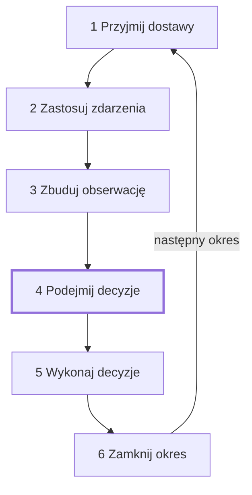

# Okres

Każdy okres przechodzi te same sześć kroków w tej samej kolejności. Agent działa
tylko w kroku 4. Pozostałe kroki przebiegają według reguł fabryki.

## Sześć kroków

1. Przyjmij dostawy. Zamówienia u dostawców z terminem dostawy w tym okresie docierają
   do swoich magazynów i są opłacane. Przesunięcia z terminem dotarcia w tym okresie
   docierają.
2. Zastosuj zdarzenia. Klienci płacą to, co jest należne. Zakłócenia zaczynają się
   albo kończą. Linie mogą mieć awarię. Klienci składają nowe zamówienia klienta.
3. Zbuduj obserwację. Symulator zapisuje to, co agent może zobaczyć. Ten krok nic
   nie zmienia.
4. Podejmij decyzje. Agent czyta obserwację i wysyła decyzje okresu.
5. Wykonaj decyzje. Każda decyzja jest sprawdzana. Jeśli przejdzie sprawdzenie, jest
   wykonywana. Kolejność to: wysyłka, anulowanie, przesunięcie, naprawa, produkcja,
   zakup.
6. Zamknij okres. Gotowa produkcja trafia do zapasu. Linie się zużywają. Fabryka płaci
   za składowanie. Spóźnione zamówienia płacą karę, a zamówienia po końcu cierpliwości
   przepadają. Fabryka płaci albo dostaje odsetki. Miary są zapisywane.

## Kiedy można użyć pozycji, która dotarła

Dostawa dociera w kroku 1, przed decyzjami. Materiały, które docierają w okresie,
mogą zostać użyte przez produkcję zdecydowaną w tym samym okresie. Przesunięcie,
które dociera w kroku 1, można wysłać w tym samym okresie.

## Kiedy produkcja trafia do zapasu

Produkcja trafia do zapasu w kroku 6 swojego okresu gotowości. Przy czasie realizacji
1 produkcja rozpoczęta w okresie trafia do zapasu przy zamknięciu tego okresu. Jej
sztuk można używać lub je wysyłać od następnego okresu. Przy czasie realizacji 2
trafia do zapasu przy zamknięciu kolejnego okresu. Godziny linii są wykorzystane w
okresie, w którym produkcja się zaczyna.

```mermaid
gantt
    title Produkcja z czasem realizacji 2 rozpoczęta w okresie 5
    dateFormat X
    axisFormat %s
    section Linia
    Wykorzystane godziny : hours, 5, 6
    section Produkcja
    Jeszcze nie w zapasie : making, 5, 7
    section Zapas
    Gotowe do użycia : usable, 7, 9
```

## Co wiadomo w chwili decyzji

Gdy agent decyduje, zna:

- opis: fabrykę i scenariusz w takim zakresie, w jakim scenariusz je pokazuje;
- obserwację okresu: gotówkę, zapas, godziny, jakie zostały każdej linii, otwarte
  zamówienia klientów i u dostawców, produkcję jeszcze niebędącą w zapasie, plany,
  przesunięcia w drodze, widoczne zakłócenia i prognozy;
- wyniki swoich decyzji z ostatniego okresu i zdarzenia od tamtej chwili.

Nie zna wylosowanych wartości świata: przyszłego popytu, tego, czy dostawa się spóźni
albo będzie niepełna, uzysków, awarii ani zakłóceń, które nie są jeszcze widoczne.

## Przykład

Przebieg `steady-market` na fabryce przykładowej z ziarnem 0, w którym agent kupuje
płytki drukowane w okresie 1 i wytwarza płyty sterujące w okresie 3.

- Okres 1, krok 5: kup 500 `pcb-blank` od `emea-electronic-parts` do `main-plant`
  po 3.8 za sztukę. Zamówienie u dostawcy `buy-1-1` zostaje złożone z czasem
  realizacji 2, więc oczekiwane jest w okresie 3. Na razie nic nie jest płacone.
- Okres 3, krok 1: zamówienie dociera. Z 500 sztuk dociera 490.05, a 9.95 dostawca
  wstrzymuje. Z tych, które dotarły, 481.964 zostaje przyjętych. Fabryka płaci
  481.964 x 3.8 = 1831.4632. Wstrzymane 9.95 mają dotrzeć okres później.
- Okres 3, krok 5: wytwórz 400 `control-board` na `smt-line` według receptury
  standardowej. 800 `microchip`, 400 `pcb-blank` i 400 `passive-kit` od razu
  opuszczają zapas. Linia nie jest ustawiona na żadną pozycję, więc przezbraja się na
  `control-board` przez 2 godziny za 300. Linia wykorzystuje 2 + 400 x 0.14 = 58 godzin.
  Fabryka płaci 300 + 400 x 4.9 = 2260.
- Okres 3, krok 6: przy czasie realizacji 1 produkcja trafia do zapasu przy
  zamknięciu okresu: 395.16 dobrych sztuk i 4.84 sztuki braków.
- Okres 4, krok 1: wstrzymane 9.95 docierają, a 9.786 zostaje przyjętych. 395.16 płyt
  sterujących można teraz użyć na linii montażu końcowego.
