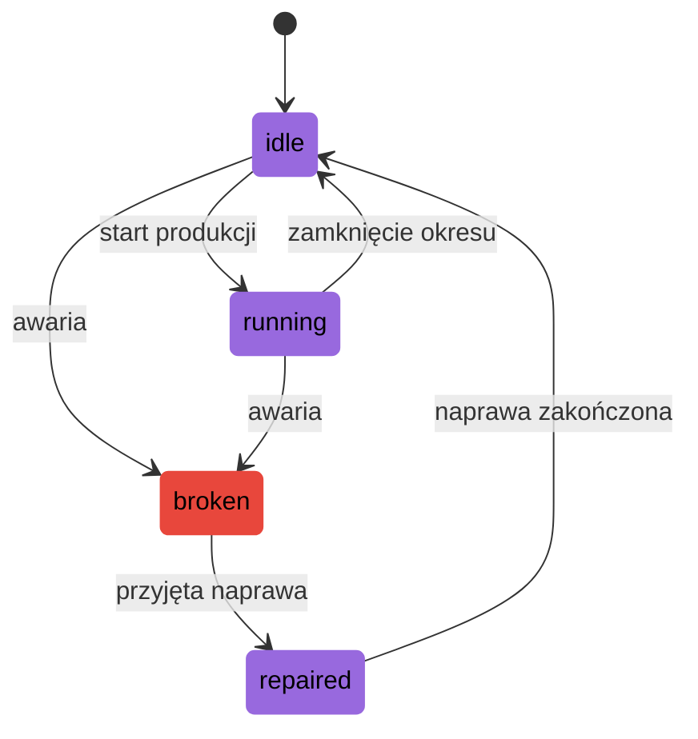
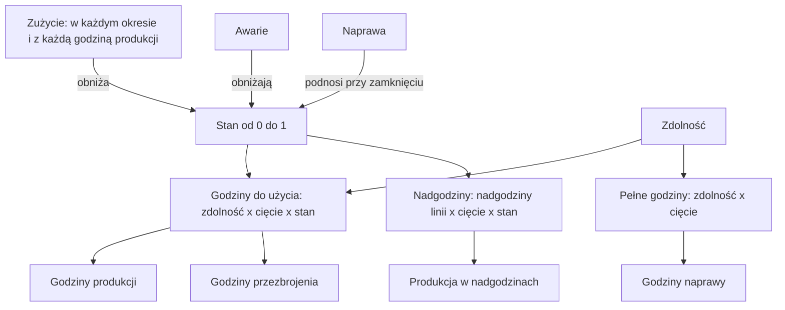

# Produkcja

Linie zamieniają materiały w komponenty, a komponenty w produkty.

Receptura mówi, jakie pozycje i ile ich potrzeba do jednej sztuki komponentu albo
produktu. Linia wytwarza kilka pozycji w jednym magazynie. W każdym okresie może
użyć swojej zdolności razy swój stan jako godzin produkcji. Stan spada w każdym
okresie i z każdą godziną produkcji, spada nagle przy awarii, a rośnie tylko przez
naprawę, za którą płaci agent. Nadgodziny dodają kilka godzin za koszt za godzinę.
Z rozpoczętych sztuk część wylosowana na każdy okres wychodzi dobra, a reszta to
braki.

## Receptury

- Receptura podaje pozycje wejściowe i ich ilości dla jednej sztuki komponentu albo
  produktu. Komponent powstaje tylko z materiałów, a produkt tylko z komponentów.
- Każda pozycja, którą wytwarza linia, ma co najmniej jedną recepturę. Pozycja może
  mieć kilka nazwanych receptur. W fabryce przykładowej `control-board` ma recepturę
  `standard` z `microchip` i recepturę `alternative` z `microchip-b` od innego
  dostawcy.
- Pozycja z kilkoma recepturami podaje swoją recepturę domyślną. Decyzja produkcji,
  która nie podaje receptury, jej używa.
- Pozycje wejściowe opuszczają zapas od razu, gdy produkcja się zaczyna. Ilość każdej
  pozycji wejściowej to rozpoczęta ilość razy ilość z receptury, zaokrąglona w górę do
  3 miejsc po przecinku.

## Linie

- Linia pracuje w jednym magazynie. Jej pozycje wejściowe pochodzą z tego magazynu, a
  pozycje, które wytwarza, do niego trafiają.
- Linia ma listę pozycji, które może wytwarzać. Dla każdej pozycji ma godziny na
  sztukę, koszt za sztukę, uzysk i czas realizacji produkcji.
- Jedną pozycję można wytwarzać na więcej niż jednej linii. W fabryce przykładowej
  `power-module` powstaje na `smt-line` w 0.112 godziny na sztukę i na
  `module-assembly-line` w 0.18 godziny.

Linia może produkować, gdy pracuje. Awaria unieruchamia ją do czasu, gdy naprawa
przywróci jej stan.

## Godziny i stan

- Zdolność to liczba godzin produkcji, jakie linia ma w jednym okresie przy stanie 1.
- Stan to liczba od 0 do 1. Przy stanie 0.5 linia ma do produkcji połowę swojej
  zdolności. Przy 0 nic nie wytwarza.
- Stan zmienia tylko godziny. Nigdy nie zmienia uzysku.
- W każdym okresie linia ma trzy ograniczenia godzin. "Cięcie" to część zdolności,
  która zostaje po cięciach zdolności działających w okresie; wynosi 1, gdy żadne
  nie działa (zobacz [Zakłócenia](disruptions.md)).
  - Zwykłe godziny produkcji plus godziny przezbrojenia wynoszą najwyżej zdolność x
    cięcie x stan.
  - Zwykłe godziny produkcji, godziny przezbrojenia i godziny naprawy razem wynoszą
    najwyżej zdolność x cięcie.
  - Nadgodziny wynoszą najwyżej nadgodziny linii x cięcie x stan.
- Każde ograniczenie jest zaokrąglane w dół do 3 miejsc po przecinku. Obserwacja
  pokazuje trzy ograniczenia jako `regular_hours_available`, `repair_hours_available`
  i `overtime_hours_available`.
- Godziny należą do jednego okresu. Niewykorzystane godziny przepadają. Godziny
  produkcji są wykorzystywane w okresie, w którym produkcja się zaczyna, niezależnie od
  jej czasu realizacji.

## Zużycie

- Przy zamknięciu każdego okresu stan każdej linii staje się równy:
  stan x (1 - zużycie na okres) - zużycie na godzinę x godziny produkcji + naprawy.
- Godziny produkcji to zwykłe godziny i nadgodziny produkcji rozpoczętej na linii w
  okresie. Godziny naprawy i przezbrojenia nie zużywają linii.
- Nowy stan jest zaokrąglany w dół do 12 miejsc po przecinku.
- Linia nigdy nie wraca do lepszego stanu sama.
- Manifest jest sprawdzany tak, aby zużycie na godzinę x (zdolność + nadgodziny)
  wynosiło najwyżej 1 - zużycie na okres, przy największej wartości każdego zakresu.
  Dzięki temu zużycie nigdy nie sprowadza stanu poniżej 0.

## Awarie

- Awaria zabiera część stanu linii: stan jest mnożony przez (1 - strata) i zaokrąglany
  w dół do 12 miejsc po przecinku.
- Awarie zdarzają się, gdy symulator stosuje zdarzenia, zanim agent podejmie
  decyzje. Obserwacja okresu już pokazuje niższe godziny.
- Awaria ma trzy źródła, w tej kolejności: zapisane zakłócenie `line_breakdown`,
  losowe zakłócenie `line_breakdown` oraz własna szansa awarii linii w każdym okresie,
  `breakdown_chance`, ze stratą losowaną dla każdej awarii, `breakdown_loss`.
- Awaria ze stratą 1 zatrzymuje linię: jej stan wynosi 0 i nie ma ona godzin
  produkcji, dopóki nie zostanie naprawiona.
- Awaria nie zmienia produkcji już rozpoczętej. Ta produkcja kończy się i trafia do
  zapasu zgodnie z planem.
- To, czy linia ulega awarii, nie zależy od tego, jak bardzo jest używana. Używanie
  obniża stan tylko przez zużycie.

## Naprawa

- Decyzja naprawy podaje linię i wielkość stanu do przywrócenia.
- Wielkość naprawy jest dodawana do stanu przy zamknięciu okresu, po zużyciu.
- Naprawy jednej linii w jednym okresie razem wynoszą najwyżej jej `repair_limit`.
- Razem wynoszą też najwyżej 1 minus stan w chwili decyzji. Dlatego stan nigdy nie
  przekracza 1.
- Naprawa zajmuje wielkość naprawy x `repair_time` godzin. Te godziny liczą się do
  limitu zdolność x cięcie, a nie do stanu. Stan nie ogranicza naprawy; ogranicza ją
  liczba godzin, które zostały w limicie zdolność x cięcie. Dlatego cięcie zdolności o
  sile 1 wstrzymuje każdą naprawę, dopóki działa.
- Naprawa kosztuje wielkość naprawy x `repair_cost`, płatne w chwili decyzji.
- W kolejności wykonania naprawy idą przed produkcją. Dlatego naprawa jest sprawdzana,
  zanim zostanie wykorzystana jakakolwiek godzina produkcji okresu.

## Nadgodziny

- Linia z `overtime_hours` powyżej 0 może produkować w nadgodzinach. Każda nadgodzina
  kosztuje `overtime_cost`.
- Decyzja produkcji z `overtime` równym true wykorzystuje na swoją produkcję tylko
  nadgodziny. Jej przezbrojenie, jeśli jest, nadal wykorzystuje zwykłe godziny.
- Nadgodziny zużywają linię tak jak zwykłe godziny produkcji.
- W fabryce przykładowej `smt-line` i `final-assembly-line` mają 16 nadgodzin po 55
  za godzinę. Pozostałe dwie linie nie mają nadgodzin.

## Przezbrojenia

- Linia pamięta pozycję, na którą jest ustawiona. Na początku przebiegu jest
  ustawiona na pozycję, którą podaje scenariusz, albo nieustawiona na żadną.
- Gdy wpis linii ma czas lub koszt przezbrojenia, produkcja tej pozycji na linii
  ustawionej na inną pozycję albo nieustawionej na żadną najpierw płaci przezbrojenie.
- Godziny przezbrojenia pochodzą ze zwykłych godzin. Koszt przezbrojenia jest płacony
  razem z produkcją.
- Gdy produkcja się zaczyna, linia zostaje ustawiona na jej pozycję. Utworzenie planu
  nie zmienia ustawienia linii. Wykonanie planu je zmienia.
- Decyzje produkcji jednej linii są wykonywane w podanej kolejności. Dlatego kolejność
  ma znaczenie. W fabryce przykładowej `smt-line` jest ustawiona
  na `control-board`, a każde przezbrojenie zajmuje 2 godziny i kosztuje 300.
  Wytworzenie `power-module`, potem `control-board`, potem `power-module` płaci 3
  przezbrojenia, 6 godzin i 900. Wytworzenie `control-board`, a potem dwa razy
  `power-module` płaci 1 przezbrojenie, 2 godziny i 300.
- Manifest z przezbrojeniem jest manifestem z korzyściami skali.

## Uzysk i braki

- Uzysk to część rozpoczętych sztuk, które wychodzą dobre. Jest losowany dla każdej
  linii, pozycji i okresu.
- Produkcja używa uzysku swojego okresu początkowego, razy `1 - strength` każdego
  zakłócenia `yield_drop` na linii w tym okresie.
- Produkcje jednej linii i pozycji rozpoczęte w jednym okresie tworzą partię,
  niezależnie od ich receptur i nadgodzin.
- Dobre sztuki partii = rozpoczęte sztuki partii x uzysk, zaokrąglone połówkowo do
  parzystej do 3 miejsc po przecinku. Przy uzysku 0.6 jedna produkcja 1 płytki i 1000
  produkcji po 0.001 płytki dają tak samo 0.6 dobrej płytki.
- W kolejności identyfikatorów każda produkcja partii dostaje zaokrąglone dobre sztuki
  partii do niej włącznie minus zaokrąglone dobre sztuki partii przed nią. Przy uzysku
  0.6 pierwsze trzy produkcje po 0.001 dostają 0.001, 0 i 0.001. Braki produkcji =
  jej rozpoczęte sztuki - jej dobre sztuki.
- Pozycje wejściowe braków przepadają. Koszt produkcji jest płacony za każdą
  rozpoczętą sztukę, także za braki.

## Czas realizacji produkcji

- Produkcja rozpoczęta w okresie t trafia do zapasu przy zamknięciu okresu
  t + czas realizacji - 1. Przy czasie realizacji 1 trafia do zapasu przy zamknięciu
  swojego okresu początkowego.
- Czas realizacji wpisu linii wynosi 1, chyba że manifest podaje inny. Każda pozycja
  fabryki przykładowej ma czas realizacji 1.
- Dopóki produkcja nie trafi do zapasu, zajmuje miejsce swoich rozpoczętych sztuk w
  magazynie linii (zobacz [Magazyny i trasy](warehouses-and-routes.md)).

## Koszty produkcji

Za produkcję fabryka płaci, gdy produkcja się zaczyna, w tej kolejności:

1. ilość x `cost` wpisu linii;
2. przy nadgodzinach: ilość x godziny na sztukę x `overtime_cost`;
3. koszt przezbrojenia, jeśli jest.

## Plany

- Decyzja produkcji ze `start` po bieżącym okresie staje się planem.
- Gdy plan powstaje, sprawdza się tylko jego okres początkowy, linię, pozycję i
  recepturę. Godziny, pozycje wejściowe i miejsce są sprawdzane, gdy plan jest
  wykonywany.
- Plan jest wykonywany w swoim okresie początkowym, przed decyzjami produkcji tego
  okresu, w kolejności swojego identyfikatora. Może wtedy zostać odrzucony jak każda
  decyzja produkcji.
- Plan można anulować, zanim zostanie wykonany, bez opłaty.

Sprawdzenia i powody odrzucenia opisuje strona [Decyzje](decisions.md).

Godziny produkcji i przezbrojenia dzielą godziny do użycia. Godziny produkcji,
przezbrojenia i naprawy razem dzielą pełne godziny.

## Przykład

Przebieg `steady-market` na fabryce przykładowej z ziarnem 0. Agent
wytwarza 400 płytek sterujących w okresie 3, naprawia `smt-line` w okresie 4 i nie
decyduje nic więcej.

Linia `smt-line` ma zdolność 80, zużycie na okres 0.005, zużycie na godzinę 0.0005, czas
naprawy 16, koszt naprawy 2500 i limit naprawy 0.5. Płytka sterująca zajmuje 0.14
godziny i kosztuje 4.9, a przezbrojenie na nią zajmuje 2 godziny i kosztuje 300. Na
początku linia nie jest ustawiona na żadną pozycję. W okresach od 1 do 5 linia nie ma
awarii.

- Okres 1: stan 1, więc 80 zwykłych godzin. Nic nie powstaje.
- Zamknięcie okresu 1: 1 x (1 - 0.005) = 0.995.
- Zamknięcie okresu 2: 0.995 x 0.995 = 0.990025.
- Okres 3: dostępne zwykłe godziny 80 x 0.990025 = 79.202. Wytworzenie 400
  `control-board` według receptury standardowej: 800 `microchip`, 400 `pcb-blank` i 400
  `passive-kit` opuszczają zapas. Linia wykorzystuje 400 x 0.14 = 56 godzin produkcji i
  2 godziny przezbrojenia, 58 ze swoich 79.202. Fabryka płaci 400 x 4.9 = 1960 i 300 za
  przezbrojenie. Linia jest teraz ustawiona na `control-board`.
- Zamknięcie okresu 3: uzysk `smt-line` i `control-board` wylosowany dla okresu 3 to
  0.9879. Dobre sztuki 400 x 0.9879 = 395.16; braki 400 - 395.16 = 4.84. Godziny
  przezbrojenia nie zużywają linii, więc stan staje się równy
  0.990025 x 0.995 - 0.0005 x 56 = 0.985074875 - 0.028 = 0.957074875.
- Okres 4: dostępne zwykłe godziny 80 x 0.957074875 = 76.56599, po zaokrągleniu w dół
  76.565. Dostępne nadgodziny 16 x 0.957074875 = 15.313. Naprawa o 0.04: wykorzystuje
  0.04 x 16 = 0.64 z 80 pełnych godzin i kosztuje 0.04 x 2500 = 100.
- Zamknięcie okresu 4: nic nie powstało, więc stan staje się równy
  0.957074875 x 0.995 + 0.04 = 0.952289500625 + 0.04 = 0.992289500625.
- Okres 5: dostępne zwykłe godziny 80 x 0.992289500625 = 79.383.
