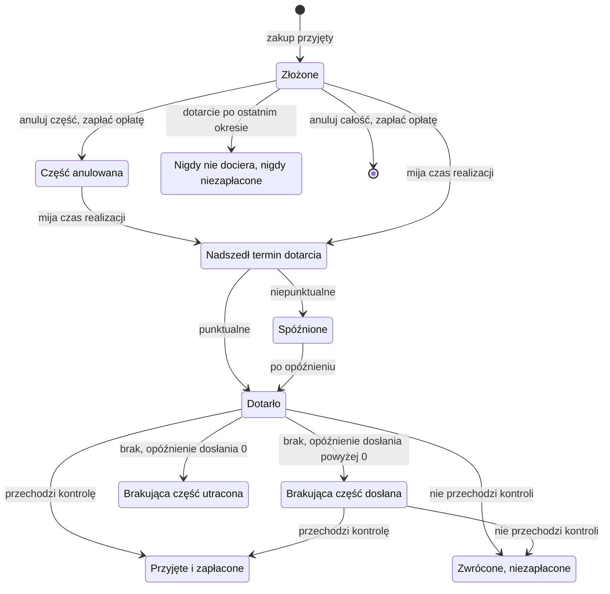

# Dostawcy

Dostawcy sprzedają fabryce materiały.

Każdy dostawca ma katalog: materiały, które sprzedaje, każdy z ceną, czasem realizacji i
tym, jak pewnie dostarcza. Zakup składa zamówienie u dostawcy. Nic nie jest płacone,
dopóki zamówienie nie dotrze. Dostawa może się spóźnić, może dotrzeć niepełna i może
zawierać sztuki, które nie przechodzą kontroli. Fabryka płaci tylko za przyjęte sztuki,
po cenie ustalonej w chwili złożenia zamówienia. Zamówienie można anulować, zanim
dotrze, za opłatę za sztukę. Zamówienie ekspresowe dociera szybciej za dodatkową cenę.
Minimalne ilości i rabaty ma tylko manifest z korzyściami skali.

## Katalog

Każdy wpis katalogu ma takie parametry:

| Klucz | Znaczenie | Losowany |
| --- | --- | --- |
| `price` | Cena jednej przyjętej sztuki. | raz na przebieg albo w każdym okresie |
| `lead_time` | Okresy od złożenia zamówienia do jego dotarcia, gdy jest na czas. Co najmniej 1. | raz na przebieg |
| `max_quantity` | Największa ilość materiału zamówiona u tego dostawcy w jednym okresie. | raz na przebieg |
| `punctuality` | Szansa, że dostawa jest na czas. | raz na przebieg |
| `delay` | Dodatkowe okresy spóźnionej dostawy. Co najmniej 1. | raz na okres złożenia |
| `completeness` | Część otwartej ilości, która dociera. | raz na okres złożenia |
| `acceptance` | Część dostarczonej ilości, która przechodzi kontrolę. | raz na okres złożenia |
| `backfill_delay` | Okresy po dostawie, po których dociera brakująca część. 0 oznacza utratę brakującej części. Opcjonalny, domyślnie 0. | raz na przebieg |
| `express_lead_time` | Czas realizacji zamówienia ekspresowego, co najmniej 1 i mniejszy niż `lead_time`. Opcjonalny. | raz na przebieg |
| `express_cost` | Dodatkowa cena za sztukę zamówienia ekspresowego. Podany dokładnie wtedy, gdy podany jest `express_lead_time`. | raz na przebieg |
| `cancellation_fee` | Opłata za anulowaną sztukę. Opcjonalny, domyślnie 0. | raz na przebieg |
| `min_quantity` | Najmniejsza ilość jednego zamówienia. Opcjonalny. | raz na przebieg |
| `discounts` | Lista progów, każdy z ilością `from` i ceną `price`. Opcjonalny. | raz na przebieg |

Parametr to stała liczba albo zakres. Wpis katalogu może brać wartości z grup swojego
dostawcy i swojego materiału, na przykład z regionu dostawców albo kategorii materiałów;
zobacz [Grupy](groups.md). Dwóch dostawców może sprzedawać ten sam materiał, każdy z
własną ceną, czasem realizacji i losowaniami.

## Ceny

Domyślnie cena jest losowana raz na przebieg. Zakres ceny z `drawn: period` jest zamiast
tego losowany dla każdego okresu. Każda cena każdego okresu jest losowana z ziarna przed
okresem 1, więc żadna decyzja jej nie zmienia.

- Opis pokazuje zakres ceny losowanej w każdym okresie.
- Obserwacja pokazuje w `prices` tylko cenę bieżącego okresu.

Zamówienie u dostawcy zachowuje cenę za sztukę z okresu, w którym zostało złożone,
niezależnie od okresu dotarcia. Dlatego agent może kupić z wyprzedzeniem, gdy cena jest
niska. Fabryka przykładowa nie losuje żadnej ceny w każdym okresie.

## Cena za sztukę w zamówieniu

Cena za sztukę w zamówieniu jest ustalana w chwili złożenia zamówienia:

1. Weź cenę z katalogu w tym okresie albo cenę najwyższego progu rabatu, do którego
   sięga ilość.
2. Pomnóż ją przez czynnik każdego aktywnego zakłócenia `price_change` materiału i
   zaokrąglij do 4 miejsc po przecinku.
3. Dla zamówienia ekspresowego dodaj `express_cost`.

## Składanie zamówienia

Decyzja zakupu podaje dostawcę, materiał, ilość, magazyn i, opcjonalnie, `express`. Jest
sprawdzana w tej kolejności i odrzucana przy pierwszej regule, którą łamie:

- dostawca nie istnieje (`unknown_supplier`);
- materiału nie ma w jego katalogu (`not_in_catalogue`);
- magazyn nie istnieje (`unknown_warehouse`) albo nie przyjmuje materiału
  (`not_accepted`);
- prosi o ekspres, a wpis nie ma ekspresowego czasu realizacji (`no_express`);
- ilość jest poniżej minimalnej ilości (`below_min_quantity`);
- ilość, razem z zamówieniami tego samego materiału u tego samego dostawcy już
  przyjętymi w okresie, jest większa niż największa ilość (`over_max_quantity`);
- magazyn nie ma miejsca na całą ilość (`not_enough_space`); zobacz
  [Magazyny i trasy](warehouses-and-routes.md);
- jego koszt zabrałby gotówkę, pomniejszoną o to, co otwarte zamówienia u dostawców
  jeszcze są winne, poniżej minus limit kredytowy (`over_credit_limit`); zobacz
  [Gotówka i zysk](cash-and-profit.md).

Największa ilość liczy zamówienia ekspresowe i zwykłe razem.

Przyjęta decyzja zakupu tworzy zamówienie u dostawcy z identyfikatorem
`buy-<period>-<n>`. Dopóki zamówienie nie dotrze, jego otwarta ilość zajmuje miejsce w
magazynie i liczy się do limitu kredytowego po swojej cenie za sztukę.

## Jedno losowanie na rodzaj zamówienia i okres

Dla każdego dostawcy, materiału i okresu złożenia świat zawiera jeden zestaw wartości
dostawy dla zwykłych zamówień: czy dostawa jest punktualna, jej opóźnienie, jej
kompletność i jej przyjęcie. Wpis z ekspresowym czasem realizacji ma drugi zestaw dla
zamówień ekspresowych, losowany osobno. Oba są losowane przed okresem 1, dla każdego
okresu, bez względu na to, czy zamówienie zostanie złożone.

Wszystkie zwykłe zamówienia jednego materiału złożone u jednego dostawcy w tym samym
okresie mają wspólny pierwszy zestaw, a wszystkie zamówienia ekspresowe drugi. Podział
zamówienia nie zmienia tego, czy jest spóźnione lub niepełne. Zamówienie ekspresowe
pokazuje tylko własny zestaw: to, co przynosi, nic nie mówi o zwykłym zamówieniu tego
samego okresu, które jest jeszcze w drodze. Zamówienie tego samego materiału u innego
dostawcy albo w innym okresie ma własne zestawy.

## Punktualność i opóźnienie

Zamówienie dociera w okresie złożenia plus jego czas realizacji, zwykły albo ekspresowy.
Gdy losowanie jego rodzaju zamówienia i okresu nie jest punktualne, zamówienie dociera
`delay` okresów później. Zakłócenie `transport_delay` dostawcy aktywne w okresie
dotarcia dodaje swoje opóźnienie.

Dostawa, która dotarłaby po ostatnim okresie, nigdy nie dociera i nie jest płacona.

Obserwacja pokazuje każde otwarte zamówienie u dostawcy ze spodziewanym okresem
dotarcia: okresem złożenia plus użyty czas realizacji albo okresem zapisanym dla
zamówienia ze stanu początkowego. Nie pokazuje spóźnienia dostawy ani okresu dosłania.

## Kompletność i dosłanie

Dostawa przynosi otwartą ilość razy kompletność. Reszty brakuje.

- Przy `backfill_delay` równym 0 brakująca część przepada, a zamówienie się zamyka.
- Przy `backfill_delay` powyżej 0 brakująca część zostaje otwarta i dociera
  `backfill_delay` okresów po dostawie. Ta późniejsza dostawa to dosłanie. Dosłanie
  przynosi całą swoją otwartą ilość i zamyka zamówienie.

Zakłócenie `supplier_outage` wstrzymuje część tego, co dociera, w dostawie albo w
dosłaniu. Wstrzymana część przepada i nigdy nie jest dosłana. Dosłanie nigdy nie jest
opóźnione przez `transport_delay`.

## Przyjęcie i płatność

Liczba przyjętych sztuk to liczba sztuk, które dotarły, razy przyjęcie. Dosłanie używa
przyjęcia wylosowanego dla rodzaju zamówienia i okresu, w którym je złożono.

- Przyjęte sztuki trafiają do zapasu magazynu zamówienia.
- Fabryka od razu płaci liczbę przyjętych sztuk razy cenę za sztukę w zamówieniu.
- Sztuki, które nie przechodzą kontroli, są zwracane i nie są płacone.

Dostawy docierają w pierwszym kroku okresu, przed decyzjami, więc przyjętych sztuk można
użyć w tym samym okresie; zobacz [Okres](period.md).

## Partie dostaw

Zwykłe zamówienia u dostawcy jednego dostawcy, materiału i magazynu złożone w jednym
okresie, które docierają w jednym okresie, tworzą partię dostawy, a zamówienia
ekspresowe tworzą własną. Dosłania tych zamówień tworzą własną partię dostawy. Partia
zaokrągla każdą ze swoich części raz, od swojej sumy:

- sztuki wysłane = otwarte sztuki partii x kompletność, zaokrąglone połówkowo do
  parzystej do 3 miejsc po przecinku;
- sztuki, które dotarły = sztuki wysłane x część, którą zostawia każde aktywne
  `supplier_outage`, zaokrąglone tak samo;
- sztuki przyjęte = sztuki, które dotarły x przyjęcie x część, którą zostawia każde
  aktywne `quality_drop`, zaokrąglone tak samo.

W kolejności identyfikatorów każde zamówienie dostaje sztuki partii aż do niego
włącznie, pomniejszone o sztuki partii przed nim. Przy kompletności 0.6 jedno zamówienie
1 układu i 1000 zamówień po 0.001 układu w jednym okresie przynoszą tak samo 0.6 układu;
pierwsze trzy zamówienia po 0.001 przynoszą 0.001, 0 i 0.001. Zamówienia do dwóch
magazynów, złożone w dwóch okresach albo jedno zwykłe i jedno ekspresowe to dwie partie.

## Zamówienia u dostawców ze stanu początkowego

Scenariusz może zacząć przebieg z otwartymi zamówieniami u dostawców. Każde jest złożone
w okresie 0 po cenie z katalogu, bez rabatu i bez ekspresu. Dociera w całości i jest w
całości przyjęte w okresie zapisanym w scenariuszu. Gdy cena jest losowana w każdym
okresie, jego cena to cena okresu 1. Żadne zakłócenie na nie nie działa. Można je
anulować jak każde inne otwarte zamówienie.

## Anulowanie

Decyzja anulowania podaje zamówienie u dostawcy i ilość. Jest odrzucana, gdy:

- zamówienie nie istnieje albo jest zamknięte (`unknown_order`); zamówienie złożone w
  bieżącym okresie jeszcze nie istnieje, bo anulowania są wykonywane przed zakupami;
- nie ma ilości (`wrong_quantity`);
- ilość jest większa niż otwarta ilość zamówienia (`over_open_quantity`);
- zostawia część zamówienia otwartą, a zamówiona ilość pomniejszona o wszystkie
  anulowania spada poniżej minimalnej ilości (`below_min_quantity`); zamówienia u
  dostawców ze stanu początkowego nie podlegają tej regule;
- zostawia część zamówienia otwartą, a zamówiona ilość pomniejszona o wszystkie
  anulowania spada poniżej `from` progu rabatu, według którego wyceniono zamówienie
  (`below_discount_tier`).

Przyjęte anulowanie od razu obniża otwartą ilość i kosztuje `quantity` razy
`cancellation_fee`. Anulowane sztuki zwalniają swoje miejsce i nie liczą się już do
limitu kredytowego. Zamówienie z otwartą ilością 0 się zamyka. Anulowana sztuka nigdy
nie dociera. Anulowanie może też objąć otwartą brakującą część, która czeka na dosłanie.

Opłata nigdy nie jest wyższa niż najniższa cena jej wpisu katalogu, z rabatami. Przy
opłacie 0 anulowanie zamówienia przed jego dotarciem nic nie kosztuje. Każdy wpis
katalogu fabryki przykładowej ma opłatę równą około jednej dziesiątej swojej ceny.

## Rabaty

Próg rabatu daje niższą cenę każdej sztuce zamówienia, którego ilość sięga jego `from`.
Zamówienie bierze cenę najwyższego progu, do którego sięga.

- Progi rosną w `from` i maleją w cenie. Pierwszy próg jest poniżej ceny z katalogu.
- `from` progu leży od `min_quantity` do `max_quantity`.
- Próg liczy ilość jednego zamówienia, nie jednego okresu: gdy próg zaczyna się od 1000,
  dwa zamówienia po 600 płacą więcej za sztukę niż jedno zamówienie na 1200.

## Zakłócenia dostawców

Na te reguły działa pięć rodzajów zakłóceń; zobacz [Zakłócenia](disruptions.md).

| Rodzaj | Działanie |
| --- | --- |
| `supplier_outage` | Ilość docierająca od dostawcy razy `1 - strength`. Reszta przepada. |
| `quality_drop` | Przyjęcie u dostawcy razy `1 - strength`. |
| `transport_delay` | Dostawa od dostawcy, która dotarłaby w aktywnym okresie, dociera `delay` okresów później. |
| `material_shortage` | Największa ilość materiału u każdego dostawcy razy `1 - strength`. |
| `price_change` | Cena materiału u każdego dostawcy razy `factor`, dla zamówień złożonych, gdy zakłócenie działa. |

## Co widzi agent

Opis pokazuje katalog, chyba że scenariusz ukrywa parametr; zobacz
[Informacje](information.md). Każda obserwacja pokazuje w `events` każdą dostawę i
dosłanie z ilością zamówioną, dostarczoną, przyjętą i utraconą oraz z płatnością. Miary
dostawców obejmują `units_ordered_from_suppliers`, `units_arrived`, `units_accepted`,
`units_rejected_at_inspection`, `units_lost_in_delivery`, `units_cancelled`,
`units_arrived_late`, `material_payment` i `cancellation_fee`.

## Życie zamówienia u dostawcy

Na końcu przebiegu każda sztuka zamówienia u dostawcy jest przyjęta, zwrócona przy
kontroli, utracona w dostawie, anulowana albo wciąż otwarta i nigdy niedostarczona.

## Przykład

Przebieg `steady-market` na fabryce przykładowej z ziarnem 0. Dostawca
`emea-electronic-parts` sprzedaje `pcb-blank` po 3.8000, z progiem rabatu od 1000 sztuk
po 3.6100. Jego czas realizacji to 2, ekspresowy czas realizacji 1, a koszt ekspresu
0.9500. Jego opóźnienie dosłania to 1, a opłata za anulowanie 0.3800.

Okres 1, dwa zakupy do `main-plant`:

- `buy-1-1`: 1000 sztuk. Ilość sięga progu od 1000, więc każda sztuka kosztuje 3.6100
  zamiast 3.8000. Spodziewany okres dotarcia to 1 + 2 = 3.
- `buy-1-2`: 200 sztuk, ekspres. 200 jest poniżej progu, więc cena za sztukę to 3.8000 +
  0.9500 = 4.7500. Spodziewany okres dotarcia to 1 + 1 = 2.
- Razem 1200 sztuk, w granicach największej ilości 2500.

Świat zawiera dwa zestawy wartości dla `emea-electronic-parts`, `pcb-blank` i okresu 1.
Zwykłe zamówienie używa zestawu zwykłych zamówień: punktualna, kompletność 0.9801,
przyjęcie 0.9835. Zamówienie ekspresowe używa zestawu zamówień ekspresowych: punktualna,
kompletność 0.9627, przyjęcie 0.9897.

Okres 2, krok 1, dociera zamówienie ekspresowe:

- dotarło: 200 x 0.9627 = 192.54;
- przyjęte: 192.54 x 0.9897 = 190.556838, po zaokrągleniu 190.557;
- zapłacone: 190.557 x 4.75 = 905.14575;
- brakuje: 200 - 192.54 = 7.46, termin w okresie 2 + 1 = 3.

Okres 2, krok 5, anulowanie 100 sztuk z `buy-1-1` jest odrzucone z
`below_discount_tier`, `asked` 100, `available` 0. Zostawiłoby 900 sztuk, poniżej progu
1000, według którego wyceniono zamówienie. Anulowanie wszystkich 1000 sztuk przeszłoby,
za opłatę 1000 x 0.38 = 380.

Okres 3, krok 1, dociera `buy-1-1`, a potem dosłanie `buy-1-2`:

- `buy-1-1`: dociera 1000 x 0.9801 = 980.1; przyjęte 980.1 x 0.9835 = 963.92835, po
  zaokrągleniu 963.928; zapłacone 963.928 x 3.61 = 3479.78008; brakuje 1000 - 980.1 =
  19.9, z terminem w okresie 4.
- Dosłanie `buy-1-2`: dociera 7.46; przyjęte 7.46 x 0.9897 = 7.383162, po zaokrągleniu
  7.383; zapłacone 7.383 x 4.75 = 35.06925. Zamówienie się zamyka.

Okres 4, krok 1, dosłanie `buy-1-1`: dociera 19.9; przyjęte 19.9 x 0.9835 = 19.57165, po
zaokrągleniu 19.572; zapłacone 19.572 x 3.61 = 70.65492. Zamówienie się zamyka.

Z 1000 sztuk `buy-1-1` przyjęte i zapłacone jest 963.928 + 19.572 = 983.5, a 16.5
zostaje zwrócone przy kontroli.
