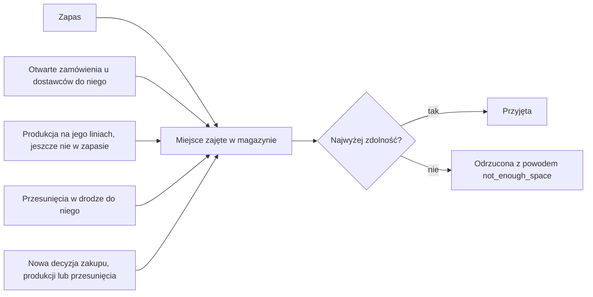

# Magazyny i trasy

Magazyny przechowują zapas fabryki. Trasy je łączą.

Magazyn ma zdolność, czyli ilość miejsca, i przyjmuje niektóre rodzaje lub grupy
pozycji. Każda sztuka pozycji zajmuje stałe miejsce. Decyzja zakupu, produkcji lub
przesunięcia zostaje odrzucona, gdy magazyn, do którego trafia, nie ma na nią miejsca.
Liczy się zapas i wszystko, co już jest w drodze do magazynu: otwarte zamówienia u
dostawców, produkcja, która nie trafiła jeszcze do zapasu, i przesunięcia. Dlatego
magazyn nigdy się nie przepełnia, cokolwiek wylosuje świat. Każda sztuka w zapasie płaci
w każdym okresie koszt składowania razy współczynnik swojego magazynu. Przesunięcie
przenosi zapas trasą za koszt za sztukę i z czasem realizacji.

## Magazyny

Manifest wymienia jeden lub więcej magazynów. Każdy ma te parametry:

| Klucz | Znaczenie | Domyślnie |
| --- | --- | --- |
| `capacity` | Miejsce, jakie ma magazyn. Powyżej 0. | wymagany |
| `storage_factor` | Współczynnik kosztu składowania tego, co przechowuje. Powyżej 0. | 1 |
| `transport_factor` | Współczynnik kosztu transportu wysyłek z tego magazynu. Powyżej 0. | 1 |
| `accepts` | `materials`, `components`, `products` lub grupy pozycji zapisane jako `{"group": "<id>"}`. | każda pozycja |

Wszystkie cztery są stałymi liczbami lub listami. Żaden nie jest losowany z zakresu.

Każda linia pracuje w jednym magazynie. Z niego bierze pozycje wejściowe i do niego
oddaje to, co wytwarza. Zakup podaje magazyn, do którego idzie jego dostawa. Wysyłka
podaje magazyn, z którego wychodzi. Gdy manifest ma jeden magazyn, decyzja może go
pominąć.

## Miejsce

Każda pozycja ma `space`: miejsce, jakie zajmuje jedna sztuka, powyżej 0. Miejsce
zapasu to jego ilość razy miejsce jego pozycji.

## Co przyjmuje magazyn

Magazyn przechowuje tylko pozycje, które przyjmuje. Pozycja jest przyjmowana, gdy jej
rodzaj albo grupa, do której należy, jest w `accepts`.

- Zakup do magazynu, który nie przyjmuje materiału, zostaje odrzucony z powodem
  `not_accepted`.
- Przesunięcie do magazynu, który nie przyjmuje pozycji, zostaje odrzucone z powodem
  `not_accepted`.
- Manifest zostaje odrzucony w trzech przypadkach. Magazyn linii nie przyjmuje pozycji
  wejściowej lub pozycji, którą linia wytwarza. Żaden magazyn nie przyjmuje materiału.
  Pozycja wejściowa nie może dotrzeć do magazynu swojej linii trasami przez magazyny,
  które ją przyjmują.
- Scenariusz zostaje odrzucony, gdy jego zapas początkowy lub początkowe zamówienia u
  dostawców umieszczają pozycję w magazynie, który jej nie przyjmuje.

## Otwarte zamówienia zajmują swoje miejsce

Miejsce zajęte w magazynie to suma:

- miejsca jego zapasu;
- miejsca produkcji, która nie trafiła jeszcze do zapasu, na liniach magazynu, przy
  ilości rozpoczętej;
- miejsca otwartej ilości każdego zamówienia u dostawcy do tego magazynu;
- miejsca każdego przesunięcia w drodze do tego magazynu.

Decyzja zakupu, produkcji lub przesunięcia zostaje odrzucona z powodem
`not_enough_space`, gdy miejsce zajęte w magazynie, do którego trafia, byłoby po decyzji
większe niż zdolność.

- Zakup dodaje miejsce całej swojej ilości.
- Produkcja zabiera swoje pozycje wejściowe z zapasu i dodaje miejsce całej
  rozpoczętej ilości. Jedno i drugie dzieje się w magazynie jej linii.
- Przesunięcie dodaje miejsce swojej ilości do magazynu docelowego.

Wynik decyzji odrzuconej podaje dwie liczby: `asked`, miejsce, które decyzja by
dodała, i `available`, zdolność minus miejsce zajęte przed decyzją.

Wysyłki, anulowania, przesunięcia, naprawy, produkcja i zakupy są wykonywane w tej
kolejności. Każdą decyzję sprawdza się względem stanu, który zostawiają wcześniejsze.
Wysyłka lub anulowanie wcześniej w okresie zwalnia miejsce dla późniejszej decyzji tego
samego okresu; zobacz [Kolejność wykonania](decisions.md#kolejność-wykonania).

Dostawa nigdy nie przynosi więcej niż otwarta ilość jej zamówienia. Produkcja nigdy nie
daje więcej, niż rozpoczęto. Sztuki utracone, zwrócone przy kontroli lub odrzucone jako
braki tylko zwalniają miejsce. Dlatego magazyn nigdy się nie przepełnia, jakiekolwiek są
wylosowane wartości. Zamówienie z terminem za 10 okresów zajmuje swoje miejsce od
okresu, w którym zostało złożone.

Scenariusz zostaje odrzucony, gdy zapas początkowy i początkowe zamówienia u dostawców
magazynu zajmują więcej miejsca, niż magazyn ma.

Obserwacja pokazuje dla każdego magazynu w `space`: `used`, miejsce zapasu;
`reserved`, miejsce produkcji, która nie trafiła jeszcze do zapasu, otwartych
zamówień u dostawców i przesunięć w drodze do niego; oraz `capacity`. Wolne miejsce to
`capacity - used - reserved`.

## Koszt składowania

Każda pozycja ma `storage_cost`: koszt przechowania jednej sztuki przez jeden okres.
Przy zamknięciu każdego okresu, gdy gotowa produkcja trafiła już do zapasu, fabryka
płaci za każdy magazyn i każdą pozycję: zapas razy `storage_cost` razy `storage_factor`
magazynu.

Przesunięcie w drodze płaci za składowanie ze współczynnikiem magazynu docelowego.
Produkcja, która nie trafiła jeszcze do zapasu, i otwarte zamówienia u dostawców nie
płacą za składowanie.

## Współczynnik transportu

Wysyłka do klienta kosztuje za sztukę `transport_cost` klienta i produktu razy
`transport_factor` magazynu, z którego wychodzi; zobacz
[Klienci i popyt](customers-and-demand.md). Współczynnik transportu nie
zmienia kosztu przesunięcia.

## Trasy

Trasa łączy dwa różne magazyny w jednym kierunku. Manifest podaje najwyżej jedną trasę
dla każdej uporządkowanej pary magazynów, pod `routes.<from>.<to>`. Trasa ma dwa
parametry. Każdy, gdy jest zakresem, jest losowany raz na przebieg:

- `cost`: koszt za przesuniętą sztukę;
- `lead_time`: liczba okresów, jaką trwa przesunięcie. 0 oznacza, że dociera od razu.

Trasa z A do B nie daje trasy z B do A.

## Przesunięcia

Przesunięcie podaje pozycję, ilość, `source` i `destination`. Sprawdza się je w tej
kolejności i odrzuca przy pierwszej złamanej zasadzie:

- żadna trasa nie prowadzi z magazynu źródłowego do docelowego (`unknown_route`);
- pozycja nie istnieje albo magazyn docelowy jej nie przyjmuje (`not_accepted`);
- ilość jest większa niż zapas pozycji w magazynie źródłowym (`not_enough_stock`);
- ilość jest większa niż zapas pozycji w magazynie źródłowym minus sztuki, które
  przesunięcia z czasem realizacji 0 wniosły tam w tym okresie
  (`transferred_this_period`);
- miejsce zajęte w magazynie docelowym byłoby po przesunięciu większe niż jego
  zdolność (`not_enough_space`).

Przyjęte przesunięcie dostaje identyfikator `transfer-<period>-<n>`. Potem:

- zapas w magazynie źródłowym od razu spada;
- fabryka od razu płaci ilość razy `cost` trasy;
- przy czasie realizacji 0 zapas w magazynie docelowym od razu rośnie;
- w innym przypadku przesunięcie dociera w pierwszym kroku okresu równego okresowi
  decyzji plus czas realizacji i w tym okresie można je już wysłać;
- w drodze zajmuje miejsce w magazynie docelowym i przy każdym zamknięciu płaci za
  składowanie ze współczynnikiem magazynu docelowego.

Sztuki, które wnosi przesunięcie z czasem realizacji 0, służą produkcji w tym samym
okresie i każdej decyzji od następnego okresu. Żadne inne przesunięcie tego okresu ich
nie zabiera, więc sztuki przesunięte w okresie to najwyżej zapas z początku przesunięć.

Żadne zakłócenie nie działa na przesunięcie. Przesunięcie, które na końcu przebiegu
jest jeszcze w drodze, jest nic niewarte; zobacz
[Gotówka i zysk](cash-and-profit.md).

## Miary

Miary magazynów to między innymi `space_used`, `stock_space`, `storage_cost` i
`transport_cost`. Miary tras to `units_transferred` i `transfer_cost`.

## Przykład

Fabryka przykładowa ma dwa magazyny. `main-plant` ma zdolność 116 i przyjmuje
każdą pozycję. `distribution-centre` ma zdolność 120, współczynnik składowania 0.6,
współczynnik transportu 0.85 i przyjmuje tylko produkty. Jedna trasa prowadzi z
`main-plant` do `distribution-centre`, z kosztem 0.8 za sztukę i czasem realizacji 1.

Przebieg `full-warehouse` na fabryce przykładowej z ziarnem 0. Na początku okresu 1
`main-plant` przechowuje:

| Pozycja | Zapas | Miejsce na sztukę | Miejsce |
| --- | --- | --- | --- |
| `lcd-panel` | 505 | 0.020 | 10.1 |
| `connector-pins` | 1554 | 0.001 | 1.554 |
| `copper-wire` | 2823 | 0.001 | 2.823 |
| `plastic-resin` | 415 | 0.002 | 0.83 |
| `steel-sheet` | 1631 | 0.001 | 1.631 |
| `display-unit` | 290 | 0.025 | 7.25 |
| `enclosure` | 5800.009 | 0.015 | 87.000135 |
| Razem | | | 111.188135 |

Nic nie jest w drodze, więc zajęte miejsce to 111.188135, a wolne miejsce to
116 - 111.188135 = 4.811865. Trzy zakupy do `main-plant` w okresie 1:

1. 2000 `microchip` od `apac-chips` dodaje 2000 x 0.001 = 2. Zajęte miejsce rośnie do
   113.188135, w granicach 116: przyjęty.
2. 500 `lcd-panel` od `apac-displays-plastics` dodałoby 500 x 0.020 = 10. Wolne jest
   tylko 116 - 113.188135 = 2.811865: odrzucony z powodem `not_enough_space`, `asked`
   10, `available` 2.811865.
3. 140 `lcd-panel` od `apac-displays-plastics` dodaje 140 x 0.020 = 2.8, w granicach
   2.811865: przyjęty.

Obserwacja okresu 2 pokazuje dla `main-plant` `used` 111.188135 i `reserved`
2 + 2.8 = 4.8. 2140 zamówionych sztuk zajmuje to miejsce od okresu 1, aż dotrą.

Przebieg `steady-market` na fabryce przykładowej z ziarnem 0 pokazuje przesunięcie. W
okresie 1 produkcja 100 `industrial-controller` na `final-assembly-line` trafia do
zapasu przy zamknięciu z 99.03 dobrymi sztukami. W okresie 2 przesunięcie 90 z nich
idzie z `main-plant` do `distribution-centre`:

- zapas w `main-plant` od razu spada z 99.03 do 9.03;
- fabryka od razu płaci 90 x 0.8 = 72;
- magazyn docelowy zajmuje dla przesunięcia 90 x 0.030 = 2.7 miejsca;
- przy zamknięciu okresu 2 przesunięcie płaci za składowanie ze współczynnikiem magazynu
  docelowego: 90 x 0.3299 x 0.6 = 17.8146;
- w kroku 1 okresu 3 dociera 90 sztuk. Zapas `industrial-controller` w
  `distribution-centre` rośnie z 270 do 360, a miejsce `used` magazynu
  `distribution-centre` z 24.3 do 27.
