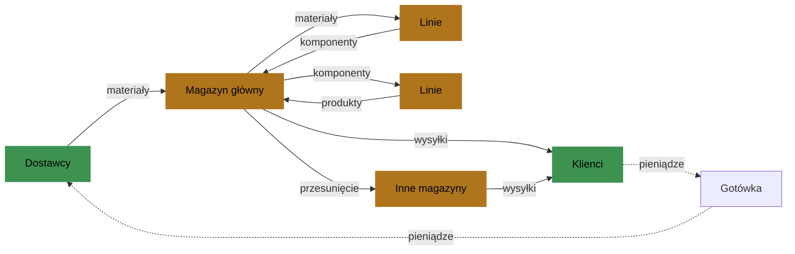

# Pojęcia

Przebieg to jeden agent, który prowadzi jedną fabrykę przez pewną liczbę okresów.

## Fabryka na jednej stronie

- Pozycje. Fabryka przechowuje trzy rodzaje pozycji. Materiały kupuje od dostawców.
  Komponenty wytwarza na liniach z materiałów. Produkty wytwarza na liniach z
  komponentów i sprzedaje klientom.
- Receptury. Receptura podaje pozycje wejściowe i ich ilości potrzebne do jednej sztuki
  komponentu lub produktu. Pozycja może mieć kilka receptur, na przykład standardową i
  zastępczą z innym materiałem.
- Dostawcy. Każdy dostawca ma katalog: materiały, które sprzedaje. Każdy materiał ma
  cenę, czas realizacji i to, jak niezawodnie dostawca go dostarcza.
- Klienci. Każdy klient kupuje wybrane produkty po ustalonej cenie. W każdym okresie
  składa zamówienia klienta i czeka na nie pewną liczbę okresów.
- Linie. Linia wytwarza wybrane pozycje w jednym magazynie. Ma pewną liczbę godzin
  produkcji na okres i stan od 0 do 1. Stan spada z użyciem i z czasem. Naprawa go
  podnosi.
- Magazyny i trasy. Magazyn ma pojemność, czyli ilość miejsca, i przyjmuje wybrane
  pozycje. Trasa przesuwa zapas z jednego magazynu do innego w pewnej liczbie okresów,
  za koszt za sztukę.
- Gotówka. Fabryka płaci za materiały, produkcję, składowanie, transport, naprawy,
  kary i odsetki. Dostaje pieniądze za to, co wysyła. Gotówka może spaść poniżej zera.
  Wtedy fabryka płaci odsetki.

Pozycje płyną od dostawców przez linie do klientów. Pieniądze płyną z powrotem.

## Przebieg

- Manifest: dokument, który opisuje fabrykę: jej pozycje, partnerów, linie, magazyny,
  grupy i ich parametry. Parametr jest stałą liczbą albo zakresem, z którego się go
  losuje.
- Scenariusz: dokument, który opisuje, jak przebieg zmienia się w czasie: horyzont,
  zapas i gotówkę na początku, kształty popytu, prognozy, zakłócenia oraz parametry
  ukryte przed agentem.
- Ziarno: liczba całkowita podana na początku przebiegu.
- Świat: każda losowa wartość przebiegu, wylosowana z ziarna przed pierwszym okresem.
  Świat nie zależy od żadnej decyzji. Dlatego każdy agent przy tym samym
  manifeście, scenariuszu i ziarnie ma ten sam popyt, te same dostawy, uzyski i
  awarie.
- Okres: jeden krok czasu, numerowany od 1. Manifest może nazwać swój okres, na
  przykład "tydzień". Ta nazwa niczego nie zmienia.
- Horyzont: liczba okresów przebiegu.

Manifest jest liniowy, gdy żaden wpis katalogu nie podaje minimalnej ilości ani
rabatów i żaden wpis linii nie podaje czasu ani kosztu przezbrojenia. Program manifestu
liniowego jest liniowy w każdej regule poza sprawdzeniem kredytu przy decyzji zakupu,
które odrzuca tylko decyzje zakupu. Potrzebuje ono jednego wyboru tak albo nie w każdym
okresie z decyzją zakupu: czy okres kupuje. Manifest z korzyściami skali podaje
minimalną ilość albo rabaty, albo czas lub koszt przezbrojenia, nawet równe 0; jego pole
`linear` ma wartość false. Jego program potrzebuje więcej wyborów tak albo nie. Wartość
0 nie dodaje do programu żadnego wyboru tak albo nie. Fabryka przykładowa jest
manifestem z korzyściami skali.

## Agent i program badania

- Agent wybiera decyzje każdego okresu: co wysłać, anulować, przesunąć, naprawić,
  wytworzyć i kupić. Może to być dowolny program, optymalizator albo człowiek z
  asystentem AI.
- Program badania prowadzi badanie. Rozpoczyna przebieg przez HTTP. Daje agentowi opis
  raz, a obserwację w każdym okresie. Zgłasza decyzje, które agent zwraca.
- Program badania daje agentowi tylko opis i obserwacje przebiegu, zamknięte okresy,
  wyniki sprawdzeń oraz ścieżki HTTP przypisane do tego przebiegu. Zgodnie z założeniem
  badania agent nie ma dostępu do ścieżek HTTP manifestu i scenariusza; dotarcie do nich
  mimo to jest oszustwem, którego symulator nie potrafi technicznie uniemożliwić.
  Badanie wymagające zaskoczenia korzysta z nieopublikowanych scenariuszy, bo biblioteka
  jest w pakiecie. Optymalizator odniesienia otrzymuje świat zakończonego przebiegu bez
  decyzji z tym samym scenariuszem i ziarnem.

## Dane wyjściowe przebiegu

- Wynik decyzji: każda decyzja jest przyjęta z identyfikatorem tego, co utworzyła,
  albo odrzucona z powodem i liczbami, które za nim stoją.
- Zdarzenie: coś, co się stało, na przykład dostawa, awaria, nowe zamówienie klienta
  albo kara, z obiektem, którego dotyczy.
- Obserwacja: to, co agent widzi na początku każdego okresu: gotówka, zapas,
  linie, otwarte zamówienia, widoczne zakłócenia, prognozy oraz wyniki decyzji i
  zdarzenia od ostatniej obserwacji.
- Miara: liczba zapisywana w każdym okresie obok zysku, na przykład część sztuk
  wysłanych na czas. Jest dla całej fabryki i dla każdego obiektu i grupy.
- Zapis przebiegu: wszystko, co symulator przechowuje o przebiegu: każdy okres, świat
  i wynik przebiegu.
- Wynik przebiegu: przebieg jako całość po jego końcu: zysk i jego składniki, gotówka
  na początku i na końcu, należności oraz miary całego przebiegu.
