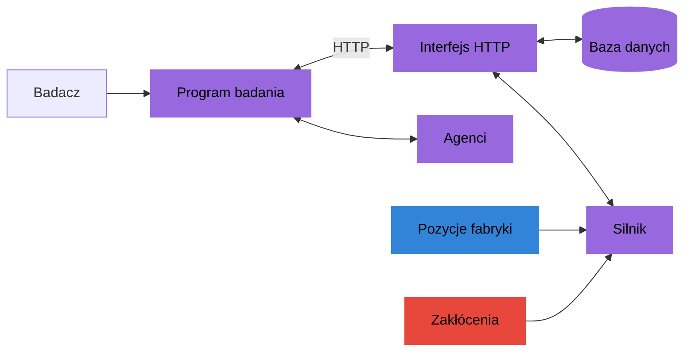
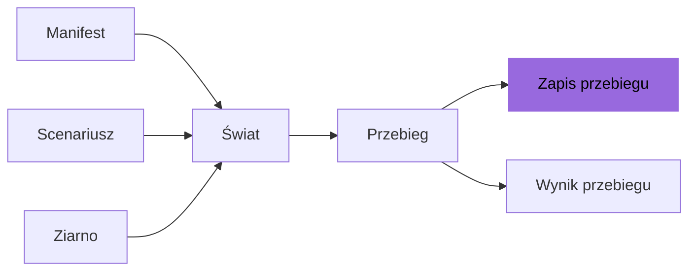

# Przegląd

Symulator fabryki jest narzędziem badawczym. Prowadzi jedną fabrykę okres po okresie.
Program badania rozpoczyna przebieg i przekazuje agentowi dostępne informacje oraz
ścieżki HTTP tego przebiegu. Każdy przebieg jest zapisany, więc można go odczytać,
porównać i odtworzyć.

## Symulator

- Jedna fabryka, planowana okres po okresie. W każdym okresie agent kupuje materiały,
  wytwarza komponenty i produkty, przesuwa zapas, naprawia linie i wysyła towar
  klientom.
- Dowolny agent: program dowolnego rodzaju, na przykład oparty na modelu językowym albo
  na programowaniu liniowym, albo człowiek z asystentem AI. Program badania uruchamia
  przebiegi i przekazuje agentowi opis oraz obserwacje.
- Każdy przebieg jest zapisany. Zapis przebiegu przechowuje to, co stało się w każdym
  okresie, świat, w którym przebieg się toczył, i wynik przebiegu. Przebieg można
  odtworzyć z jego zapisu. Nowy przebieg może go powtórzyć do wybranego okresu, a
  potem zdecydować inaczej.

Program badania komunikuje się z interfejsem HTTP, rozpoczyna przebiegi i zgłasza
decyzje agenta. Interfejs HTTP uruchamia silnik i zapisuje przebieg w bazie danych.

## Użytkownicy

- Badacze, którzy porównują, jak agenci planują w warunkach niepewności.
- Twórcy agentów AI, którzy chcą trudnego, powtarzalnego zadania z jedną jasną oceną.
- Badania z udziałem ludzi, w których człowiek decyduje z pomocą asystenta AI.

## Badanie w 5 krokach

1. Wybierz fabrykę i scenariusz: co fabryka ma i jak popyt, dostawy i zakłócenia
   zmieniają się w czasie.
2. Wybierz ziarna. Ziarno ustala każdą losową wartość przebiegu.
3. Uruchom każdego agenta na każdym ziarnie.
4. Odczytaj wyniki: zysk i miary każdego przebiegu.
5. Porównaj agentów na tych samych ziarnach.

Manifest opisuje fabrykę. Scenariusz opisuje, jak przebieg zmienia się w czasie. Razem
z ziarnem dają świat: każdą losową wartość, wylosowaną raz przed pierwszym okresem.
Agent prowadzi przebieg w tym świecie. Przebieg zostawia swój zapis i swój wynik.

## Dane wyjściowe

- Jeden zysk na przebieg. Zysk jest jedyną liczbą, która ocenia przebieg.
- Wiele miar obok zysku, na przykład część sztuk wysłanych na czas, utracone sztuki i
  odrzucone decyzje. Miary są dla całej fabryki i dla każdej linii, magazynu,
  partnera i grupy.
- Ten sam świat dla każdego agenta. Przy tym samym manifeście, scenariuszu i ziarnie
  każdy agent ma ten sam popyt, te same dostawy, uzyski, awarie i
  zakłócenia, cokolwiek zdecyduje.
- Pełny zapis każdego przebiegu.
- Odniesienie: zysk optymalizatora odniesienia, który zna cały świat. Przebieg jest
  oceniany jako część drogi od zysku braku decyzji do odniesienia.

## Zawartość pakietu

- Fabryka przykładowa: fabryka elektroniki z minimalnymi ilościami, rabatami i
  przezbrojeniami. Zobacz stronę [Fabryka przykładowa](../library/example-factory.md).
- Biblioteka scenariuszy: 23 scenariusze na fabryce przykładowej. Każdy sprawdza jeden
  mechanizm, na przykład przestój dostawcy albo sezon popytu. Zobacz
  stronę [Biblioteka scenariuszy](../library/scenario-library.md).
- Benchmark: klient, który prowadzi przebieg przez HTTP, siedem optymalizatorów, wśród
  nich optymalizator odniesienia, oraz optymalizator poinformowany, narzędzie
  diagnostyczne. Zobacz stronę [Rozgrywanie przebiegu](../benchmark/playing-a-run.md).
- Test przeciążający, w którym grają optymalizatory na bibliotece scenariuszy i który
  podaje ich wyniki. Zobacz stronę [Test przeciążający](../benchmark/stress-test.md).

## Zakres

- To jedna fabryka, a nie sieć fabryk lub firm.
- Niektórych procesów nie ma: stałych kosztów za zamówienie, wysyłek "wszystko albo
  nic", wad, które docierają do klientów, partii i zapasu wydawanego w kolejności
  przyjęcia, dat w kalendarzu, zmian zamówień klientów ani rezerwowania godzin lub
  materiałów dla planu.
- Nie ma ekranu dla ludzi. Człowiek bierze udział przez program badania, który
  pokazuje obserwację i wysyła decyzje.

Każde ograniczenie i jego znaczenie dla badania opisuje strona
[Ograniczenia](../reference/limits.md).
