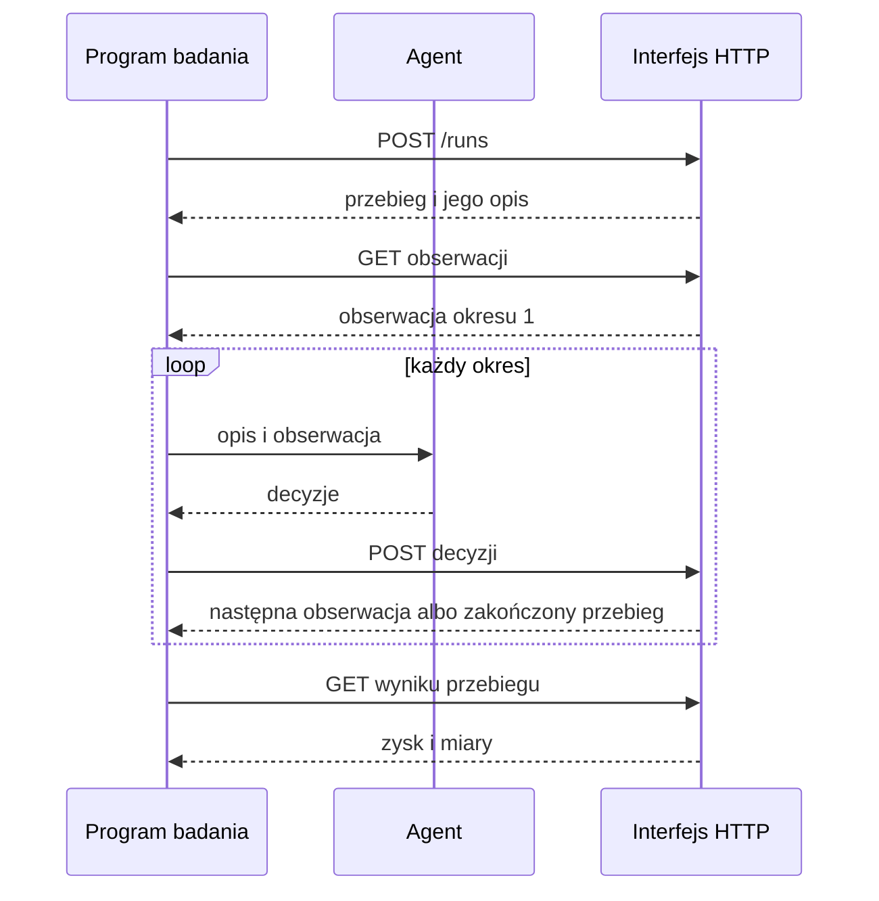

# Szybki start

Ta strona instaluje symulator, uruchamia serwer i rozgrywa pierwszy przebieg. Potrzebne
są Python 3.14, uv, menedżer pakietów Pythona, oraz kopia repozytorium.

## Najmniejszy przykład

W katalogu głównym repozytorium zainstaluj pakiet:

```sh
uv sync
```

Serwer przechowuje każdy przebieg w jednym pliku bazy danych. Utwórz jego folder, a
potem uruchom serwer:

```sh
mkdir -p data/records
FACTORY_SIMULATOR_DATABASE_URL=duckdb:///data/records/runs.duckdb \
  uv run uvicorn factory_simulator.api.main:app
```

Serwer słucha pod adresem `http://127.0.0.1:8000`. Przy pierwszym starcie ładuje
fabrykę przykładową i bibliotekę scenariuszy.

## Fabryki i scenariusze

```sh
curl http://127.0.0.1:8000/api/v1/manifests
```

Odpowiedź wymienia każdą fabrykę z jej identyfikatorem, nazwą i opisem. Fabryka
przykładowa ma nazwę `Electronics factory with economies of scale` i opis
`The electronics factory with minimum quantities, discounts and changeovers: large buys and long production runs cost less per unit.`
`GET /api/v1/manifests/{id}/scenarios` wymienia scenariusze jednej fabryki.

## Pierwszy przebieg

Ten program używa tylko biblioteki standardowej. Rozpoczyna przebieg scenariusza
`steady-market` na fabryce przykładowej z ziarnem 7. W żadnym z 52 okresów
nic nie decyduje. Na końcu wypisuje zysk. Liczby z częścią ułamkową są czytane jako
`Decimal`, więc żadna cyfra nie ginie.

```python
import json
from decimal import Decimal
from urllib.request import Request, urlopen

API = "http://127.0.0.1:8000/api/v1"


def call(method: str, path: str, body: object = None) -> dict:
    data = None if body is None else json.dumps(body).encode()
    request = Request(
        API + path,
        data=data,
        method=method,
        headers={"Content-Type": "application/json"},
    )
    with urlopen(request) as response:
        return json.loads(response.read(), parse_float=Decimal)


manifests = call("GET", "/manifests")["manifests"]
name = "Electronics factory with economies of scale"
factory = next(m for m in manifests if m["name"] == name)
scenarios = call("GET", f"/manifests/{factory['id']}/scenarios")["scenarios"]
steady = next(s for s in scenarios if s["name"] == "steady-market")
run = call("POST", "/runs", {"scenario_id": steady["id"], "seed": 7})

observation = call("GET", f"/runs/{run['id']}/observation")
while True:
    answer = call(
        "POST",
        f"/runs/{run['id']}/decisions",
        {"period": observation["period"], "decisions": []},
    )
    if answer.get("finished"):
        break
    observation = answer

print(call("GET", f"/runs/{run['id']}/result")["profit"])
```

Wypisuje `-709331.2306`. Przebieg trwa około 3 sekund.



## Wynik przebiegu

`GET /api/v1/runs/{id}/result` odpowiada, gdy przebieg się skończy. Wynik przebiegu
podaje ziarno, liczbę okresów, zysk i jego składniki, gotówkę na początku i na końcu,
należności oraz miary całego przebiegu. Zysk jest tu ujemny. Bez decyzji fabryka nic
nie kupuje, nic nie wytwarza i nic nie wysyła. Płaci karę za każde utracone
zamówienie.

## Miejsce zapisu przebiegu

Każdy przebieg jest przechowywany w `data/records/runs.duckdb`, pliku, z którym
uruchomiono serwer. `GET /api/v1/runs/{id}/periods` podaje każdy okres przebiegu.
`GET /api/v1/runs/{id}/export` podaje zakończony przebieg jako jeden plik ZIP, który
można odczytać bez pakietu.

## Błędy

Odpowiedź z błędem ma jeden klucz, `detail`, z tekstem `<key>: <problem>`, na przykład
`period: is 2, the run is in period 1`, gdy zgłoszenie podaje inny okres niż bieżący.
Wszystkie kody i teksty błędów są na stronie
[Interfejs HTTP](../reference/http-interface.md#błędy).
